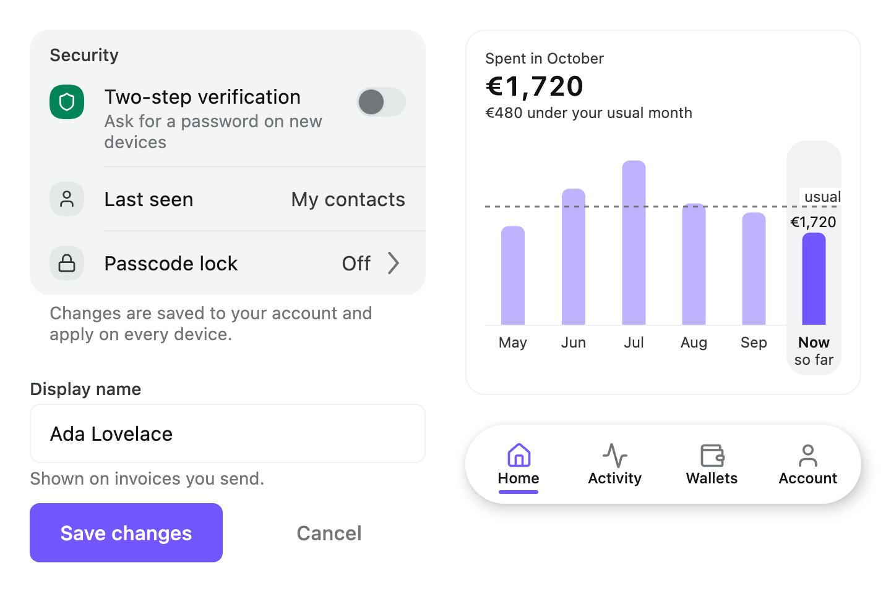

# Areca

A design system for Compose Multiplatform: a theme, 110+ components, charts, date and time pickers,
an image cropper, an on-screen keyboard, ready-made parts for sign-in, profile and attachment
screens, and 1,000+ icons — for Android, iOS and desktop JVM from one Kotlin codebase.


<picture>
  <source media="(prefers-color-scheme: dark)" srcset="docs/images/overview-dark.png">
  
</picture>

## Quick start

**1. Add the repository.** Areca is published to GitHub Packages. In `settings.gradle.kts`:

```kotlin
dependencyResolutionManagement {
    repositories {
        google()
        mavenCentral()
        exclusiveContent {
            forRepository {
                maven("https://maven.pkg.github.com/VoirDev/areca-ui") {
                    name = "Areca"
                    credentials(PasswordCredentials::class)
                }
            }
            filter { includeGroup("dev.voir.areca") }
        }
    }
}
```

GitHub Packages asks for a token even to read public packages. Put a GitHub user name and a classic
personal access token with `read:packages` in `~/.gradle/gradle.properties`:

```properties
ArecaUsername=<your GitHub user name>
ArecaPassword=<a classic token with read:packages>
```

**2. Add the dependency.** The latest version is on the
[Releases](https://github.com/VoirDev/areca-ui/releases) page; keep every Areca artifact on the
same version.

```kotlin
kotlin {
    sourceSets {
        commonMain.dependencies {
            implementation("dev.voir.areca:foundation:<version>")
            implementation("dev.voir.areca:icons:<version>") // optional: ArecaIcons.*
        }
    }
}
```

**3. Wrap the app in the theme and build a screen.**

```kotlin
@Composable
fun App() {
    ArecaThemeProvider(darkTheme = isSystemInDarkTheme()) {
        Box(Modifier.fillMaxSize().background(ArecaTheme.colors.bgCanvas)) {
            NewsletterScreen()
        }
    }
}

@Composable
fun NewsletterScreen() {
    var email by rememberSaveable { mutableStateOf("") }
    BaseLayout(topBar = { TopBar(title = "Newsletter") }) { padding ->
        Column(
            modifier = Modifier.padding(padding).padding(ArecaTheme.spacing.xl),
            verticalArrangement = Arrangement.spacedBy(ArecaTheme.spacing.xl),
        ) {
            FieldGroup(label = "Email") { field ->
                TextField(value = email, onValueChange = { email = it }, field = field, singleLine = true)
            }
            Button("Subscribe", onClick = { /* … */ }, modifier = Modifier.fillMaxWidth())
        }
    }
}
```

The full walkthrough, CI credentials included, is [Getting started](docs/getting-started.md).

## What's inside

Areca is a set of modules you add as you need them. Everything except `icons` and `viewmodel` draws
with the theme from `foundation`.

### Theme

Colours, typography, spacing, radius, elevation and motion tokens, light and dark, set up once with
`ArecaThemeProvider` and read through `ArecaTheme`. Change the brand colour, fonts or corner radius
in one place and every component follows. → [Theme](docs/theme.md) ·
[Customising components](docs/customising.md)

### Foundation components — `dev.voir.areca:foundation`

| Family | Components |
| --- | --- |
| Buttons and text | `Button`, `IconButton`, `Text`, `Heading`, `TextLink`, `SensitiveText` |
| Fields | `TextField`, `PasswordField`, `SearchField`, `AffixTextField`, `OtpField`, `SelectField`, `FieldGroup` |
| Selection | `Checkbox`, `Radio`, `Toggle`, `SlidingSelector`, `Swatch`, `SwatchPicker`, `NumberStepper`, `BadgeSelect` |
| Display | `Icon`, `FeaturedIcon`, `Badge`, `Avatar`, `Stat`, `StatGrid` |
| Lists and settings | Grouped lists, settings rows (toggle, navigation, value), `ContentList`, `PagedContentList`, `Table`, `LazyTable` |
| Layout | `BaseLayout`, `CollapsingHeaderLayout`, `PullToRefreshLayout`, `Card`, `Expandable`, dividers |
| Navigation | `TopBar`, `LargeTopBar`, `Tabs`, `TabBar`, `FloatingTabBar`, `NavList`, `SwipePager`, `PageIndicator` |
| Overlays | `Dialog`, `ConfirmationDialog`, `FlowModal`, `ConfirmSheet`, `DropdownPopup` |
| Feedback | `Notice`, `Toast`, `Spinner`, `ProgressBar`, `Skeleton`, `StepIndicator`, `StatusScene`, `WheelPicker` |

→ [Component catalogue](docs/components.md) (every component, with pictures) ·
[Foundation README](ui/foundation/README.md)

### Specialised UI

| Module | Artifact | What you get |
| --- | --- | --- |
| [Charts](ui/charts/README.md) | `dev.voir.areca:charts` | Bar, stacked-bar, column and line charts, a meter bar and a legend |
| [Date and time](ui/datetime/README.md) | `dev.voir.areca:datetime` | Calendar, date range, month and year picker, time picker, date-time field, heat-map days |
| [Crop](ui/crop/README.md) | `dev.voir.areca:crop` | An image cropper with aspect ratios, straightening, zoom, rotation and mirroring |
| [Keyboard](ui/keyboard/README.md) | `dev.voir.areca:keyboard` | An on-screen keyboard: host, layouts and key grids |

### Flows — parts for whole screens

Flow modules draw the pieces of common screens and report what the user did; your app decides what
it means. Each README has recipes to copy.

| Module | Artifact | Screens |
| --- | --- | --- |
| [Auth](flow/auth/README.md) | `dev.voir.areca:flow-auth` | Sign in, email first, verify a code, sign-in providers, pages an emailed link opens |
| [Profile](flow/profile/README.md) | `dev.voir.areca:flow-profile` | Profile cards, account rows, account switcher, devices, sign out, delete account |
| [Attachments](flow/attachments/README.md) | `dev.voir.areca:flow-attachments` | The strip of attached files, sheets that add one, the viewer |

### Standalone

No theme needed, no dependency on the rest of Areca.

| Module | Artifact | What you get |
| --- | --- | --- |
| [Icons](standalone/icons/README.md) | `dev.voir.areca:icons` | 1,062 vector icons from Lucide and Tabler Icons, as `ArecaIcons.*` |
| [ViewModel](standalone/viewmodel/README.md) | `dev.voir.areca:viewmodel` | Multiplatform ViewModel, UI state, effects and paged lists |

### Playground

A desktop app with an interactive page for every component and flow:

```bash
./gradlew :playground:run
```

### For AI coding agents

Areca ships Agent Skills that teach coding agents to build with it — which component answers which
need, exact signatures, rules and screen recipes. In Claude Code:

```text
/plugin marketplace add VoirDev/areca-ui
```

```text
/plugin install areca@areca-ui
```

| Skill | Covers |
| --- | --- |
| `areca:areca-ui-v1` | Screens with the theme, foundation, charts, date and time, crop, keyboard, flows and icons |
| `areca:areca-viewmodel-v1` | Presentation code on `dev.voir.areca:viewmodel` |

Other agents can read [`skills/`](skills) directly.

## Documentation

| | |
| --- | --- |
| [Getting started](docs/getting-started.md) | Install, theme, first screen, adding modules |
| [Component catalogue](docs/components.md) | Every foundation component: what it is for and where it lives |
| [Theme](docs/theme.md) | Tokens, changing the theme, always-dark regions |
| [Customising](docs/customising.md) | Styles, sizes and app-wide defaults |
| [Accessibility](docs/accessibility.md) | What components do for you and what you supply |
| [Localisation](docs/localisation.md) | Every built-in string and how to replace it |
| [Recipes](docs/recipes/README.md) | Whole screens to copy |
| [All docs](docs/README.md) | The full index |

## Contributing

See [CONTRIBUTING.md](CONTRIBUTING.md) for building, verifying and the conventions each part of the
repository follows. Coding agents working in this repository start from [AGENTS.md](AGENTS.md).

## License

Apache License 2.0 — see [LICENSE](LICENSE). The icons carry the Lucide and Tabler licences; see
[standalone/icons/NOTICE.md](standalone/icons/NOTICE.md).
