# Components

Every component in `dev.voir.areca:foundation`, grouped by family, with what it is for and where it
lives. Find the intent below, or scan a family's table; each component links to its section in the
[foundation README](../ui/foundation/README.md), which has the snippet and the options that matter.

**How to read it.** *Package* is the part after `dev.voir.areca.foundation` — `button` means
`dev.voir.areca.foundation.button`. *Playground* is the component's page in the playground
(`./gradlew :playground:run`), from
`playground/src/commonMain/kotlin/dev/voir/areca/playground/foundation/<package>/<Page>.kt` (the
`field.select` pages are in `field`); a dash means it has none yet. KDoc is the reference for every parameter.

Every component needs the theme around it: wrap the application in `ArecaThemeProvider`, and a
region that is always dark in `ArecaDarkTheme`, both in `dev.voir.areca.theme` — see
[Theme](theme.md). Components take their fills from the surface they are drawn on — a grey page
with white cards by default (`SurfaceLayout.Grouped`), or a white page with grey cards
(`SurfaceLayout.Plain`) — see [Surfaces](theme.md#surfaces). Styles, sizes and defaults work the same way for every component — see
[Customising](customising.md).

## Which component?

| I need to… | Use |
| --- | --- |
| Offer the screen's primary action | `Button` (the default style is `ButtonStyle.solid()`; one per screen) |
| Offer a secondary, cancel or destructive action | `Button` with `ButtonStyle.soft()`, `outlined()` or `plain(ActionColor.Neutral)`; `soft(ActionColor.Danger)` for a destructive one |
| Act with an icon alone | `IconButton`; in a top bar, `IconAction` or a named control such as `SearchAction` |
| Turn something on or off with an icon — a favourite, a pin | `IconToggleButton`; in a top bar, `FavoriteAction` |
| Put a link in text | `TextLink`; a prompt and a link ("No account? Sign up") `TextLinkPrompt` |
| Show text; a title with a supporting line | `Text` with a `TextVariant`; `Heading` |
| Lay a screen out differently on a tablet or desktop | `AdaptiveContent` or `adaptive(…)` on `ArecaTheme.window`; `WindowClassBox` around each pane |
| Navigate an app on phone, tablet and desktop | `AdaptiveNavigation` with `AdaptiveToolbar` on each screen; `EdgeColumn` or `NavRail` on their own |
| Show a list beside the open item; filters beside results | `ListDetail`; `SupportingPane` |
| Keep a form or a grid from stretching on a wide window | `ContentColumn`; `AdaptiveGrid` |
| Open a form or a row's actions | `FlowModal` or `Dialog`, as the app chooses; `AdaptiveMenu`, from a right-click or long press with `Modifier.contextMenu` |
| Name an icon or a truncated control for a pointer user | `TooltipBox`; an `IconButton` shows its `contentDescription` already |
| Give a scrolling element of your own a desktop scrollbar | `VerticalScrollbar`; `HorizontalScrollbar` |
| Hide a value until revealed | `SensitiveText` |
| Show a sum of money or a quantity with its symbol | `AmountText` with an `Amount` the app formatted; `masked = true` to hide the figures |
| Keep a figure on one line however long it gets | `AmountText(autoSize = …)`, or `Text(maxLines = 1, autoSize = TextAutoSize.StepBased(…))` |
| Show an icon; give a block its subject; show a disclosure arrow | `Icon`; `FeaturedIcon`; `Chevron` |
| Take labelled text input with a hint or an error | `FieldGroup` around `TextField` |
| Take a password; show its rules | `PasswordField`; `RequirementList` |
| Search | `SearchField` |
| Take an amount with a currency or a unit | `AffixTextField` |
| Take a one-time code | `OtpField` |
| Take a compound value — a dialling code and a number | `FieldRow` with `SelectSegment` and `TextSegment` |
| Pick from a short list; from a long or searchable one | `SelectField`; `SelectFlowModal` — as tall as its options (theme, language at their rows' height), a search over the whole sheet; grouped under titles, with "add your own", via `sections` and `onCreateOption` |
| Pick from a scrolling wheel | `WheelPicker` with `WheelPickerColumn`; dates and times are in [datetime](../ui/datetime/README.md) |
| Filter with chips | `BadgeSelect`, `LazyBadgeSelect` (scrolls) or `FlowBadgeSelect` (wraps) |
| Show one toggle chip; the filters applied above a list, each with a cross | `Chip(selected, onSelectedChange)`; `Chip(onRemove = …)` |
| Pick a plan or an option shown as a card — a paywall | `ChoiceCard` in a `selectableGroup()` column; `ChoiceCardMode.Multiple` for several |
| Pick a colour; nudge a small number | `SwatchPicker`; `NumberStepper` |
| Switch a setting on; tick a box in a form; pick one of many | `Toggle`; `Checkbox`; `Radio` |
| Put one of those controls in a row with a title | `ToggleListItem`, `CheckboxListItem`, `RadioListItem`, `CheckmarkListItem` |
| Build a settings screen | `Settings` with `Section`s of `SettingsRow`, `SettingsToggleRow`, `SettingsSelectRow`, `SettingsTextFieldRow`, `SettingsOptionRow` |
| Lay out a form as "label … value" rows, with units | `SettingsTextFieldRow(title = …, suffix = { SettingsTextFieldSuffix(…) })` in a `Section` |
| Show grouped rows on one surface | `List` (eager), `LazyList` (lazy), `ListItemColumn` (rows you compose) |
| Show a row that navigates; one that expands | `NavigationListItem`; `ExpandableListItem` |
| Show a remote list with loading, empty and error faces | `ContentList`; paged, `PagedContentList` |
| Show a long list grouped by date or category, a card per group | `GroupedContentList` or `GroupedPagedContentList` with `groupLayout = ContentListGroupLayout.Inset` |
| Show a grid with group headers; tabular data | `LazyVerticalGroupedGrid`; `Table` or `LazyTable` |
| Group content on a surface | `Card`; show and hide a region `Expandable` |
| Fill a container of your own so what is inside it takes the right fills | `ArecaTheme.surface.raised` with `RaisedSurface`; a panel at a chosen level `ProvideSurface` |
| Separate two things | `HorizontalDivider`, `VerticalDivider` |
| Frame a screen with bars | `BaseLayout` |
| Float the screen's primary action above the bottom edge; show toasts above the bars | `BaseLayout(floatingAction = { Button(…) })`; `BaseLayout(toastState = …)` |
| Pin a screen's primary action to the bottom; with a count; disabled with a reason | `BottomActionBar` as `BaseLayout`'s `bottomBar` (`FlowModalActionBar` is for sheets) |
| Dock a form's action that runs validation when pressed early; with a line above it | `BottomActionBar(ready = complete, caption = "…")` |
| Put a total or a summary over its breakdown on a panel | `PanelLayout` |
| Title a screen | `TopBar` with `BackAction`; a large title that collapses `LargeTopBar` |
| Collapse a hero above content that stays | `CollapsingHeaderLayout` |
| Show the application's destinations | `TabBar` (docked) or `FloatingTabBar` (floating) |
| Go back to the top when the selected tab is tapped again | `ScrollToTopOnTabReselect()` on the screen's scroll state; anything else `OnTabReselect` |
| Switch views within a screen | `Tabs` |
| Choose one of a few values; words with a moving pill; a three-state toggle | `SlidingSelector` (`SlidingSelectorStyle.Segmented`, `Pill`, `Underline`, `Button`; `SelectorMode.Optional` to allow none) |
| Navigate a sidebar or a tree | `NavList` |
| Page through an onboarding tour | `SwipePager` with `PagerControls` and `PageIndicator` |
| Say which picture or page is on screen | `PageIndicator` (`variant`: dots, a shrinking window, a line, story segments); as a count, `PageCounter` |
| Show the steps of a flow | `StepIndicator` |
| Refresh by pulling | `PagedContentList(onRefresh = …)`, or `PullToRefreshLayout` (experimental) |
| Open a bottom sheet | `FlowModal(visible = …)` with `FlowModalActionBar`; from code, `FlowModal(controller)` |
| Open a sheet about one item | `FlowModal(item = …) { item -> }`, which keeps the item while it slides out; for an overlay of your own, `rememberLastNonNull(item)` |
| Give a sheet its header; with a pinned search field | `FlowModalTopBar`; `FlowModalTopBar(bottom = { SearchField(…) })` |
| Confirm something hard to undo | `ConfirmSheet`; centred, `ConfirmationDialog` |
| Open any other dialog | `Dialog` |
| Open a menu from a control | `DropdownPopup` |
| Say something just happened | `ToastHost` |
| Say something that stays on the page | `Notice` with `NoticeText`; one that comes and goes `AnimatedNotice` |
| Say in words that a region is empty or failed to load | `Fallback(title, body, tone = FallbackTone.Empty / Failure, actionText, onAction)` |
| Fill an empty or failed region with content of your own | `Fallback` (slot form) |
| Give a whole screen to progress or a result | `StatusScene` with `StatusMark` |
| Show that something is loading | `Spinner`; `ProgressBar`; `Skeleton`, `ListItemSkeleton`, `SettingsRowSkeleton` |
| Hold the place of something that is not text — an avatar, a thumbnail, a card | `SkeletonBlock`; a region of them, announced once, `SkeletonGroup` |
| Show a loading face without a flash on a fast load | `rememberSettledLoading(loading)` |
| Show a status label; a count; a dot | `Badge`; `NotificationBadge`; `IndicatorDot` |
| Show a figure; a block of figures | `Stat`; `StatGrid` |
| Show a chart | [charts](../ui/charts/README.md) |
| Show a person | `Avatar` |
| Show a logo, a bank or a currency with a monogram when there is no image | `Avatar(shape = ArecaTheme.shapes.tile, letters = …)`, its slot only when there is an image; in a settings row `SettingsRowTile` |
| Tell the rows of a settings menu or a set of categories apart by colour | `SettingsRowIcon(imageVector, hue = ArecaTheme.hues.…)`; elsewhere `FeaturedIconStyle.solidHue` / `softHue` |
| Build a row of your own that lines up with list rows | `SlotRow` |
| Place content beside other content; veil a box | `RelativePositionLayout`; `Overlay` |
| Tell a screen reader something changed | `AnnounceOnChange` |

## Buttons and actions

<picture>
  <source media="(prefers-color-scheme: dark)" srcset="images/foundation-buttons-dark.png">
  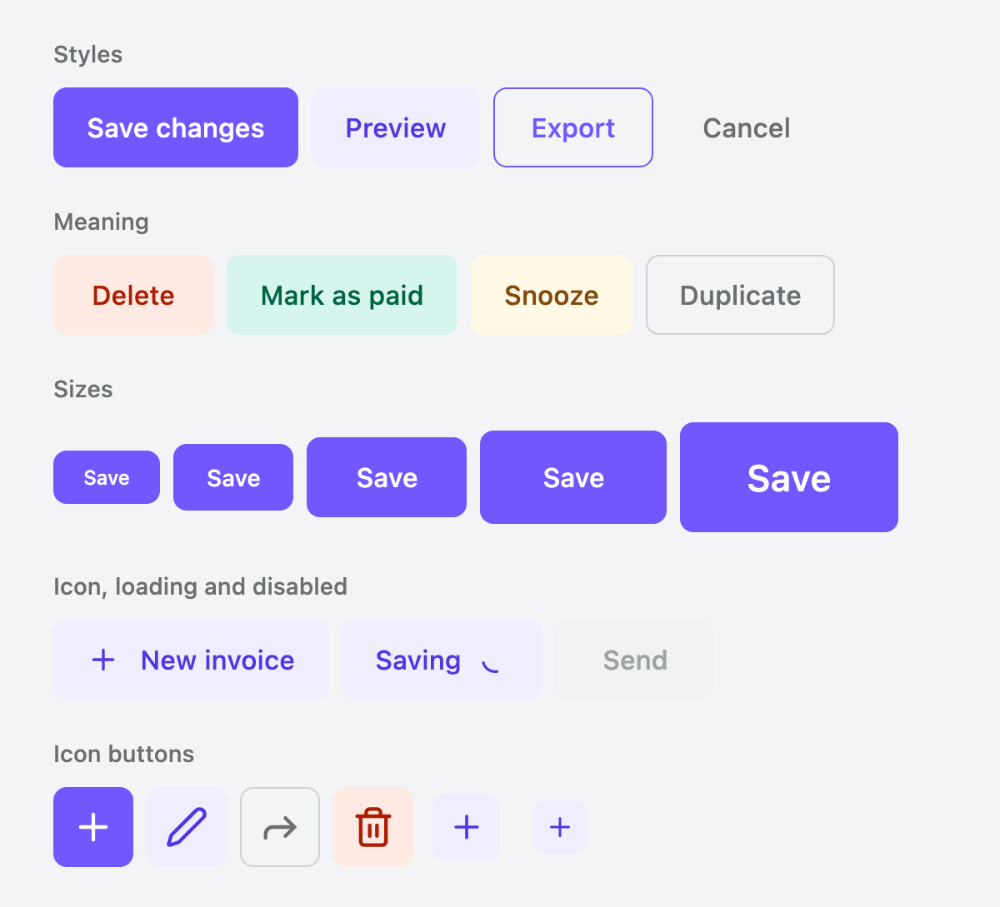
</picture>

| Component | Use it for | Package | Playground |
| --- | --- | --- | --- |
| [`Button`](../ui/foundation/README.md#buttons-and-actions) | An action with a label, and optionally an icon either side | `button` | `ButtonShowcase` |
| [`IconButton`](../ui/foundation/README.md#buttons-and-actions) | An action shown by an icon alone | `button` | `IconButtonShowcase` |
| [`IconToggleButton`](../ui/foundation/README.md#buttons-and-actions) | An icon that is on or off — a favourite, a pin — announced as a toggle | `button` | — |
| [`BackAction`](../ui/foundation/README.md#buttons-and-actions) | A top bar's back control | `topbar` | `TopBarActionsShowcase` |
| [`CloseAction`](../ui/foundation/README.md#buttons-and-actions) | A top bar's dismiss control, for a sheet or a full-screen task | `topbar` | `TopBarActionsShowcase` |
| [`DoneAction`](../ui/foundation/README.md#buttons-and-actions) | The worded control that finishes a task: "Done", "Save" | `topbar` | `TopBarActionsShowcase` |
| [`CancelAction`](../ui/foundation/README.md#buttons-and-actions) | The worded control that abandons a task: "Cancel", "Discard" | `topbar` | `TopBarActionsShowcase` |
| [`TextAction`](../ui/foundation/README.md#buttons-and-actions) | Any other top bar control written as a word | `topbar` | `TopBarActionsShowcase` |
| [`IconAction`](../ui/foundation/README.md#buttons-and-actions) | Any other top bar control shown as one icon | `topbar` | `TopBarActionsShowcase` |
| [`Action`](../ui/foundation/README.md#buttons-and-actions) | A top bar control holding any mark | `topbar` | `TopBarActionsShowcase` |
| [`SearchAction`](../ui/foundation/README.md#buttons-and-actions) | Open search | `topbar` | `TopBarActionsShowcase` |
| [`ShareAction`](../ui/foundation/README.md#buttons-and-actions) | Share what is on screen | `topbar` | `TopBarActionsShowcase` |
| [`EditAction`](../ui/foundation/README.md#buttons-and-actions) | Edit what is on screen | `topbar` | `TopBarActionsShowcase` |
| [`DeleteAction`](../ui/foundation/README.md#buttons-and-actions) | Delete what is on screen or selected | `topbar` | `TopBarActionsShowcase` |
| [`AddAction`](../ui/foundation/README.md#buttons-and-actions) | Create a new item of what the screen lists | `topbar` | `TopBarActionsShowcase` |
| [`SettingsAction`](../ui/foundation/README.md#buttons-and-actions) | Open settings | `topbar` | `TopBarActionsShowcase` |
| [`DownloadAction`](../ui/foundation/README.md#buttons-and-actions) | Save what is on screen to the device | `topbar` | `TopBarActionsShowcase` |
| [`NotificationsAction`](../ui/foundation/README.md#buttons-and-actions) | Open notifications, with the unread count | `topbar` | `TopBarActionsShowcase` |
| [`FilterAction`](../ui/foundation/README.md#buttons-and-actions) | Open filters, with the number in force | `topbar` | `TopBarActionsShowcase` |
| [`FavoriteAction`](../ui/foundation/README.md#buttons-and-actions) | Mark and unmark a favourite | `topbar` | `TopBarActionsShowcase` |
| [`MenuAction`](../ui/foundation/README.md#buttons-and-actions) | Open a navigation drawer | `topbar` | `TopBarActionsShowcase` |
| [`OverflowAction`](../ui/foundation/README.md#buttons-and-actions) | Open everything the bar had no room for | `topbar` | `TopBarActionsShowcase` |
| [`AvatarAction`](../ui/foundation/README.md#buttons-and-actions) | Who is signed in, opening an account menu | `topbar` | `TopBarActionsShowcase` |

The `…Action` controls are written inside a `TopBar`'s or `LargeTopBar`'s `leading` and `trailing`
slots only.

## Text

<picture>
  <source media="(prefers-color-scheme: dark)" srcset="images/foundation-amounts-dark.png">
  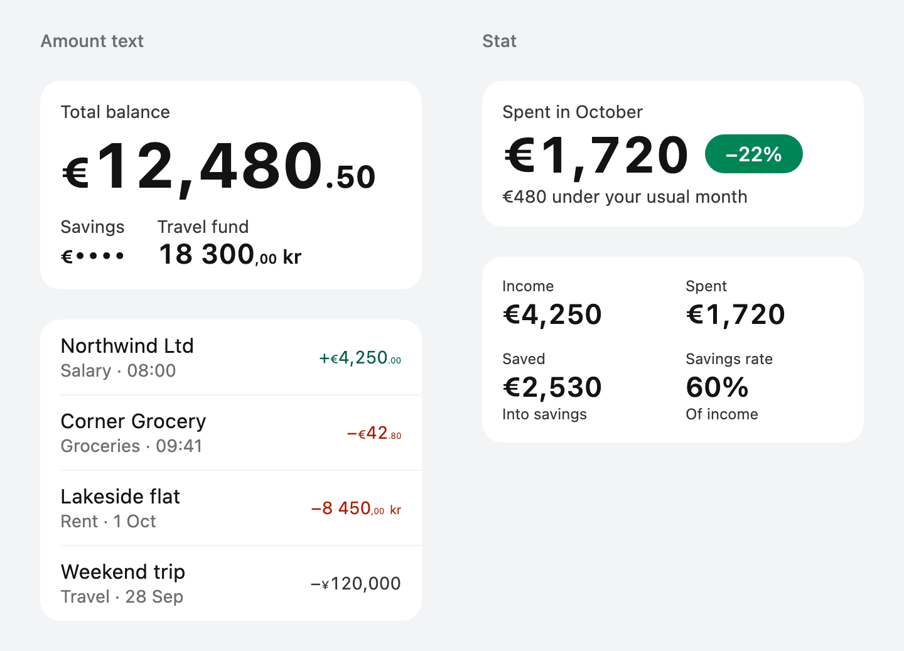
</picture>

| Component | Use it for | Package | Playground |
| --- | --- | --- | --- |
| [`Text`](../ui/foundation/README.md#text) | All text, by `TextVariant` and `TextColor`, or inheriting a slot's style | `text` | `TextShowcase` |
| [`Heading`](../ui/foundation/README.md#text) | A section's title with a supporting line, announced as a heading | `text` | `TextShowcase` |
| [`TextLink`](../ui/foundation/README.md#text) | A standalone pressable label — "Forgot password?" | `text` | `TextLinkShowcase` |
| [`TextLinkPrompt`](../ui/foundation/README.md#text) | A sentence with one pressable part — "No account? Sign up" | `text` | `TextLinkShowcase` |
| [`SensitiveText`](../ui/foundation/README.md#text) | A value hidden until revealed — a balance, a card number | `text` | `SensitiveTextShowcase` |
| [`AmountText`](../ui/foundation/README.md#text) | A formatted sum or quantity: tabular figures, smaller minor units and symbol, kept in order by bidi, maskable, shrinks to fit | `text` | — |

## Icons

| Component | Use it for | Package | Playground |
| --- | --- | --- | --- |
| [`Icon`](../ui/foundation/README.md#icons) | A glyph inline with text | `icon` | `IconsShowcase` |
| [`FeaturedIcon`](../ui/foundation/README.md#icons) | A glyph in a shaped container — an empty state, a dialog header | `icon` | `FeaturedIconShowcase` |
| [`Chevron`](../ui/foundation/README.md#icons) | A chevron that turns with its direction — a disclosure, a dropdown | `icon` | `ChevronShowcase` |

The glyphs themselves are `ArecaIcons.*` in the optional [icons](../standalone/icons/README.md)
artifact.

## Badges and avatars

| Component | Use it for | Package | Playground |
| --- | --- | --- | --- |
| [`Badge`](../ui/foundation/README.md#badges-and-avatars) | A short label — a status, a tag, a filter | `badge` | `BadgeShowcase` |
| [`NotificationBadge`](../ui/foundation/README.md#badges-and-avatars) | A count, overlaid on something else | `badge` | `BadgeShowcase` |
| [`IndicatorDot`](../ui/foundation/README.md#badges-and-avatars) | A status carried by colour alone: presence, unread | `badge` | `BadgeShowcase` |
| [`BadgeSelect`](../ui/foundation/README.md#badges-and-avatars) | Chips that select something, on one line | `badge` | `BadgeShowcase` |
| [`LazyBadgeSelect`](../ui/foundation/README.md#badges-and-avatars) | The same on one scrolling line | `badge` | `BadgeShowcase` |
| [`FlowBadgeSelect`](../ui/foundation/README.md#badges-and-avatars) | The same on wrapping lines | `badge` | `BadgeShowcase` |
| [`Chip`](../ui/foundation/README.md#badges-and-avatars) | One chip: a toggle, or an applied filter with a remove cross, with an optional leading mark | `badge` | — |
| [`Avatar`](../ui/foundation/README.md#badges-and-avatars) | A person or entity: an image, initials or an empty shape | `avatar` | `AvatarShowcase` |

## Stats

| Component | Use it for | Package | Playground |
| --- | --- | --- | --- |
| [`Stat`](../ui/foundation/README.md#stats) | One figure with its label and an optional note | `stat` | `StatShowcase` |
| [`StatGrid`](../ui/foundation/README.md#stats) | Stats in equal columns, read as a set | `stat` | `StatShowcase` |

## Selection controls

<picture>
  <source media="(prefers-color-scheme: dark)" srcset="images/foundation-selection-dark.png">
  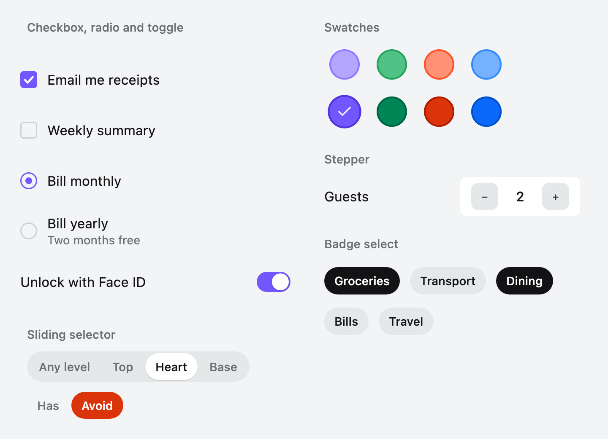
</picture>

<picture>
  <source media="(prefers-color-scheme: dark)" srcset="images/foundation-choice-dark.png">
  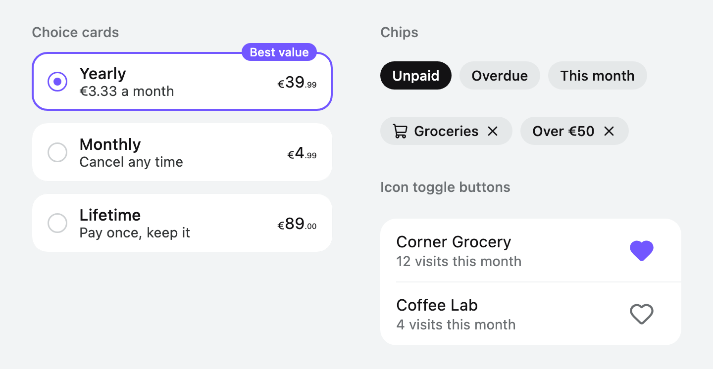
</picture>

| Component | Use it for | Package | Playground |
| --- | --- | --- | --- |
| [`Checkbox`](../ui/foundation/README.md#selection-controls) | A value in a form, saved later; `indeterminate` for mixed children | `selection` | `CheckboxShowcase` |
| [`Radio`](../ui/foundation/README.md#selection-controls) | One option of several | `selection` | `RadioShowcase` |
| [`Toggle`](../ui/foundation/README.md#selection-controls) | A setting that applies the moment it is flipped | `selection` | `ToggleShowcase` |
| [`NumberStepper`](../ui/foundation/README.md#selection-controls) | A whole number nudged by one between bounds | `selection` | `NumberStepperShowcase` |
| [`SlidingSelector`](../ui/foundation/README.md#selection-controls) | A row of options with one thumb sliding to the chosen one: segments, a pill under words, underlines, a three-state toggle. `Tabs` and `FloatingTabBar` are built on it | `selection` | `SlidingSelectorShowcase` |
| [`Swatch`](../ui/foundation/README.md#selection-controls) | One colour sample | `selection` | `SwatchShowcase` |
| [`SwatchPicker`](../ui/foundation/README.md#selection-controls) | A scrolling set of swatches with one selection | `selection` | `SwatchShowcase` |

With a title and a row-wide tap target, use the list rows under
[Lists and settings](#lists-and-settings).

## Fields

<picture>
  <source media="(prefers-color-scheme: dark)" srcset="images/foundation-fields-dark.png">
  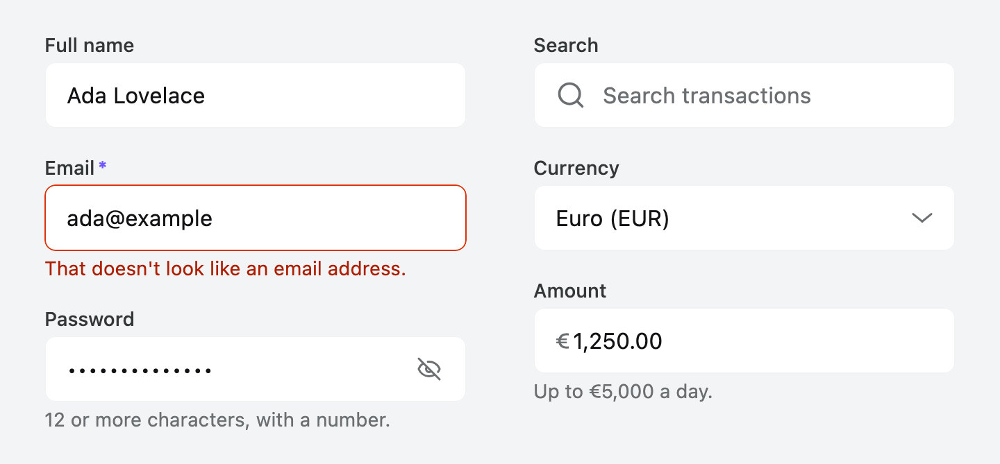
</picture>

| Component | Use it for | Package | Playground |
| --- | --- | --- | --- |
| [`TextField`](../ui/foundation/README.md#fields) | Free text | `field` | `TextFieldShowcase` |
| [`PasswordField`](../ui/foundation/README.md#fields) | A secret, with a reveal control | `field` | `TextFieldShowcase` |
| [`SearchField`](../ui/foundation/README.md#fields) | A query, with a clear control and the search action | `field` | `TextFieldShowcase` |
| [`AffixTextField`](../ui/foundation/README.md#fields) | A value with a fixed prefix or suffix — a currency, a unit | `field` | `TextFieldShowcase` |
| [`OtpField`](../ui/foundation/README.md#fields) | A one-time code, one character to a cell | `field` | `OtpFieldShowcase` |
| [`SelectField`](../ui/foundation/README.md#fields) | A value chosen from a dropdown | `field.select` | `SelectFieldShowcase` |
| [`SelectFlowModal`](../ui/foundation/README.md#fields) | A choice in a sheet, sized to its options — compact for a few, tall with search for many; flat rows on the sheet with a mark, a description and a detail; with `sections`, grouped under titles and an "add your own" row; `headerBottom` puts a line or pill under the title and keeps the stock close. Stock bodies `SelectFlowModalDefaults.List` / `SectionedList`; dropdowns use `MenuList` | `field.select` | `SelectFlowModalShowcase` |
| [`FieldRow`](../ui/foundation/README.md#fields) | Several parts sharing one border and one status | `field` | `FieldRowShowcase` |
| [`TextSegment`](../ui/foundation/README.md#fields) | A typed part of a `FieldRow` | `field` | `FieldRowShowcase` |
| [`SelectSegment`](../ui/foundation/README.md#fields) | A dropdown part of a `FieldRow` | `field.select` | `FieldRowShowcase` |
| [`FieldGroup`](../ui/foundation/README.md#fields) | A field's label and its assistive or error line | `field` | `FieldGroupShowcase` |
| [`FieldGroupLayout`](../ui/foundation/README.md#fields) | `FieldGroup`'s arrangement with the label and message as your own slots | `field` | — |
| [`Field`](../ui/foundation/README.md#fields) | The bare container, for a value no stock field holds | `field` | — |

## Feedback

<picture>
  <source media="(prefers-color-scheme: dark)" srcset="images/foundation-feedback-dark.png">
  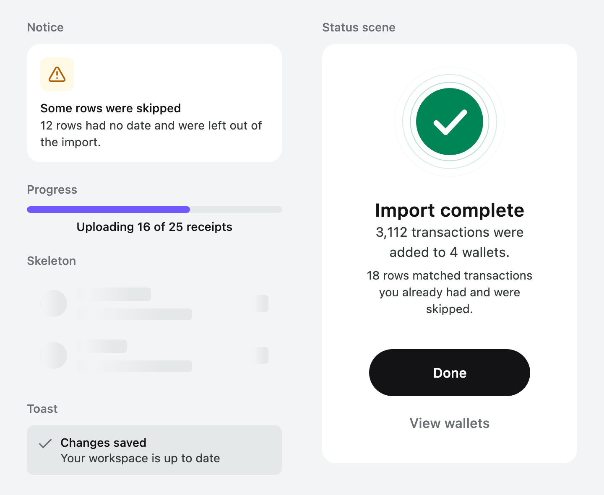
</picture>

<picture>
  <source media="(prefers-color-scheme: dark)" srcset="images/foundation-states-dark.png">
  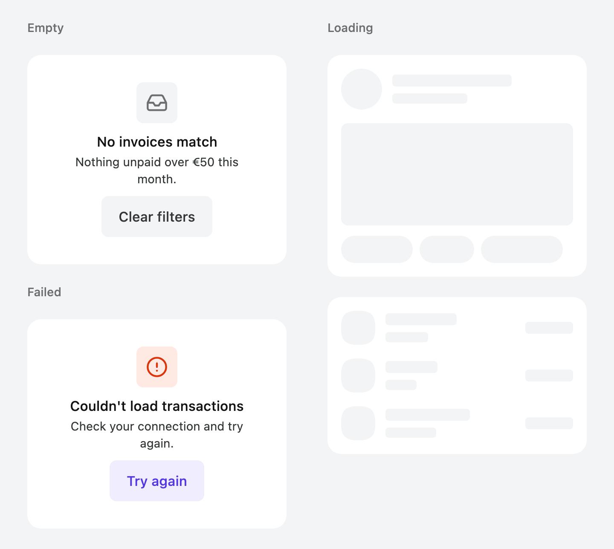
</picture>

| Component | Use it for | Package | Playground |
| --- | --- | --- | --- |
| [`Spinner`](../ui/foundation/README.md#feedback) | Work of unknown length | `feedback` | `ProgressShowcase` |
| [`ProgressBar`](../ui/foundation/README.md#feedback) | Work with a known total, or indeterminate | `feedback` | `ProgressShowcase` |
| [`StepIndicator`](../ui/foundation/README.md#feedback) | Which of a handful of steps the user is on | `feedback` | — |
| [`Skeleton`](../ui/foundation/README.md#feedback) | Placeholder bars while content loads | `feedback` | `SkeletonShowcase` |
| [`SkeletonBlock`](../ui/foundation/README.md#feedback) | One placeholder shape sized by its modifier — an avatar, a thumbnail, a card | `feedback` | — |
| [`SkeletonGroup`](../ui/foundation/README.md#feedback) | A region of placeholders announced once | `feedback` | — |
| [`RequirementList`](../ui/foundation/README.md#feedback) | The rules a value must meet, ticked off as met | `feedback` | `RequirementListShowcase` |
| [`Fallback`](../ui/foundation/README.md#feedback) | Part of a screen standing in for missing content: empty, failed, offline. `Fallback(title, …, tone)` is the stock empty state and failure in words | `feedback` | `FallbackShowcase` |
| [`ToastHost`](../ui/foundation/README.md#feedback) | Shows queued toasts one at a time | `feedback` | `ToastShowcase` |
| [`Toast`](../ui/foundation/README.md#feedback) | One toast's surface, drawn by the host | `feedback` | `ToastShowcase` |
| [`AnnounceOnChange`](../ui/foundation/README.md#feedback) | A sentence spoken by the screen reader when it appears or changes | `dev.voir.areca.foundation` | — |

## Notices and status

| Component | Use it for | Package | Playground |
| --- | --- | --- | --- |
| [`Notice`](../ui/foundation/README.md#notices-and-status) | A block set off from the page to say one thing | `notice` | `NoticeShowcase` |
| [`NoticeText`](../ui/foundation/README.md#notices-and-status) | A line of a notice's body | `notice` | `NoticeShowcase` |
| [`AnimatedNotice`](../ui/foundation/README.md#notices-and-status) | A notice present only while there is something to say | `notice` | `NoticeShowcase` |
| [`StatusScene`](../ui/foundation/README.md#notices-and-status) | A whole screen given to one piece of work: running, done or stopped | `status` | `StatusSceneShowcase` |
| [`StatusMark`](../ui/foundation/README.md#notices-and-status) | The disc a status scene shows | `status` | `StatusMarkShowcase` |
| [`StatusSceneActions`](../ui/foundation/README.md#notices-and-status) | A status scene's buttons | `status` | `StatusSceneShowcase` |

## Overlays

<picture>
  <source media="(prefers-color-scheme: dark)" srcset="images/foundation-overlays-dark.png">
  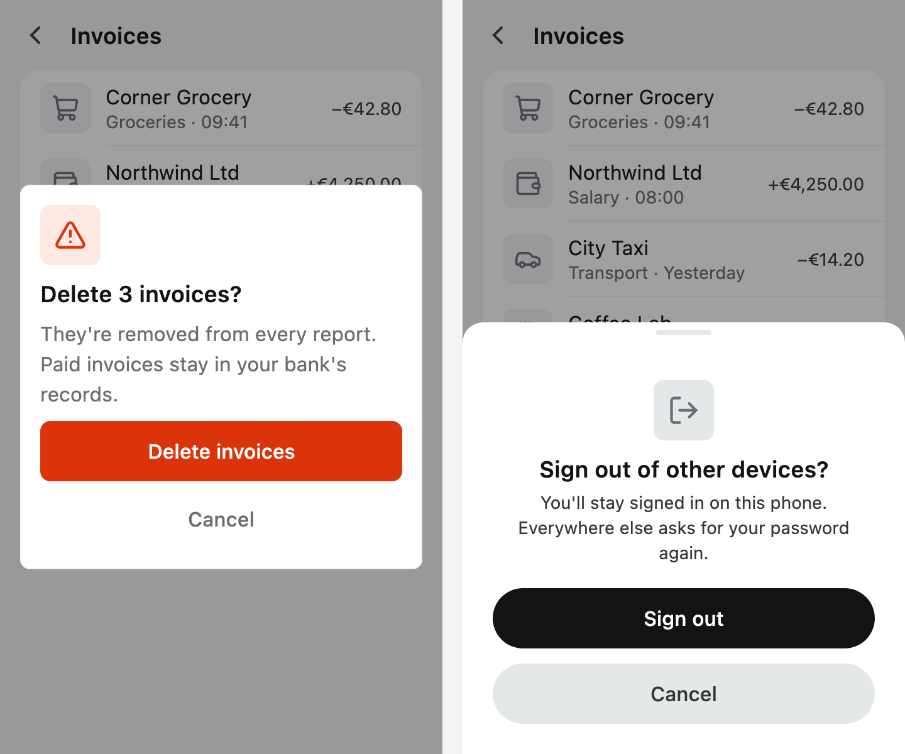
</picture>

<picture>
  <source media="(prefers-color-scheme: dark)" srcset="images/foundation-sheets-dark.png">
  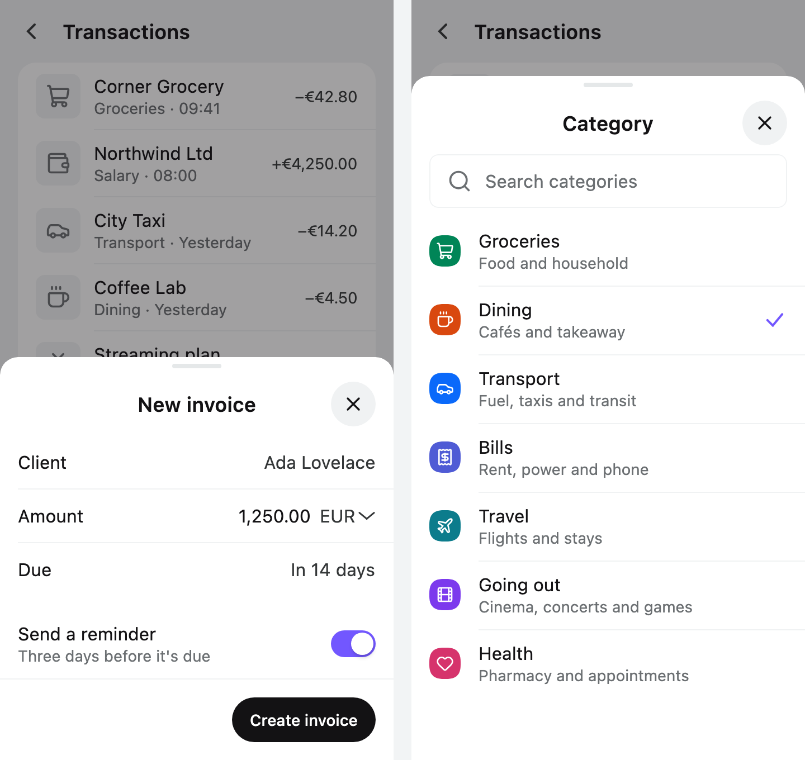
</picture>

| Component | Use it for | Package | Playground |
| --- | --- | --- | --- |
| [`ConfirmSheet`](../ui/foundation/README.md#overlays) | A yes-or-no question in a bottom sheet | `overlay` | `ConfirmSheetShowcase` |
| [`ConfirmSheetRows`](../ui/foundation/README.md#overlays) | Choice rows in a `ConfirmSheet`'s `extra`, run edge to edge past its padding | `overlay` | — |
| [`ConfirmationDialog`](../ui/foundation/README.md#overlays) | The same question as a centred dialog, with progress | `overlay` | `ConfirmationDialogShowcase` |
| [`Dialog`](../ui/foundation/README.md#overlays) | A centred window for a short task | `overlay` | `DialogShowcase` |
| [`FlowModal`](../ui/foundation/README.md#overlays) | A bottom sheet dragged between heights and away; shown by a `visible` flag, an `item` or a controller | `overlay` | `FlowModalShowcase` |
| [`FlowModalTopBar`](../ui/foundation/README.md#overlays) | A sheet's header: centred title, close cross, optional pinned content | `overlay` | — |
| [`FlowModalActionBar`](../ui/foundation/README.md#overlays) | A sheet's footer with its commit button | `overlay` | `FlowModalShowcase` |
| [`FlowModalSecondaryAction`](../ui/foundation/README.md#overlays) | The secondary button in a sheet's footer | `overlay` | `FlowModalShowcase` |
| [`DropdownPopup`](../ui/foundation/README.md#overlays) | A surface hanging off the control that opened it — a menu | `overlay` | — |
| [`TooltipBox`](../ui/foundation/README.md#overlays) | A short label naming its content under a pointer or keyboard focus | `overlay` | `TooltipShowcase` |

## Layout and surfaces

<picture>
  <source media="(prefers-color-scheme: dark)" srcset="images/foundation-layouts-dark.png">
  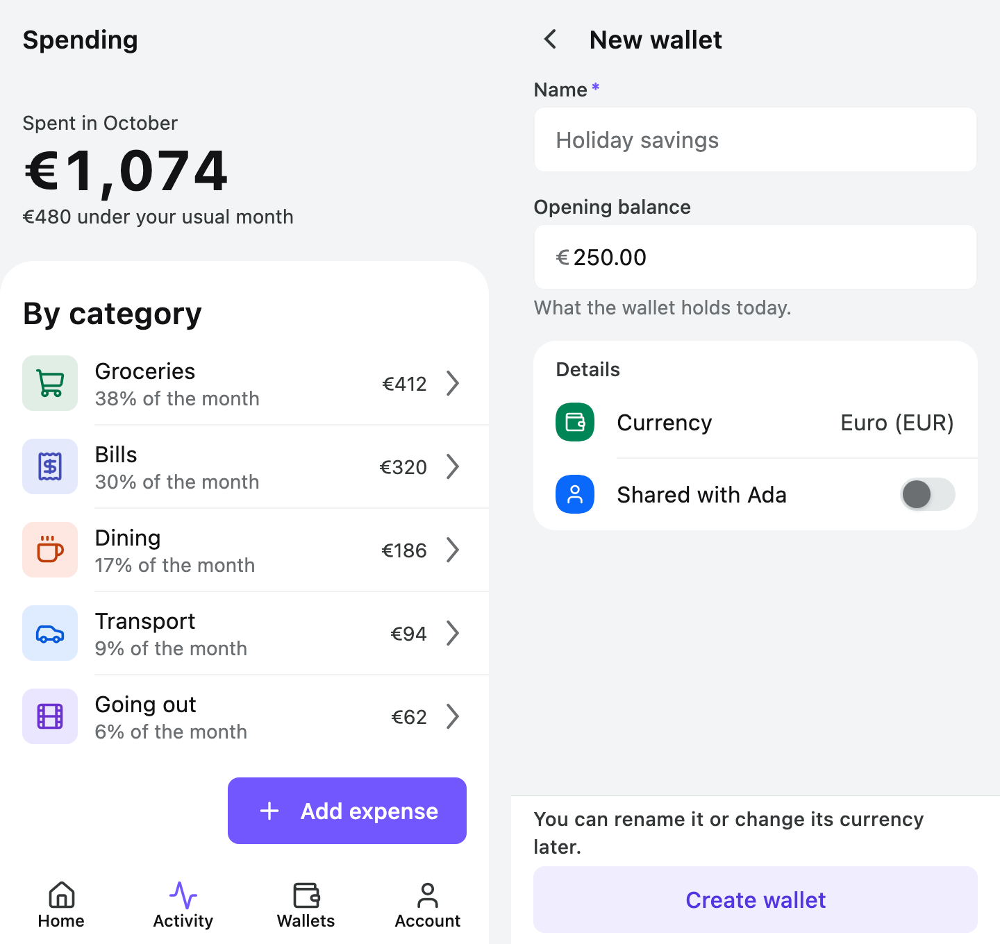
</picture>

| Component | Use it for | Package | Playground |
| --- | --- | --- | --- |
| [`BaseLayout`](../ui/foundation/README.md#layout-and-surfaces) | A screen's frame with top and bottom bars, a floating action and toasts | `layout` | `BaseLayoutShowcase` |
| [`BottomActionBar`](../ui/foundation/README.md#layout-and-surfaces) | A screen's bottom bar with its primary action, a count, a caption, a soft not-ready state, or a hint why it is unavailable | `layout` | `BottomActionBarShowcase` |
| [`PanelLayout`](../ui/foundation/README.md#layout-and-surfaces) | A header on the page's ground over a rounded-top panel that fills the rest of the screen | `layout` | — |
| [`CollapsingHeaderLayout`](../ui/foundation/README.md#layout-and-surfaces) | A header that scrolls away above a strip that stays | `layout` | `CollapsingHeaderLayoutShowcase` |
| [`PullToRefreshLayout`](../ui/foundation/README.md#layout-and-surfaces) | Pull-to-refresh around scrolling content (experimental) | `layout` | `PullToRefreshShowcase` |
| [`PullToRefreshIndicator`](../ui/foundation/README.md#layout-and-surfaces) | Its default indicator (experimental) | `layout` | `PullToRefreshShowcase` |
| [`Card`](../ui/foundation/README.md#layout-and-surfaces) | A surface grouping content, optionally pressable, expandable or with a footer. By default on the `raised` fill of the surface under it; `CardStyle.Outlined` keeps that surface's ground | `layout` | `CardShowcase` |
| [`Expandable`](../ui/foundation/README.md#layout-and-surfaces) | A region that opens and closes under a trigger | `layout` | `ExpandableShowcase` |
| [`ChoiceCard`](../ui/foundation/README.md#layout-and-surfaces) | One answer of a choice as a card — a plan, an option with a price — with a ring, a mark, a badge and radio or checkbox semantics | `layout` | — |
| [`HorizontalDivider`](../ui/foundation/README.md#layout-and-surfaces) | A horizontal rule, optionally labelled | `layout` | `DividerShowcase` |
| [`VerticalDivider`](../ui/foundation/README.md#layout-and-surfaces) | A vertical rule | `layout` | `DividerShowcase` |
| [`RelativePositionLayout`](../ui/foundation/README.md#layout-and-surfaces) | A companion on one of eight sides of its content | `layout` | — |
| [`Overlay`](../ui/foundation/README.md#layout-and-surfaces) | A tint over a box's content without changing its size | `layout` | `BaseLayoutShowcase` |
| [`VerticalScrollbar`](../ui/foundation/README.md#layout-and-surfaces) | A draggable scrollbar for a column, list or grid, under a pointer only | `layout` | `ScrollbarShowcase` |
| [`HorizontalScrollbar`](../ui/foundation/README.md#layout-and-surfaces) | The same for a row, under a pointer only | `layout` | `ScrollbarShowcase` |
| [`SystemBars`](theme.md) | The colour behind the status and navigation bars, for a region that is always dark | `dev.voir.areca.platform` | — |
| [`RaisedSurface`](theme.md#your-own-fill) | Puts its content one surface level up, for content on a fill of your own in `ArecaTheme.surface.raised` | `dev.voir.areca.theme` | — |
| [`ProvideSurface`](theme.md#your-own-fill) | Puts its content at a chosen surface level (`Page`, `Card`, `Inset`) of a screen's or a sheet's ladder | `dev.voir.areca.theme` | — |

## Adaptive layouts

<picture>
  <source media="(prefers-color-scheme: dark)" srcset="images/foundation-adaptive-dark.png">
  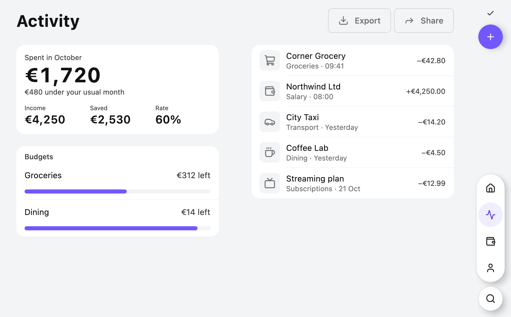
</picture>

| Component | Use it for | Package | Playground |
| --- | --- | --- | --- |
| [`AdaptiveNavigation`](../ui/foundation/README.md#adaptive-layouts) | An app's top-level navigation: bottom bar, edge column, rail or sidebar by window | `adaptive` | `AdaptiveNavigationShowcase` |
| [`AdaptiveToolbar`](../ui/foundation/README.md#adaptive-layouts) | A screen's title, back and actions: a top bar, or round buttons in the edge column | `adaptive` | `AdaptiveNavigationShowcase` |
| [`EdgeColumn`](../ui/foundation/README.md#adaptive-layouts) | A floating column of status, toolbar, destinations and search along one edge | `adaptive` | `AdaptiveNavigationShowcase` |
| [`EdgeButton`](../ui/foundation/README.md#adaptive-layouts) | A round action of the edge column: plain, primary or toggled | `adaptive` | `AdaptiveNavigationShowcase` |
| [`VerticalTabBar`](../ui/foundation/README.md#adaptive-layouts) | Destinations as a vertical capsule of icons, the overflow in More | `adaptive` | `AdaptiveNavigationShowcase` |
| [`EdgeStatus`](../ui/foundation/README.md#adaptive-layouts) | The app's own status icon in the edge column, filled when it needs attention | `adaptive` | `AdaptiveNavigationShowcase` |
| [`FloatingSidebar`](../ui/foundation/README.md#adaptive-layouts) | A sidebar floating in from an edge over a scrim | `adaptive` | `AdaptiveNavigationShowcase` |
| [`NavRail`](../ui/foundation/README.md#adaptive-layouts) | A column of icon-and-label destinations along the start edge | `adaptive` | `AdaptiveNavigationShowcase` |
| [`ListDetail`](../ui/foundation/README.md#adaptive-layouts) | A list and the open item, side by side when there is room; a pointer drags the divider | `adaptive` | `ListDetailShowcase` |
| [`SupportingPane`](../ui/foundation/README.md#adaptive-layouts) | Main content with filters, reviews or details beside it, or in a sheet | `adaptive` | `SupportingPaneShowcase` |
| [`ContentColumn`](../ui/foundation/README.md#adaptive-layouts) | A form or reading column that stops growing and centres | `adaptive` | `ContentColumnShowcase` |
| [`AdaptiveGrid`](../ui/foundation/README.md#adaptive-layouts) | A grid whose column count follows its width | `adaptive` | `AdaptiveGridShowcase` |
| [`AdaptiveMenu`](../ui/foundation/README.md#adaptive-layouts) | Actions for a row, a card or a details sheet, in groups with destructive ones last: a card at the trigger (`AdaptiveMenuPresentation.Dropdown`, the default) or a sheet (`Sheet`), as the app chose, on every window; restyled with `AdaptiveMenuStyle` and `AdaptiveMenuSize` | `adaptive` | `AdaptiveMenuShowcase` |
| [`Modifier.contextMenu`](../ui/foundation/README.md#adaptive-layouts) | Opens a row's `AdaptiveMenu` on a right-click, a long press or the Menu key | `adaptive` | `AdaptiveMenuShowcase` |

## Window classes

| Component | Use it for | Package | Playground |
| --- | --- | --- | --- |
| [`AdaptiveContent`](../ui/foundation/README.md#window-classes) | One of several layouts, chosen by the width class in scope | `dev.voir.areca.window` | `WindowClassShowcase` |
| [`WindowClassBox`](../ui/foundation/README.md#window-classes) | A pane that reports its own size as its content's window class | `dev.voir.areca.window` | `WindowClassShowcase` |
| [`ProvideWindowClass`](../ui/foundation/README.md#window-classes) | A given window class for a subtree, in a preview or a test | `dev.voir.areca.window` | `WindowClassShowcase` |

## Slot rows

| Component | Use it for | Package | Playground |
| --- | --- | --- | --- |
| [`SlotRow`](../ui/foundation/README.md#slot-rows) | A start, centre and end row that lines up with every list row, button and bar | `slot` | `ThreeSlotRowShowcase` |

## Lists and settings

<picture>
  <source media="(prefers-color-scheme: dark)" srcset="images/foundation-lists-dark.png">
  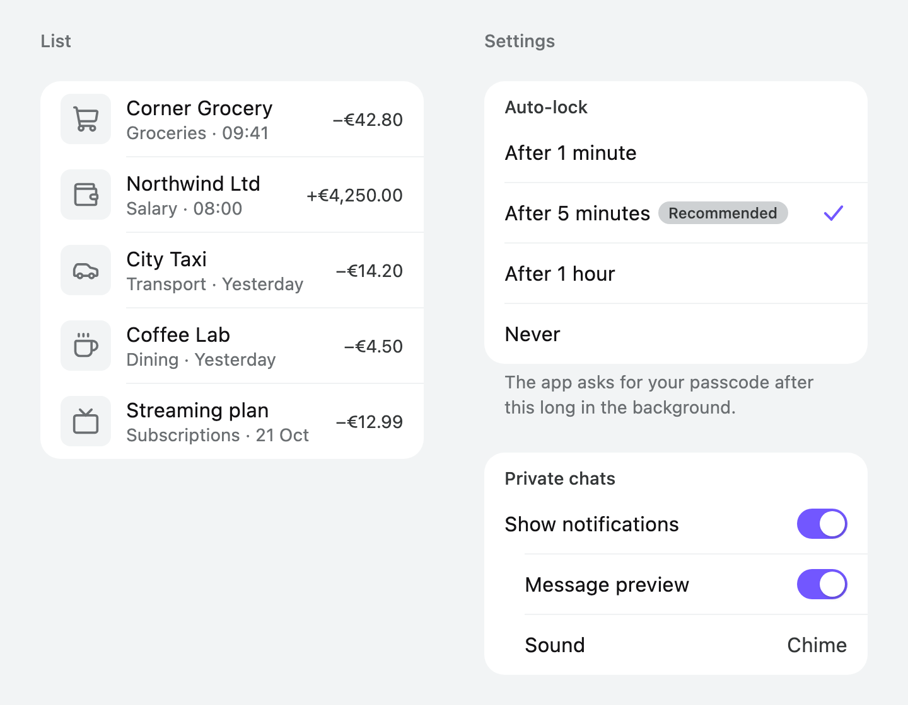
</picture>

| Component | Use it for | Package | Playground |
| --- | --- | --- | --- |
| [`List`](../ui/foundation/README.md#lists-and-settings) | A short grouped list, declared with `item(...)` | `list` | `ListShowcase` |
| [`LazyList`](../ui/foundation/README.md#lists-and-settings) | A long grouped list, composed lazily | `list` | `ListShowcase` |
| [`ListItemColumn`](../ui/foundation/README.md#lists-and-settings) | A group of rows you compose, with separators | `list` | `ListItemShowcase` |
| [`ListItem`](../ui/foundation/README.md#lists-and-settings) | A row with title, subtitle, caption, value, leading and trailing slots; `ListItemStyle` presets `plain`, `surface`, `outlined`, `soft`, `ghost` and `flood` (fills when selected), re-inked with `withValueColor` / `withChevronColor` | `list` | `ListItemShowcase` |
| [`NavigationListItem`](../ui/foundation/README.md#lists-and-settings) | A row that opens something | `list` | `ListItemShowcase` |
| [`CheckboxListItem`](../ui/foundation/README.md#lists-and-settings) | A row that is a checkbox | `list` | `ListItemShowcase` |
| [`RadioListItem`](../ui/foundation/README.md#lists-and-settings) | A row that is a radio | `list` | `ListItemShowcase` |
| [`ToggleListItem`](../ui/foundation/README.md#lists-and-settings) | A row that is a toggle | `list` | `ListItemShowcase` |
| [`CheckmarkListItem`](../ui/foundation/README.md#lists-and-settings) | A row ticked when chosen | `list` | `ListItemShowcase` |
| [`ExpandableListItem`](../ui/foundation/README.md#lists-and-settings) | A row that discloses content under it | `list` | `ListItemShowcase` |
| [`ListItemSkeleton`](../ui/foundation/README.md#lists-and-settings) | A row-shaped placeholder | `list` | `ListItemShowcase` |
| [`ListItemChevron`](../ui/foundation/README.md#lists-and-settings) | The trailing chevron of a row you compose, in the row's own chevron ink (`ListItemStyle.withChevronColor`) or the trailing slot's | `list` | `ListItemShowcase` |
| [`ListItemCheckmark`](../ui/foundation/README.md#lists-and-settings) | The trailing check mark of a row you compose | `list` | `ListItemShowcase` |
| [`Settings`](../ui/foundation/README.md#lists-and-settings) | A settings screen of sections | `settings` | `SettingsShowcase` |
| [`Section`](../ui/foundation/README.md#lists-and-settings) | One section of rows on its own card, with header, footer and band | `settings` | `SettingsShowcase` |
| [`SettingsRow`](../ui/foundation/README.md#lists-and-settings) | A settings row: a value, a navigation or an action | `settings` | `SettingsShowcase` |
| [`SettingsToggleRow`](../ui/foundation/README.md#lists-and-settings) | A settings row with a switch | `settings` | `SettingsShowcase` |
| [`SettingsSelectRow`](../ui/foundation/README.md#lists-and-settings) | A settings row choosing from a dropdown | `settings` | `SettingsShowcase` |
| [`SettingsOptionRow`](../ui/foundation/README.md#lists-and-settings) | One option of a set, as a settings row | `settings` | `SettingsShowcase` |
| [`SettingsTextFieldRow`](../ui/foundation/README.md#lists-and-settings) | A field typed in place, as a settings row; with `title`, a "label … value" form row | `settings` | `SettingsShowcase` |
| [`SettingsTextFieldSuffix`](../ui/foundation/README.md#lists-and-settings) | The unit after a text field row's input, pressable to change it | `settings` | `SettingsShowcase` |
| [`SettingsRowIcon`](../ui/foundation/README.md#lists-and-settings) | A row's leading glyph on a tile, in an `ActionColor` or a categorical hue (`hue = ArecaTheme.hues.…`) | `settings` | `SettingsShowcase` |
| [`SettingsRowTile`](../ui/foundation/README.md#lists-and-settings) | Any other leading visual, cropped to the tile | `settings` | `SettingsShowcase` |
| [`SettingsRowLink`](../ui/foundation/README.md#lists-and-settings) | A second action at the end of a pressable row | `settings` | `SettingsShowcase` |
| [`SettingsBlock`](../ui/foundation/README.md#lists-and-settings) | Free content on a section card, inset like a row | `settings` | `SettingsShowcase` |
| [`SettingsRowSkeleton`](../ui/foundation/README.md#lists-and-settings) | A settings-row-shaped placeholder | `settings` | `SettingsShowcase` |

## Collections

| Component | Use it for | Package | Playground |
| --- | --- | --- | --- |
| [`ContentList`](../ui/foundation/README.md#collections) | A set loaded in one go, with loading, empty and error faces | `collection` | `ContentListShowcase` |
| [`GroupedContentList`](../ui/foundation/README.md#collections) | The same, in labelled groups; `ContentListGroupLayout.Inset` puts each on a card | `collection` | `ContentListShowcase` |
| [`PagedContentList`](../ui/foundation/README.md#collections) | A set loaded a page at a time, with pull-to-refresh | `collection` | `ContentListShowcase` |
| [`GroupedPagedContentList`](../ui/foundation/README.md#collections) | The same, in labelled groups; `ContentListGroupLayout.Inset` puts each on a card | `collection` | `ContentListShowcase` |
| [`LazyVerticalGroupedGrid`](../ui/foundation/README.md#collections) | A vertical grid broken into labelled groups | `collection` | `GroupedGridShowcase` |
| [`LazyHorizontalGroupedGrid`](../ui/foundation/README.md#collections) | A horizontal grid broken into labelled groups | `collection` | `GroupedGridShowcase` |

## Tables

| Component | Use it for | Package | Playground |
| --- | --- | --- | --- |
| [`Table`](../ui/foundation/README.md#tables) | Rows and columns of data, composed in one pass | `table` | `TableShowcase` |
| [`LazyTable`](../ui/foundation/README.md#tables) | The same for a long set, composed on demand | `table` | `TableShowcase` |

## Navigation, tabs, tab bar and top bar

<picture>
  <source media="(prefers-color-scheme: dark)" srcset="images/foundation-navigation-dark.png">
  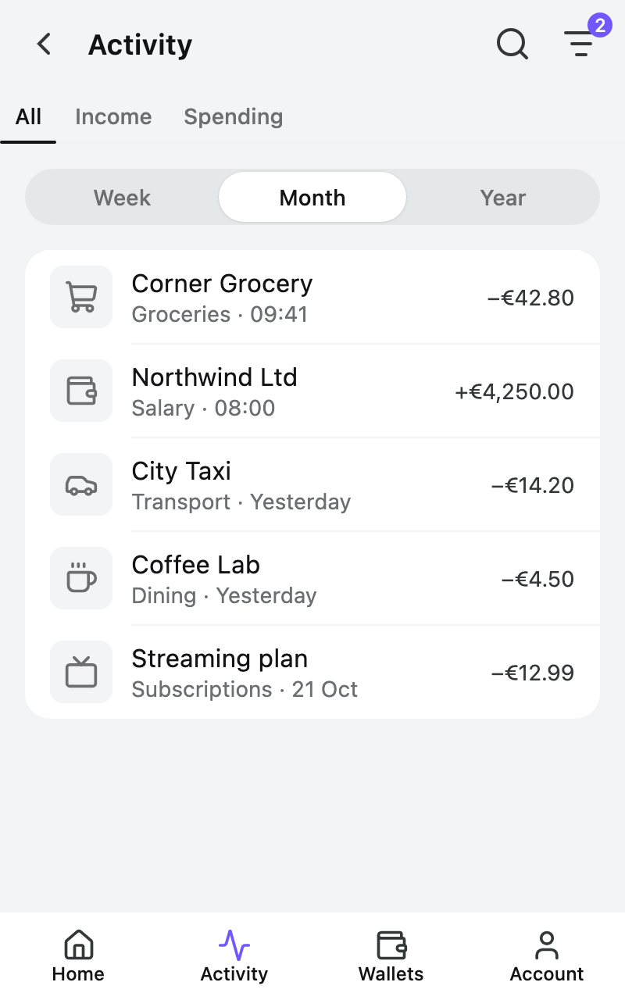
</picture>

| Component | Use it for | Package | Playground |
| --- | --- | --- | --- |
| [`TopBar`](../ui/foundation/README.md#navigation-tabs-tab-bar-and-top-bar) | A screen's heading bar | `topbar` | `TopBarShowcase` |
| [`LargeTopBar`](../ui/foundation/README.md#navigation-tabs-tab-bar-and-top-bar) | A large title that collapses into a `TopBar` | `topbar` | `LargeTopBarShowcase` |
| [`TopBarProgress`](../ui/foundation/README.md#navigation-tabs-tab-bar-and-top-bar) | A hairline of progress along the bar's bottom edge | `topbar` | `TopBarShowcase` |
| [`Tabs`](../ui/foundation/README.md#navigation-tabs-tab-bar-and-top-bar) | Tabs switching the content below: underlined, buttons or segmented. Built on `SlidingSelector` | `tabs` | `TabsShowcase` |
| [`TabBar`](../ui/foundation/README.md#navigation-tabs-tab-bar-and-top-bar) | The application's destinations, docked to the bottom | `tabbar` | `TabBarShowcase` |
| [`FloatingTabBar`](../ui/foundation/README.md#navigation-tabs-tab-bar-and-top-bar) | The same, floating above the bottom edge | `tabbar` | `FloatingTabBarShowcase` |
| [`FloatingTabBarItemContent`](../ui/foundation/README.md#navigation-tabs-tab-bar-and-top-bar) | A floating tab's icon and optional label | `tabbar` | `FloatingTabBarShowcase` |
| [`NavList`](../ui/foundation/README.md#navigation-tabs-tab-bar-and-top-bar) | A sidebar of destinations, with expandable sections | `navigation` | `NavListShowcase` |
| [`NavItem`](../ui/foundation/README.md#navigation-tabs-tab-bar-and-top-bar) | One destination row, for a sidebar you compose yourself | `navigation` | `NavListShowcase` |
| [`SwipePager`](../ui/foundation/README.md#navigation-tabs-tab-bar-and-top-bar) | Pages swiped sideways | `navigation` | — |
| [`PagerControls`](../ui/foundation/README.md#navigation-tabs-tab-bar-and-top-bar) | A pager's dots and next button | `navigation` | — |
| [`PageIndicator`](../ui/foundation/README.md#navigation-tabs-tab-bar-and-top-bar) | A pager's position as marks: elongated or plain dots, a shrinking window, a line or story segments; on the page or over a picture | `navigation` | `PageIndicatorShowcase` |
| [`PageCounter`](../ui/foundation/README.md#navigation-tabs-tab-bar-and-top-bar) | A pager's position as a count, "3 / 9" | `navigation` | `PageCounterShowcase` |
| [`ScrollToTopOnTabReselect`](../ui/foundation/README.md#navigation-tabs-tab-bar-and-top-bar) | Scrolls a column, list or grid to its top when its tab is tapped again | `navigation` | — |
| [`OnTabReselect`](../ui/foundation/README.md#navigation-tabs-tab-bar-and-top-bar) | Runs an action when the selected destination is tapped again; the taps come from `LocalTabReselect` | `navigation` | — |

A top bar's controls — `BackAction` and the rest — are under
[Buttons and actions](#buttons-and-actions).

## Wheel picker

| Component | Use it for | Package | Playground |
| --- | --- | --- | --- |
| [`WheelPicker`](../ui/foundation/README.md#wheel-picker) | Wheels sharing one centre row | `wheel` | `WheelPickerShowcase` |
| [`WheelPickerColumn`](../ui/foundation/README.md#wheel-picker) | One wheel of items | `wheel` | `WheelPickerShowcase` |
| [`WheelPickerItem`](../ui/foundation/README.md#wheel-picker) | A wheel row's default text, for your own `itemContent` | `wheel` | `WheelPickerShowcase` |
| [`WheelPickerHighlight`](../ui/foundation/README.md#wheel-picker) | The band behind the centre row; the picker's default background | `wheel` | `WheelPickerShowcase` |
| [`WheelPickerEdgeFade`](../ui/foundation/README.md#wheel-picker) | The fade over the top and bottom rows; the picker's default foreground | `wheel` | `WheelPickerShowcase` |

## Other modules

- [Charts](../ui/charts/README.md) — `dev.voir.areca:charts`: bar, column, line and stacked bar
  charts, meter bars and legends.
- [Date and time](../ui/datetime/README.md) — `dev.voir.areca:datetime`: calendars, date ranges and
  time pickers.
- [Crop](../ui/crop/README.md) — `dev.voir.areca:crop`: an image cropping screen.
- [Keyboard](../ui/keyboard/README.md) — `dev.voir.areca:keyboard`: an on-screen keyboard.
- Flows — parts and recipes for whole screens: [auth](../flow/auth/README.md),
  [profile](../flow/profile/README.md) and [attachments](../flow/attachments/README.md).
- [Icons](../standalone/icons/README.md) — `dev.voir.areca:icons`: the `ArecaIcons.*` glyph set,
  usable without the theme.
