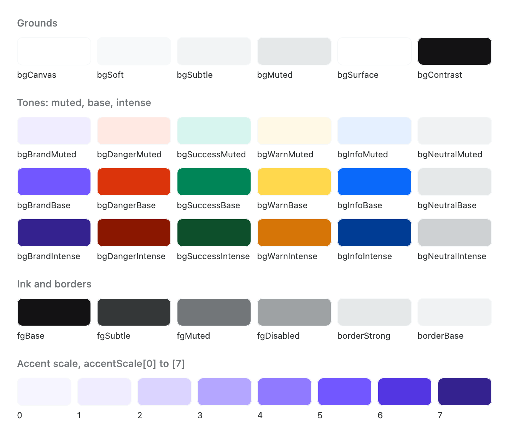

# Theme

The theme is a set of tokens — colours, type, spacing, corners, elevation and motion — that every
Areca component reads. `ArecaThemeProvider` puts them in scope, `ArecaTheme` reads them back, and
changing one token changes every component that uses it.

Everything on this page is in `dev.voir.areca.theme`, in `dev.voir.areca:foundation`.

<picture>
  <source media="(prefers-color-scheme: dark)" srcset="images/theme-colors-dark.png">
  
</picture>

## The provider

Wrap the application once, near its root:

```kotlin
@Composable
fun App() {
    ArecaThemeProvider(darkTheme = isSystemInDarkTheme()) {
        Box(Modifier.fillMaxSize().background(ArecaTheme.colors.bgCanvas)) {
            Home()
        }
    }
}
```

`darkTheme` picks the direction; pass `isSystemInDarkTheme()` or the user's own setting. The provider
paints nothing, so give the screen its ground, `bgCanvas`. It also seeds every component's default
style and size — see [Customising](customising.md#defaults-for-a-subtree).

Without a provider, every token falls back to the light theme's default, so previews and tests
compose without wrapping.

## Reading tokens

`ArecaTheme` is the only way to read a token. Every accessor is `@Composable` and returns the value
the nearest provider put in scope:

| Accessor | Type | Holds |
| --- | --- | --- |
| `ArecaTheme.colors` | `ArecaColors` | Semantic colours — the ones to use |
| `ArecaTheme.typography` | `ArecaTypography` | Named text styles |
| `ArecaTheme.spacing` | `ArecaSpacing` | The spacing scale and the screen gutters |
| `ArecaTheme.shapes` | `ArecaShapes` | Corner shapes |
| `ArecaTheme.radius` | `ArecaRadius` | Corner lengths, as raw `Dp`; prefer `shapes` |
| `ArecaTheme.elevation` | `ArecaElevation` | Shadow depths |
| `ArecaTheme.motion` | `ArecaMotion` | Durations and easings |
| `ArecaTheme.isDark` | `Boolean` | The direction, for a decision no token can carry |
| `ArecaTheme.darkColors` | `ArecaColors` | The dark counterpart of the colours in scope — see [Regions that are always dark](#regions-that-are-always-dark) |
| `ArecaTheme.baseColors` | `ArecaBaseColors` | The raw palette, for when no semantic colour says what you mean |
| `ArecaTheme.baseTypography` | `ArecaBaseTypography` | The raw type scale |
| `ArecaTheme.fonts` | `ArecaFonts` | The font families |

```kotlin
Column(
    modifier = Modifier
        .background(ArecaTheme.colors.bgSurface, ArecaTheme.shapes.lg)
        .padding(ArecaTheme.spacing.xl),
    verticalArrangement = Arrangement.spacedBy(ArecaTheme.spacing.md),
) {
    Text("Storage", style = ArecaTheme.typography.headingSmall)
    Text("12 GB of 50 GB used", variant = TextVariant.BodySmall, color = TextColor.Subtle)
}
```

Read semantic tokens in screen code — `ArecaTheme.colors.fgDangerText`, not
`ArecaTheme.baseColors.red70` and never `Color(0xFF…)` — so the screen follows a re-themed or dark
application.

## Colours

`ArecaTheme.colors` is an `ArecaColors`: one meaning per token, mapped from the palette for the
current direction.

### Grounds

The grounds step back from the page in order: `bgCanvas`, `bgSoft`, `bgSubtle`, `bgMuted`.

| Token | Use it for |
| --- | --- |
| `bgCanvas` | The page itself. Nothing sits behind it |
| `bgSoft` | The softest ground set off from the canvas: an expanded group, a highlighted row, a note block. A control filled with `bgSubtle` still reads on it |
| `bgSubtle` | A region set off without a border: a settings card, a grouped list, a chip or a search pill |
| `bgMuted` | A region further back: an inset well, a track, a section's band |
| `bgSurface` | A raised container on the canvas: cards, sheets, popovers |
| `bgContrast` | The inverted surface — dark in light, light in dark. Pair with `fgOnContrast` |
| `bgContrastMuted` | A weaker inverted surface, for content layered on `bgContrast` |
| `bgOverlayDark` | A scrim darkening what is behind a modal surface |
| `bgOverlayLight` | A scrim lightening what is behind it, over dark imagery |
| `bgDisabled` | The fill of a control the user cannot act on |

### Tone families

Six families — `Brand`, `Danger`, `Success`, `Warn`, `Info`, `Neutral` — each with three fills:

| Token | Use it for |
| --- | --- |
| `bg{Family}Muted` | A tinted ground: a chip, a banner, a selected row, an inline error region |
| `bg{Family}Base` | A solid fill, as on a primary or destructive button. Pair with `fgOnFill` — except `bgWarnBase`, which is light in both themes: pair it with `fgOnWarn` |
| `bg{Family}Intense` | The fill under press or hover |

So `bgBrandMuted`, `bgBrandBase`, `bgBrandIntense`, `bgDangerMuted`, … `bgNeutralIntense`.

### Foregrounds

| Token | Use it for |
| --- | --- |
| `fgBase` | Primary text and icons |
| `fgSubtle` | Secondary text: supporting lines, inactive labels |
| `fgMuted` | Tertiary text: placeholders, timestamps, decorative icons. Never the only carrier of meaning |
| `fgDisabled` | Text and icons of a control the user cannot act on |
| `fgOnContrast` | Content on `bgContrast` |
| `fgOnFill` | Content on any solid tone fill except `bgWarnBase`. White in both themes |
| `fgOnWarn` | Content on `bgWarnBase` |
| `fgBrand`, `fgDanger`, `fgSuccess`, `fgInfo`, `fgWarn` | Icons, graphics and rules in a tone colour |
| `fgBrandText`, `fgDangerText`, `fgSuccessText`, `fgInfoText`, `fgWarnText` | Text in a tone colour, as in a field's error message |
| `fgNeutral` | Neutral status text and icons; the one family with a single foreground |

Each tone has two foregrounds because a small icon and body text need different steps: set type in
the `…Text` token, graphics in the plain one.

### Borders

| Token | Use it for |
| --- | --- |
| `borderBase` | A card or an input at rest |
| `borderStrong` | A border that must separate more clearly, such as a hovered control |
| `borderIntense` | A focused or pressed control |
| `borderSubtle` | A barely visible divider between rows of one group |
| `borderOnSubtle` | A hairline drawn on `bgSubtle`, such as between the rows of a settings card |
| `borderDisabled` | A control the user cannot act on |
| `borderDanger`, `borderSuccess`, `borderInfo`, `borderWarn` | A control in that state |

### Accent

| Token | Use it for |
| --- | --- |
| `accentBase` | Selection and focus: a checked control, a focus ring, an active tab |
| `accentStrong` | The accent under press or hover |
| `accentIntense` | The strongest accent, for a held or dragged state |
| `accentSubtle` | A selection indicator that should not compete with content |
| `accentMuted` | A tint behind selected content |
| `accentScale` | Eight shades for data — a heat-map day, a density cell. Index `0` is nearest the canvas in both themes, so a shade picked by index reads as "more" the same way in light and dark |

### Text colour shortcuts

`Text(text, variant = …, color = …)` takes a `TextColor` instead of a raw colour:

| `TextColor` | Token |
| --- | --- |
| `Base`, `Subtle`, `Muted`, `Disabled` | `fgBase`, `fgSubtle`, `fgMuted`, `fgDisabled` |
| `OnContrast`, `OnFill` | `fgOnContrast`, `fgOnFill` |
| `Brand`, `Danger`, `Success`, `Info`, `Warning` | `fgBrandText`, `fgDangerText`, `fgSuccessText`, `fgInfoText`, `fgWarnText` |

### The palette

`ArecaTheme.baseColors` is an `ArecaBaseColors`: `baseWhite`, `baseBlack`, and six ramps — `brand`,
`neutral`, `green`, `blue`, `yellow`, `red` — each from step `10`, the lightest, to `100`, the
darkest (`brand10` … `brand100`), plus `neutral15`. `ArecaColors.light(baseColors)` and
`ArecaColors.dark(baseColors)` map the same palette to each direction, which is why replacing the
palette re-themes both.

## Typography

`ArecaTheme.typography` is an `ArecaTypography`: styles named by role, built on the raw scale.

| Style | `TextVariant` | Size / line height | Weight | Use it for |
| --- | --- | --- | --- | --- |
| `display` | `Display` | 50 / 60 sp | Bold | Display text, at most once a screen |
| `headingExtraLarge` | `HeadingExtraLarge` | 40 / 48 sp | Bold | A screen whose title is its main content |
| `headingLarge` | `HeadingLarge` | 32 / 38 sp | Bold | A page title |
| `headingMedium` | `HeadingMedium` | 26 / 30 sp | SemiBold | A screen heading |
| `headingSmall` | `HeadingSmall` | 22 / 26 sp | SemiBold | A section heading |
| `headingExtraSmall` | `HeadingExtraSmall` | 18 / 24 sp | SemiBold | A subsection inside a card or a group |
| `bodyExtraLarge` | `BodyExtraLarge` | 22 / 26 sp | Medium | Emphasised body copy, such as a summary line |
| `bodyLarge` | `BodyLarge` | 18 / 24 sp | Normal | A lead paragraph |
| `bodyMedium` | `BodyMedium` | 16 / 20 sp | Normal | Default body copy |
| `bodySmall` | `BodySmall` | 14 / 17 sp | Normal | Compact body copy |
| `bodyExtraSmall` | `BodyExtraSmall` | 12 / 14 sp | Normal | Supporting copy |
| `caption` | `Caption` | 14 / 17 sp | Medium, letter-spaced | Short text under a field or an image |
| `labelLarge` | `LabelLarge` | 16 / 20 sp | Medium | A large control's label, a list row's primary line |
| `labelMedium` | `LabelMedium` | 14 / 17 sp | Medium | The default control label |
| `labelSmall` | `LabelSmall` | 12 / 14 sp | Medium | A dense control: a badge, a chip |

`Text("…", variant = TextVariant.HeadingSmall)` is the usual way to set one; `TextVariant.X.style`
returns the `TextStyle`.

The raw scale, `ArecaTheme.baseTypography` (`ArecaBaseTypography`), is size and line height only:
`xxs` 10, `xs` 12, `sm` 14, `md` 16, `lg` 18, `xl` 22, `xl2` 26, `xl3` 32, `xl4` 40, `xl5` 50, `xl6` 64,
`xl7` 72 sp.

`ArecaTheme.fonts` (`ArecaFonts`) holds two families, both `FontFamily.Default` unless you supply
them: `primary`, which every style uses, and `secondary`, which nothing uses by default — for opting
single styles into a second voice.

## Spacing

`ArecaTheme.spacing` is an `ArecaSpacing`, one ordered ramp plus two gutters:

| Token | Dp | Use it for |
| --- | --- | --- |
| `none` | 0 | No space, where a value must be passed |
| `xs2` | 2 | A hairline separation, such as a badge's internal gap |
| `xs` | 4 | The tightest gap between two elements |
| `sm` | 6 | A gap inside a dense control, such as an icon and its label |
| `md` | 8 | The default gap between related elements |
| `lg` | 12 | Padding inside a small container |
| `xl` | 16 | Padding inside a standard container |
| `xl2` | 20 | Padding inside a roomy container |
| `xl3` | 24 | The gap between grouped blocks within a section |
| `xl4` | 32 | The gap between sections |
| `xl5` | 40 | The gap before a major break |
| `xl6` | 48 | Space above a page heading |
| `xl7` | 64 | Rhythm for sparse, full-height layouts |
| `xl8` | 80 | Empty states and onboarding |
| `xl9` | 96 | Hero and splash layouts |
| `horizontalContentInsets` | 16 | The gutter between screen content and the window's sides |
| `verticalContentInsets` | 24 | The gutter at the top and bottom of a screen |

Apply the gutters with the modifiers rather than reading them: `Modifier.horizontalContentInsets()`,
`Modifier.verticalContentInsets()` and `Modifier.contentInsets()` for both.

## Corners

`ArecaTheme.shapes` (`ArecaShapes`) holds the shapes components use; `ArecaTheme.radius`
(`ArecaRadius`) the lengths they are built from.

| Shape | Radius | Use it for |
| --- | --- | --- |
| `none` | 0 dp | Square corners |
| `xs` | 2 dp | Hairline elements, such as a progress track |
| `sm` | 4 dp | Small controls: badges, chips, swatches |
| `md` | 8 dp | Interactive surfaces: inputs, list rows |
| `lg` | 16 dp | Containers: cards, popovers, dropdowns |
| `xl` | 24 dp | Sheets and modals |
| `xl2` | 32 dp | Full-bleed surfaces that still show a corner |
| `full` | — | Fully rounded ends: a circle on a square, a pill on a wide element |
| `tile` | — | A squircle that holds a glyph: a settings tile, a category mark |
| `button` | `md` | Every labelled action. Replace it to draw all buttons in one shape |

## Elevation

`ArecaTheme.elevation` (`ArecaElevation`) is a stacking order: a surface sits one step above what
is behind it.

| Token | Dp | Use it for |
| --- | --- | --- |
| `none` | 0 | Flush with the surface behind |
| `xs` | 1 | A resting lift, such as a sticky bar |
| `sm` | 2 | A surface lifted by interaction: a dragged row, a toggle thumb |
| `md` | 4 | Anchored transient surfaces: dropdowns, popovers |
| `lg` | 8 | Floating surfaces that own focus: a toast, a floating tab bar |
| `xl` | 16 | Modal surfaces over a scrim |

## Motion

`ArecaTheme.motion` (`ArecaMotion`) groups durations by how much of the screen moves:

| Duration | Ms | Use it for |
| --- | --- | --- |
| `instant` | 100 | A change under the finger: a press tint, a focus ring, a checkbox mark |
| `fast` | 150 | A small element changing in place: a chevron turning, a tab indicator sliding |
| `medium` | 200 | The default: a container resizing, a popover appearing, a crossfade |
| `slow` | 300 | A surface travelling far: a sheet, a drawer, a full-screen transition |
| `deliberate` | 450 | A one-off moment the user is meant to watch, such as a success confirmation |

| Easing | Use it for |
| --- | --- |
| `standard` | The default, for changes in place |
| `enter` | Content arriving on screen |
| `exit` | Content leaving the screen |
| `pressIn` | Something expanding from the point the user touched |
| `fade` | Anything fading or crossfading |

`Duration.tween(easing)` turns a duration into a `TweenSpec`, so no screen spells a millisecond
count:

```kotlin
val background by animateColorAsState(
    if (selected) ArecaTheme.colors.accentMuted else ArecaTheme.colors.bgCanvas,
    animationSpec = ArecaTheme.motion.medium.tween(ArecaTheme.motion.standard),
)
```

## Changing the theme

Each parameter of `ArecaThemeProvider` defaults to a value derived from the one above it, so
override at the highest level that says what you mean and the rest follows:

| Parameter | What it is | Derived from |
| --- | --- | --- |
| `baseColors` | The raw palette, `ArecaBaseColors` | — |
| `colors` | Semantic colours, `ArecaColors` | `baseColors`, for `darkTheme` |
| `radius` | Corner lengths, `ArecaRadius` | — |
| `shapes` | Corner shapes, `ArecaShapes` | `radius` |
| `spacing` | The spacing scale and gutters, `ArecaSpacing` | — |
| `elevation` | The shadow scale, `ArecaElevation` | — |
| `motion` | Durations and easings, `ArecaMotion` | — |
| `fonts` | Font families, `ArecaFonts` | — |
| `baseTypography` | The raw type scale, `ArecaBaseTypography` | `fonts` |
| `typography` | Named text styles, `ArecaTypography` | `baseTypography` |

Every token type is a data class, so `copy` changes one value:

```kotlin
val BrandPalette = ArecaBaseColors(
    brand60 = Color(0xFF0B7A75),
    brand70 = Color(0xFF075E5A),
)

@Composable
fun App(brandSans: FontFamily) {
    ArecaThemeProvider(
        darkTheme = isSystemInDarkTheme(),
        baseColors = BrandPalette,
        radius = ArecaRadius(md = 12.dp, lg = 20.dp),
        spacing = ArecaSpacing(horizontalContentInsets = 20.dp),
        fonts = ArecaFonts(primary = brandSans),
    ) {
        Home()
    }
}
```

- **Colours.** Supplying `baseColors` re-themes both directions; it is the usual way in. Supplying
  `colors` replaces the mapping for the current direction only, so build it for that direction:
  `(if (dark) ArecaColors.dark(palette) else ArecaColors.light(palette)).copy(accentBase = …)`.
- **Shapes.** `radius` rebuilds every shape. To change one shape, pass `shapes`:
  `ArecaShapes.from(radius).copy(button = …)` draws every button in that shape.
- **Type.** `fonts` reaches every style. To change one style, pass
  `typography = ArecaTypography.from(ArecaBaseTypography.from(fonts)).copy(display = …)`.

To restyle one component rather than the theme, see [Customising](customising.md).

## Regions that are always dark

A photo editor, a media viewer or a camera is dark whatever the theme around it. Wrap it in
`ArecaDarkTheme`, which keeps everything the application set — palette, shapes, spacing, motion,
type — and changes only the direction:

```kotlin
@Composable
fun PhotoViewer(photo: Painter) {
    ArecaDarkTheme {
        SystemBars(color = ArecaTheme.colors.bgCanvas)
        Box(Modifier.fillMaxSize().background(ArecaTheme.colors.bgCanvas)) {
            Image(photo, contentDescription = null, modifier = Modifier.fillMaxSize())
        }
    }
}
```

| Declaration | Package | Does |
| --- | --- | --- |
| `ArecaDarkTheme { … }` | `dev.voir.areca.theme` | Puts its content in the dark theme, keeping the application's tokens. Inside an already dark theme it changes nothing |
| `ArecaTheme.darkColors` | `dev.voir.areca.theme` | The dark counterpart of the colours in scope, for naming a dark colour before the dark scope begins — a style parameter's default, which is resolved at the call site |
| `SystemBars(color, lightIcons)` | `dev.voir.areca.platform` | Paints the window's status and navigation bars while composed and restores them when it leaves. Acts on Android; does nothing on iOS and the desktop |
| `edgeToEdgeDialogProperties()` | `dev.voir.areca.foundation.overlay` | A dialog window that draws behind the system bars, to pair with `SystemBars` in a dialog |

Do not nest `ArecaThemeProvider(darkTheme = true)` for a dark region: it starts again from the
library defaults and loses the application's palette.
