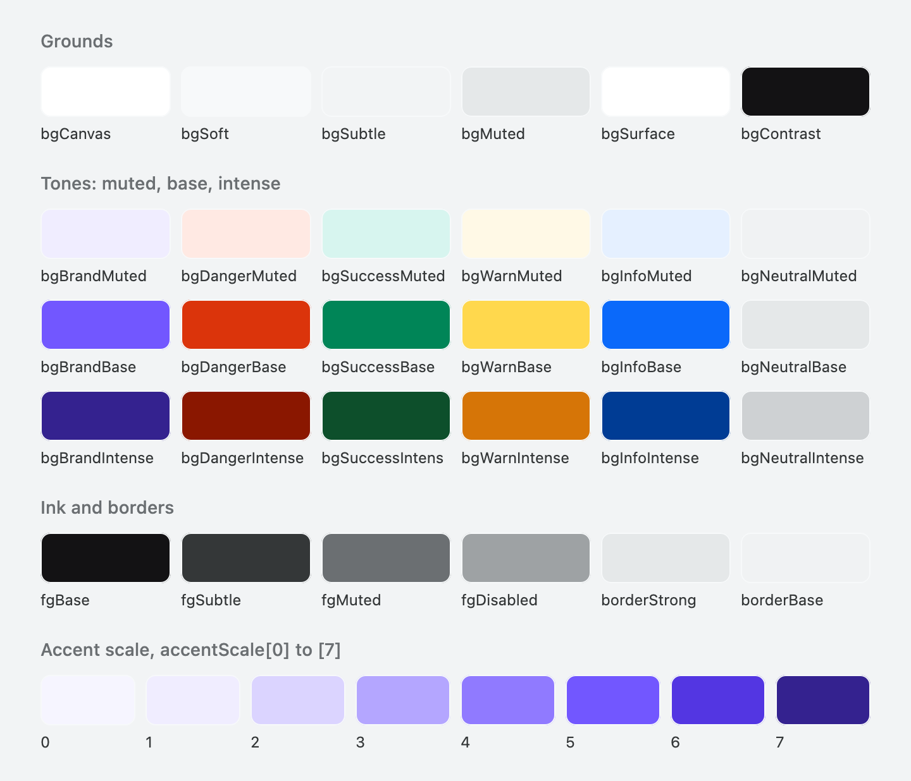
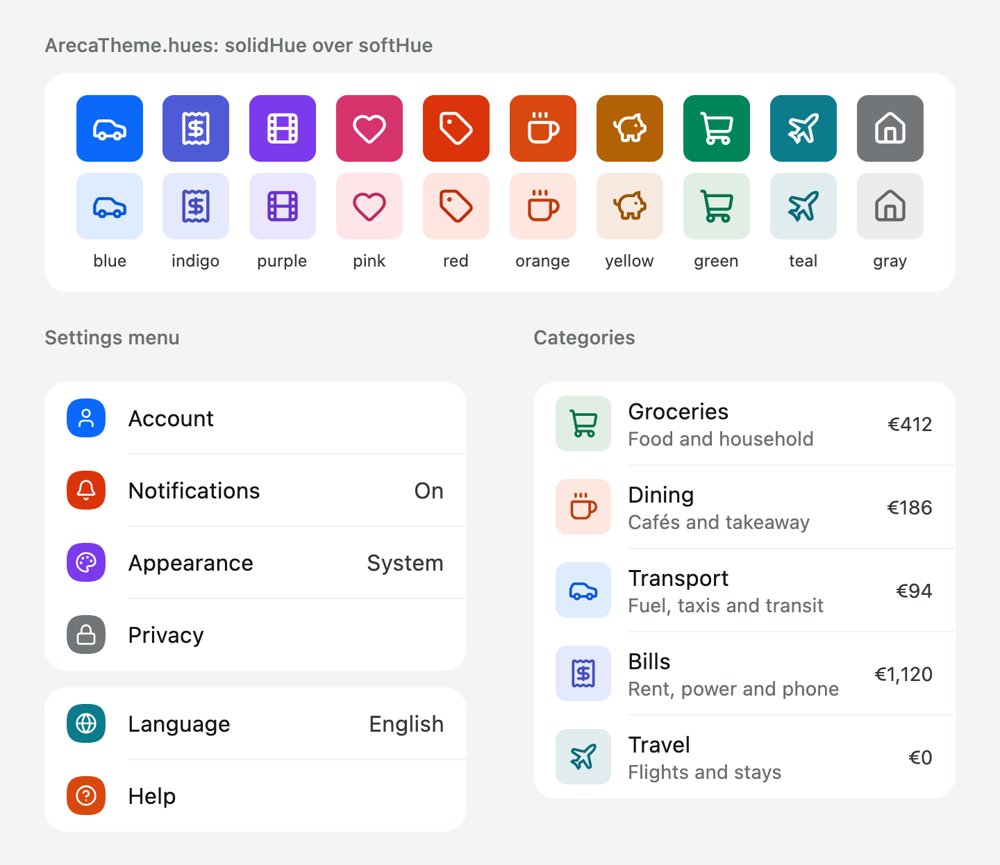
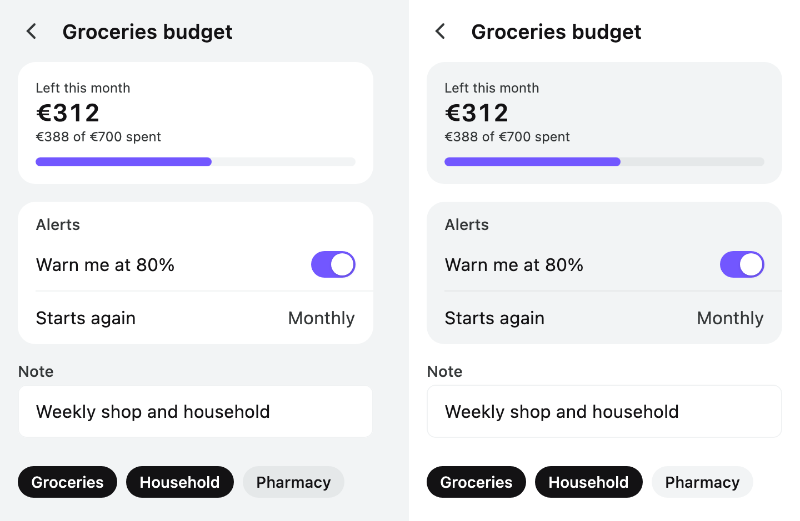

# Theme

The theme is a set of tokens — colours, type, spacing, corners, elevation and motion — that every
Areca component reads. `ArecaThemeProvider` puts them in scope, `ArecaTheme` reads them back, and
changing one token changes every component that uses it.

Everything on this page is in `dev.voir.areca.theme`, in `dev.voir.areca:foundation`.

<picture>
  <source media="(prefers-color-scheme: dark)" srcset="images/theme-colors-dark.png">
  
</picture>

## The provider

Wrap the application once, near its root:

```kotlin
@Composable
fun App() {
    ArecaThemeProvider(darkTheme = isSystemInDarkTheme()) {
        Home()
    }
}
```

`darkTheme` picks the direction; pass `isSystemInDarkTheme()` or the user's own setting.
`surfaceLayout` picks the grounds: `SurfaceLayout.Grouped`, the default, is a grey page with white
cards; `SurfaceLayout.Plain` is a white page with grey cards — see [Surfaces](#surfaces).

The provider paints nothing. Each screen's `BaseLayout` paints its page in the layout's page ground,
so the root needs no background of its own. The provider also seeds every component's default style
and size — see [Customising](customising.md#defaults-for-a-subtree) — and provides the
application's own defaults passed as `componentDefaults` (see
[App-wide component defaults](#app-wide-component-defaults)).

Without a provider, every token falls back to the light theme's default, so previews and tests
compose without wrapping.

## Reading tokens

`ArecaTheme` is the only way to read a token. Every accessor is `@Composable` and returns the value
the nearest provider put in scope:

| Accessor | Type | Holds |
| --- | --- | --- |
| `ArecaTheme.colors` | `ArecaColors` | Semantic colours — the ones to use |
| `ArecaTheme.surface` | `ArecaSurface` | The roles of the surface the content in scope is drawn on: `ground`, `raised`, `well`, `onWell`, `separator`, `field` — see [Surfaces](#surfaces) |
| `ArecaTheme.surfaceLevel` | `SurfaceLevel` | Where the content in scope sits: `Page`, `Card` or `Inset` |
| `ArecaTheme.surfaces` | `ArecaSurfaces` | Every surface of the theme: `layout`, the `screen` and `sheet` ladders, and `bar` |
| `ArecaTheme.hues` | `ArecaHues` | Categorical colours, one per kind of thing — see [Hues](#hues) |
| `ArecaTheme.typography` | `ArecaTypography` | Named text styles |
| `ArecaTheme.spacing` | `ArecaSpacing` | The spacing scale and the screen gutters |
| `ArecaTheme.sizing` | `ArecaSizing` | Control heights and the touch target, for touch or a pointer |
| `ArecaTheme.shapes` | `ArecaShapes` | Corner shapes |
| `ArecaTheme.radius` | `ArecaRadius` | Corner lengths, as raw `Dp`; prefer `shapes` |
| `ArecaTheme.elevation` | `ArecaElevation` | Shadow depths |
| `ArecaTheme.motion` | `ArecaMotion` | Durations and easings |
| `ArecaTheme.isDark` | `Boolean` | The direction, for a decision no token can carry |
| `ArecaTheme.darkColors` | `ArecaColors` | The dark counterpart of the colours in scope — see [Regions that are always dark](#regions-that-are-always-dark) |
| `ArecaTheme.baseColors` | `ArecaBaseColors` | The raw palette, for when no semantic colour says what you mean |
| `ArecaTheme.baseTypography` | `ArecaBaseTypography` | The raw type scale |
| `ArecaTheme.fonts` | `ArecaFonts` | The font families |
| `ArecaTheme.hostWindow` | `WindowClass` | The whole window's class, ignoring panes: for choosing how an overlay opens |
| `ArecaTheme.window` | `WindowClass` | Not a token: the width and height classes and input mode of the window or pane in scope — see [Window classes](../ui/foundation/README.md#window-classes) |

```kotlin
Column(
    modifier = Modifier
        .background(ArecaTheme.surface.raised, ArecaTheme.shapes.surface)
        .padding(ArecaTheme.spacing.xl),
    verticalArrangement = Arrangement.spacedBy(ArecaTheme.spacing.md),
) {
    RaisedSurface {
        Text("Storage", variant = TextVariant.HeadingSmall)
        Text("12 GB of 50 GB used", variant = TextVariant.BodySmall, color = TextColor.Subtle)
    }
}
```

Read semantic tokens in screen code — `ArecaTheme.colors.fgDangerText`, not
`ArecaTheme.baseColors.red70` and never `Color(0xFF…)` — so the screen follows a re-themed or dark
application.

## Colours

`ArecaTheme.colors` is an `ArecaColors`: one meaning per token, mapped from the palette for the
current direction.

### Grounds

The ground tokens are fixed steps of the palette: `bgCanvas`, `bgSoft`, `bgSubtle`, `bgMuted`,
`bgSurface`. Components do not read them for a page, a card or a well; they read the roles of the
surface they are drawn on (see [Surfaces](#surfaces)), which change with the layout and with what
the component sits on. Read `ArecaTheme.surface` for anything drawn on a surface, and a ground token
only for a fill that must stay one colour wherever it is.

| Token | Light · dark | What it is |
| --- | --- | --- |
| `bgCanvas` | white · `neutral100` | The lightest ground in light, the darkest in dark |
| `bgSoft` | `neutral10` · between `neutral100` and `neutral90` | A step off `bgCanvas` |
| `bgSubtle` | `neutral15` · `neutral90` | The grey of a grouped page or a plain card |
| `bgMuted` | `neutral30` · `neutral80` | A step further back |
| `bgSurface` | white · `neutral90` | A raised container in a fixed colour |
| `bgContrast` | | The inverted surface — dark in light, light in dark. Pair with `fgOnContrast` |
| `bgContrastMuted` | | A weaker inverted surface, for content layered on `bgContrast` |
| `bgOverlayDark` | | A scrim darkening what is behind a modal surface |
| `bgOverlayLight` | | A scrim lightening what is behind it, over dark imagery |
| `bgDisabled` | | The fill of a control the user cannot act on |

### Tone families

Six families — `Brand`, `Danger`, `Success`, `Warn`, `Info`, `Neutral` — each with three fills:

| Token | Use it for |
| --- | --- |
| `bg{Family}Muted` | A tinted ground: a chip, a banner, a selected row, an inline error region |
| `bg{Family}Base` | A solid fill, as on a primary or destructive button. Pair with `fgOnFill` — except `bgWarnBase`, which is light in both themes: pair it with `fgOnWarn` |
| `bg{Family}Intense` | The fill under press or hover |

So `bgBrandMuted`, `bgBrandBase`, `bgBrandIntense`, `bgDangerMuted`, … `bgNeutralIntense`.

In the dark theme each `bg{Family}Muted` — and `accentMuted` — is `neutral90` with 14% of the
family's colour mixed in, so a muted fill hints at its tone on a dark card. `bgNeutralBase` is
`neutral80` in the dark theme.

### Foregrounds

| Token | Use it for |
| --- | --- |
| `fgBase` | Primary text and icons |
| `fgSubtle` | Secondary text: supporting lines, inactive labels |
| `fgMuted` | Tertiary text: placeholders, timestamps, decorative icons, a section's footer. Never the only carrier of meaning. In light it is a fifth of the way from `neutral60` to `neutral70`, which keeps 4.5:1 on the grey page of a grouped layout |
| `fgDisabled` | Text and icons of a control the user cannot act on |
| `fgOnContrast` | Content on `bgContrast` |
| `fgOnFill` | Content on any solid tone fill except `bgWarnBase`. White in both themes |
| `fgOnWarn` | Content on `bgWarnBase` |
| `fgBrand`, `fgDanger`, `fgSuccess`, `fgInfo`, `fgWarn` | Icons, graphics and rules in a tone colour |
| `fgBrandText`, `fgDangerText`, `fgSuccessText`, `fgInfoText`, `fgWarnText` | Text in a tone colour, as in a field's error message |
| `fgNeutral` | Neutral status text and icons; the one family with a single foreground |

Each tone has two foregrounds because a small icon and body text need different steps: set type in
the `…Text` token, graphics in the plain one.

### Borders

| Token | Use it for |
| --- | --- |
| `borderBase` | A card or an input at rest |
| `borderStrong` | A border that must separate more clearly, such as a hovered control |
| `borderIntense` | A focused or pressed control |
| `borderSubtle` | A barely visible divider between rows of one group |
| `borderOnSubtle` | A hairline drawn on `bgSubtle`. Components draw hairlines in the surface's `separator` instead |
| `borderDisabled` | A control the user cannot act on |
| `borderDanger`, `borderSuccess`, `borderInfo`, `borderWarn` | A control in that state |

### Accent

| Token | Use it for |
| --- | --- |
| `accentBase` | Selection and focus: a checked control, a focus ring, an active tab |
| `accentStrong` | The accent under press or hover |
| `accentIntense` | The strongest accent, for a held or dragged state |
| `accentSubtle` | A selection indicator that should not compete with content |
| `accentMuted` | A tint behind selected content |
| `accentScale` | Eight shades for data — a heat-map day, a density cell. Index `0` is nearest the canvas in both themes, so a shade picked by index reads as "more" the same way in light and dark |

### Text colour shortcuts

`Text(text, variant = …, color = …)` takes a `TextColor` instead of a raw colour:

| `TextColor` | Token |
| --- | --- |
| `Base`, `Subtle`, `Muted`, `Disabled` | `fgBase`, `fgSubtle`, `fgMuted`, `fgDisabled` |
| `OnContrast`, `OnFill` | `fgOnContrast`, `fgOnFill` |
| `Brand`, `Danger`, `Success`, `Info`, `Warning` | `fgBrandText`, `fgDangerText`, `fgSuccessText`, `fgInfoText`, `fgWarnText` |

### The palette

`ArecaTheme.baseColors` is an `ArecaBaseColors`: `baseWhite`, `baseBlack`, and six ramps — `brand`,
`neutral`, `green`, `blue`, `yellow`, `red` — each from step `10`, the lightest, to `100`, the
darkest (`brand10` … `brand100`), plus `neutral15`. `ArecaColors.light(baseColors)` and
`ArecaColors.dark(baseColors)` map the same palette to each direction, which is why replacing the
palette re-themes both.

### Hues

<picture>
  <source media="(prefers-color-scheme: dark)" srcset="images/theme-hues-dark.png">
  
</picture>

`ArecaTheme.hues` is an `ArecaHues`: ten categorical colours for the tiles that tell unrelated rows
apart — a settings menu, categories of spending, a set of tags. A hue means only "this is a
different kind of thing". Meaning — brand, danger, success, warning, information — stays with the
`ActionColor` families and the tone tokens.

| Hue | Default |
| --- | --- |
| `blue` | `0xFF0A69FA` |
| `indigo` | `0xFF4F5BD5` |
| `purple` | `0xFF7C3AED` |
| `pink` | `0xFFD6336C` |
| `red` | `0xFFDB340B` |
| `orange` | `0xFFD9480F` |
| `yellow` | `0xFFB26205` |
| `green` | `0xFF008557` |
| `teal` | `0xFF0C7C8C` |
| `gray` | `0xFF727679` |

`all` lists every hue in that order, for giving each item of a set a hue by its index. Each hue is
one colour in both themes and carries a white glyph at 3:1 or more.

| Draw it with | Gives |
| --- | --- |
| `FeaturedIconStyle.solidHue(hue)` | The hue filled, the glyph `fgOnFill` (white) |
| `FeaturedIconStyle.softHue(hue)` | The hue mixed lightly into the surface, the glyph a deeper step of it (a lighter one in dark) |
| `SettingsRowIcon(imageVector, hue = …, soft = false)` | A settings row's leading tile in either form |

```kotlin
val hues = ArecaTheme.hues
SettingsRow(
    title = { Text("Appearance") },
    leading = { SettingsRowIcon(ArecaIcons.Palette, hue = hues.purple) },
    onClick = onAppearance,
)

FeaturedIcon(ArecaIcons.Tag, contentDescription = null, style = FeaturedIconStyle.softHue(hues.teal))
```

Pick one hue per concept and keep it wherever that concept appears. Replace the set with
`ArecaThemeProvider(hues = ArecaHues(…))`; `ArecaDarkTheme` keeps it. Do not recolour the `Info`
ramp or keep an app palette of tile colours for this.

## Surfaces

Every fill in Areca sits on a surface: a screen's page, a card on it, a tile inside the card, a
sheet. A surface hands out its colours by role, and components read the role of the surface they
are drawn on, so one card, field or chip is right on a grey page, inside a white card and in a
sheet without being told where it is.

### Layouts

<picture>
  <source media="(prefers-color-scheme: dark)" srcset="images/surfaces-dark.png">
  
</picture>

The same screen in `Grouped`, on the left, and in `Plain`, on the right.

`ArecaThemeProvider(surfaceLayout = …)` picks which of a screen's page and its cards is grey.

| `SurfaceLayout` | Page | Cards on it | Tiles inside a card |
| --- | --- | --- | --- |
| `Grouped` (default) | `neutral15`, grey | white | `neutral10`, a little off white |
| `Plain` | white | `neutral15`, grey | white |

In the dark theme both layouts share one ladder, on which a surface nearer the eye is lighter: the
page is `neutral100`, a card `neutral90`, a tile inside it a step lighter again.

A sheet, a dialog and a menu start their own ladder: white in light whatever the layout, a step
above the page in dark. A sheet is already a segment of its own, so its content lies straight on it
— rows with hairlines, fields, headers — with no cards by default: a `Section` on a sheet's ground
draws flat (no fill, rows edge to edge, hairlines from the text), and a `Card` there is for emphasis
only (a total, a plan to choose). The
bars docked to a screen's edges (`TabBar`, `BottomActionBar`, `NavRail`, the column of
`AdaptiveNavigation`) take `ArecaTheme.surfaces.bar`: white in light, `neutral90` in dark.

### Roles

`ArecaTheme.surface` is an `ArecaSurface`, the surface the content in scope is drawn on:

| Role | What it is | Read by |
| --- | --- | --- |
| `ground` | The surface's own fill | `BaseLayout`'s page, `TopBar`, `Table` rows, `WheelPicker`, a skeleton's highlight, a chart's marker ring |
| `raised` | A card laid on this surface | `Card` (default style), a settings `Section`, a subtle `Notice`, a `ContentList` inset group, an `ExpandableListItem` with the `Soft` container |
| `well` | Something set into this surface | Filled, soft and solid-neutral fields, soft `Neutral` buttons, icon buttons and featured icons, `CardStyle.softNeutral()`, a neutral card footer, a section's band, the tracks of `SlidingSelector`, `Tabs` and `ProgressBar`, `Skeleton`, `WheelPicker`'s highlight, an empty `Avatar`, `PageCounter`, `BadgeStyle.FilledChip`, picture placeholders |
| `onWell` | Something raised inside a well | The thumb of `SlidingSelector` and `Tabs` |
| `separator` | A hairline on this surface | The hairlines of a settings section, a `List`, a `ListItemColumn` and an inset group |
| `field` | An outlined field or a stepper | `FieldStyle.outlined()`, a filled field while focused, `NumberStepper`, a soft `Badge`. White wherever it is in light |

`surface[role]` reads a role named by a `SurfaceRole` (`Ground`, `Raised`, `Well`, `OnWell`,
`Separator`, `Field`).

### Levels and nesting

A ladder has three levels, `SurfaceLevel.Page`, `Card` and `Inset`; a surface laid on an inset is
a card again. `SurfaceRoot.Screen` and `SurfaceRoot.Sheet` name the two ladders.

| Component | Puts its content on |
| --- | --- |
| `BaseLayout` | The page of the ladder in scope |
| `FlowModal`, `Dialog`, `DropdownPopup` | The sheet ladder's page. A sheet given a fill that is a deeper ground of that ladder — the grey of a sheet's card — is laid out as that level, so the cards inside it turn white |
| `Card`, `Section`, `Notice`, a `ContentList` inset group | The level whose ground is their fill, normally one step up. A transparent fill — `CardStyle.Outlined`, `CardStyle.GhostNeutral` — keeps the surface it sits on |

So a field in a card on a grouped page takes the card's `well`, and the same field in a sheet takes
the sheet card's `well`, with nothing passed.

### Your own fill

Fill a container of your own with a role, and put what is inside it on the matching surface:

| Composable | Does |
| --- | --- |
| `RaisedSurface { … }` | Puts its content one level up: on the surface a card laid on the current one takes. Use it around content drawn on `ArecaTheme.surface.raised` |
| `ProvideSurface(level, root) { … }` | Puts its content at a chosen level of the current ladder, or of `root`'s — a white panel across a grey page is `SurfaceLevel.Card` |

```kotlin
// A tile of the app's own inside a card: the card's raised fill, and the card's next level inside it
Box(
    Modifier
        .background(ArecaTheme.surface.raised, ArecaTheme.shapes.md)
        .padding(ArecaTheme.spacing.lg),
) {
    RaisedSurface { BudgetTileContent() }
}

// A white side panel beside grey content
ProvideSurface(SurfaceLevel.Card) {
    Column(Modifier.background(ArecaTheme.surface.ground)) { Filters() }
}
```

### Replacing the surfaces

`ArecaSurfaces.from(baseColors, layout, darkTheme)` builds the surfaces from the palette's neutral
ramp, so a re-themed palette re-themes them. To set every ground by hand, pass a whole value:
`ArecaThemeProvider(surfaces = ArecaSurfaces(layout, screen, sheet, bar))`, where `screen` and
`sheet` are `SurfaceLadder(page, card, inset)` of `ArecaSurface(ground, raised, well, onWell,
separator, field)`. A value built for one direction is used for that direction only; build one per
`darkTheme`, as with `colors`.

## Typography

`ArecaTheme.typography` is an `ArecaTypography`: styles named by role, built on the raw scale.

| Style | `TextVariant` | Size / line height | Weight | Use it for |
| --- | --- | --- | --- | --- |
| `display` | `Display` | 50 / 60 sp | Bold | Display text, at most once a screen |
| `headingExtraLarge` | `HeadingExtraLarge` | 40 / 48 sp | Bold | A screen whose title is its main content |
| `headingLarge` | `HeadingLarge` | 32 / 40 sp | Bold | A page title |
| `headingMedium` | `HeadingMedium` | 26 / 32 sp | SemiBold | A screen heading |
| `headingSmall` | `HeadingSmall` | 22 / 28 sp | SemiBold | A section heading |
| `headingExtraSmall` | `HeadingExtraSmall` | 18 / 26 sp | SemiBold | A subsection inside a card or a group |
| `bodyExtraLarge` | `BodyExtraLarge` | 22 / 28 sp | Medium | Emphasised body copy, such as a summary line |
| `bodyLarge` | `BodyLarge` | 18 / 26 sp | Normal | A lead paragraph |
| `bodyMedium` | `BodyMedium` | 16 / 24 sp | Normal | Default body copy |
| `bodySmall` | `BodySmall` | 14 / 20 sp | Normal | Compact body copy |
| `bodyExtraSmall` | `BodyExtraSmall` | 12 / 16 sp | Normal | Supporting copy |
| `caption` | `Caption` | 14 / 20 sp | Medium, letter-spaced | Short text under a field or an image |
| `labelLarge` | `LabelLarge` | 16 / 24 sp | Medium | A large control's label, a list row's primary line |
| `labelMedium` | `LabelMedium` | 14 / 20 sp | Medium | The default control label |
| `labelSmall` | `LabelSmall` | 12 / 16 sp | Medium | A dense control: a badge, a chip |
| `overline` | `Overline` | 12 / 16 sp | Medium, tracked 0.06 em | A small label above what it names: a group above its rows, an eyebrow above a title |

`Text("…", variant = TextVariant.HeadingSmall)` is the usual way to set one; `TextVariant.X.style`
returns the `TextStyle`.

The raw scale, `ArecaTheme.baseTypography` (`ArecaBaseTypography`), is size and line height only,
with line heights on a 4-point grid: `xxs` 10/12, `xs` 12/16, `sm` 14/20, `md` 16/24, `lg` 18/26,
`xl` 22/28, `xl2` 26/32, `xl3` 32/40, `xl4` 40/48, `xl5` 50/60, `xl6` 64/72, `xl7` 72/80 sp. Every
step leaves its text direction unset: Areca's `Text` lays a paragraph out in the interface's direction (`LocalLayoutDirection`) unless its style sets one, so an amount written `1 234,50 د.إ` keeps its order in an English interface. A symbol in another script *before* the figures (`د.إ 1 234,50`) is reordered by the bidi algorithm whatever the paragraph's direction — draw amounts with `AmountText`, which isolates each part.

`ArecaTypography.overline` has a default, `labelSmall` tracked out, so a typography built by hand
without it still has one.

`ArecaTheme.fonts` (`ArecaFonts`) holds two families, both `FontFamily.Default` unless you supply
them: `primary`, which every style uses, and `secondary`, which nothing uses by default — for opting
single styles into a second voice.

## Spacing

`ArecaTheme.spacing` is an `ArecaSpacing`, one ordered ramp plus the screen gutters:

| Token | Dp | Use it for |
| --- | --- | --- |
| `none` | 0 | No space, where a value must be passed |
| `xs2` | 2 | A hairline separation, such as a badge's internal gap |
| `xs` | 4 | The tightest gap between two elements |
| `sm` | 6 | A gap inside a dense control, such as an icon and its label |
| `md` | 8 | The default gap between related elements |
| `lg` | 12 | Padding inside a small container |
| `xl` | 16 | Padding inside a standard container |
| `xl2` | 20 | Padding inside a roomy container |
| `xl3` | 24 | The gap between grouped blocks within a section |
| `xl4` | 32 | The gap between sections |
| `xl5` | 40 | The gap before a major break |
| `xl6` | 48 | Space above a page heading |
| `xl7` | 64 | Rhythm for sparse, full-height layouts |
| `xl8` | 80 | Empty states and onboarding |
| `xl9` | 96 | Hero and splash layouts |
| `horizontalContentInsets` | 16 | The gutter between screen content and the window's sides, on a compact window |
| `mediumHorizontalContentInsets` | 24 | The side gutter on a medium window (600dp to 839dp) |
| `expandedHorizontalContentInsets` | 32 | The side gutter from an expanded window (840dp) up |
| `verticalContentInsets` | 24 | The gutter at the top and bottom of a screen |

Apply the gutters with the modifiers rather than reading them: `Modifier.horizontalContentInsets()`,
`Modifier.verticalContentInsets()` and `Modifier.contentInsets()` for both. The modifiers pick the
side gutter for the window class in scope, so a screen gets wider margins on a tablet without asking.

## Sizing

`ArecaTheme.sizing` is an `ArecaSizing`: how tall controls are, for the way they are pressed. The
provider picks `ArecaSizing.touch()` under touch and `ArecaSizing.pointer()` under a pointer — the
input mode it reports through `ArecaTheme.window` — and every component size preset reads its height
from it.

| Token | Touch | Pointer | Use it for |
| --- | --- | --- | --- |
| `controlXs` | 32 | 28 | Controls inside a dense row or a table cell |
| `controlSm` | 40 | 32 | Controls beside a field, in a toolbar |
| `controlMd` | 48 | 36 | The default control |
| `controlLg` | 56 | 44 | A screen's primary action |
| `controlXl` | 64 | 52 | A landing screen's single call to action |
| `rowCompact` | 32 | 28 | A dense list row |
| `rowMedium` | 44 | 36 | A one-line list row |
| `rowComfortable` | 56 | 44 | A list row with a supporting line |
| `touchTarget` | 48 | 0 | The space an interactive control reserves around itself |

`dense` is `true` for the pointer set, and `sizing.select(touch = …, pointer = …)` picks a value by
it. Under a pointer the typography is a step denser too: `bodyMedium` and `labelLarge` are 14sp
rather than 16sp. Force a density with `ArecaThemeProvider(sizing = ArecaSizing.pointer())`, or
retune a step with `copy`.

## Corners

`ArecaTheme.shapes` (`ArecaShapes`) holds the shapes components use; `ArecaTheme.radius`
(`ArecaRadius`) the lengths they are built from.

| Shape | Radius | Use it for |
| --- | --- | --- |
| `none` | 0 dp | Square corners |
| `xs` | 2 dp | Hairline elements, such as a progress track |
| `sm` | 4 dp | Small controls: badges, chips, swatches |
| `md` | 8 dp | Interactive surfaces: inputs, list rows |
| `lg` | 16 dp | Containers: popovers, dropdowns |
| `xl` | 24 dp | Sheets and modals |
| `xl2` | 32 dp | Full-bleed surfaces that still show a corner |
| `full` | — | Fully rounded ends: a circle on a square, a pill on a wide element |
| `tile` | — | A squircle that holds a glyph: a settings tile, a category mark |
| `button` | `md` | Every labelled action. Replace it to draw all buttons in one shape |
| `surface` | `lg` | Every surface that groups content: each `CardStyle` preset, a settings section, a `Notice`, a `ContentList` inset group, an `ExpandableListItem`'s soft container. Replace it to change every card corner at once; a surface nested in another steps down by hand |

## Elevation

`ArecaTheme.elevation` (`ArecaElevation`) is a stacking order: a surface sits one step above what
is behind it.

| Token | Dp | Use it for |
| --- | --- | --- |
| `none` | 0 | Flush with the surface behind |
| `xs` | 1 | A resting lift, such as a sticky bar |
| `sm` | 2 | A surface lifted by interaction: a dragged row, a toggle thumb |
| `md` | 4 | Anchored transient surfaces: dropdowns, popovers |
| `lg` | 8 | Floating surfaces that own focus: a toast, a floating tab bar |
| `xl` | 16 | Modal surfaces over a scrim |

## Motion

`ArecaTheme.motion` (`ArecaMotion`) groups durations by how much of the screen moves:

| Duration | Ms | Use it for |
| --- | --- | --- |
| `instant` | 100 | A change under the finger: a press tint, a focus ring, a checkbox mark |
| `fast` | 150 | A small element changing in place: a chevron turning, a colour swapping |
| `medium` | 200 | The default: a container resizing, a popover appearing, a crossfade |
| `slow` | 300 | A surface travelling far: a sheet, a drawer, a full-screen transition |
| `deliberate` | 450 | A one-off moment the user is meant to watch, such as a success confirmation |

| Easing | Use it for |
| --- | --- |
| `standard` | The default, for changes in place |
| `enter` | Content arriving on screen |
| `exit` | Content leaving the screen |
| `pressIn` | Something expanding from the point the user touched |
| `fade` | Anything fading or crossfading |

`Duration.tween(easing)` turns a duration into a `TweenSpec`, so no screen spells a millisecond
count:

```kotlin
val background by animateColorAsState(
    if (selected) ArecaTheme.colors.accentMuted else ArecaTheme.surface.ground,
    animationSpec = ArecaTheme.motion.medium.tween(ArecaTheme.motion.standard),
)
```

A mark that travels between places — a `SlidingSelector`'s thumb, a tab indicator — moves on a
spring rather than a tween, so a new choice mid-move turns it round without a jump in speed.
`ArecaTheme.motion.slide()` is that spring: critically damped, so it never overshoots, at
`springStiffness` (`Spring.StiffnessMediumLow` by default; higher arrives sooner).

`reduceMotion` (`false` by default) is the user's request for less motion: those marks fade out and
back in at their new place instead of travelling. Areca does not read the platform setting; pass it
in where the platform offers one:

```kotlin
ArecaThemeProvider(motion = ArecaMotion(reduceMotion = platformReducesMotion)) { App() }
```

## Changing the theme

Each parameter of `ArecaThemeProvider` defaults to a value derived from the one above it, so
override at the highest level that says what you mean and the rest follows:

| Parameter | What it is | Derived from |
| --- | --- | --- |
| `baseColors` | The raw palette, `ArecaBaseColors` | — |
| `colors` | Semantic colours, `ArecaColors` | `baseColors`, for `darkTheme` |
| `surfaceLayout` | `SurfaceLayout.Grouped` (default) or `Plain` | — |
| `surfaces` | Grounds of screens, sheets and bars by role, `ArecaSurfaces` | `baseColors`, `surfaceLayout` and `darkTheme` |
| `hues` | Categorical tile colours, `ArecaHues` | — |
| `radius` | Corner lengths, `ArecaRadius` | — |
| `shapes` | Corner shapes, `ArecaShapes` | `radius` |
| `spacing` | The spacing scale and gutters, `ArecaSpacing` | — |
| `elevation` | The shadow scale, `ArecaElevation` | — |
| `motion` | Durations and easings, `ArecaMotion` | — |
| `fonts` | Font families, `ArecaFonts` | — |
| `baseTypography` | The raw type scale, `ArecaBaseTypography` | `fonts` |
| `typography` | Named text styles, `ArecaTypography` | `baseTypography` |
| `componentDefaults` | The application's own component defaults, `ComponentDefaults` | — |

Every token type is a data class, so `copy` changes one value:

```kotlin
val BrandPalette = ArecaBaseColors(
    brand60 = Color(0xFF0B7A75),
    brand70 = Color(0xFF075E5A),
)

@Composable
fun App(brandSans: FontFamily) {
    ArecaThemeProvider(
        darkTheme = isSystemInDarkTheme(),
        baseColors = BrandPalette,
        radius = ArecaRadius(md = 12.dp, lg = 20.dp),
        spacing = ArecaSpacing(horizontalContentInsets = 20.dp),
        fonts = ArecaFonts(primary = brandSans),
    ) {
        Home()
    }
}
```

- **Colours.** Supplying `baseColors` re-themes both directions; it is the usual way in. Supplying
  `colors` replaces the mapping for the current direction only, so build it for that direction:
  `(if (dark) ArecaColors.dark(palette) else ArecaColors.light(palette)).copy(accentBase = …)`.
- **Shapes.** `radius` rebuilds every shape. To change one shape, pass `shapes`:
  `ArecaShapes.from(radius).copy(button = …)` draws every button in that shape, and
  `.copy(surface = …)` every card, section and notice.
- **Grounds.** `surfaceLayout = SurfaceLayout.Plain` keeps a white page with grey cards.
- **Type.** `fonts` reaches every style. To change one style, pass
  `typography = ArecaTypography.from(ArecaBaseTypography.from(fonts)).copy(display = …)`.

To restyle one component rather than the theme, see [Customising](customising.md).

## App-wide component defaults

`componentDefaults` holds the application's own component defaults — its button size, its card
style, its settings styles. `ComponentDefaults` is a `fun interface` whose `provide()` returns the
values to provide; it runs inside the theme, so the styles it builds read the theme's tokens.

```kotlin
ArecaThemeProvider(
    darkTheme = isSystemInDarkTheme(),
    componentDefaults = ComponentDefaults {
        arrayOf(
            LocalButtonSize provides ButtonSize.Large,
            LocalTopBarStyle provides TopBarStyle.Tonal,
            LocalSettingsStyles provides SettingsDefaults.styles(),
        )
    },
) {
    AppNavigation()
}
```

`ArecaDarkTheme` runs the same `componentDefaults` again inside its dark region, so an always-dark
viewer keeps the application's buttons and cards. Locals provided in a `CompositionLocalProvider`
around the content instead do not reach inside an `ArecaDarkTheme`. `ComponentDefaults.None`, the
default, provides nothing.

## Regions that are always dark

A photo editor, a media viewer or a camera is dark whatever the theme around it. Wrap it in
`ArecaDarkTheme`, which keeps everything the application set — palette, surface layout, hues, shapes,
spacing, motion, type and `componentDefaults` — and changes only the direction; the surfaces become
the dark ladder:

```kotlin
@Composable
fun PhotoViewer(photo: Painter) {
    ArecaDarkTheme {
        SystemBars(color = ArecaTheme.colors.bgCanvas)
        Box(Modifier.fillMaxSize().background(ArecaTheme.colors.bgCanvas)) {
            Image(photo, contentDescription = null, modifier = Modifier.fillMaxSize())
        }
    }
}
```

| Declaration | Package | Does |
| --- | --- | --- |
| `ArecaDarkTheme { … }` | `dev.voir.areca.theme` | Puts its content in the dark theme, keeping the application's tokens. Inside an already dark theme it changes nothing |
| `ArecaTheme.darkColors` | `dev.voir.areca.theme` | The dark counterpart of the colours in scope, for naming a dark colour before the dark scope begins — a style parameter's default, which is resolved at the call site |
| `SystemBars(color, lightIcons)` | `dev.voir.areca.platform` | Paints the window's status and navigation bars while composed and restores them when it leaves. Acts on Android; does nothing on iOS and the desktop |
| `edgeToEdgeDialogProperties()` | `dev.voir.areca.foundation.overlay` | A dialog window that draws behind the system bars, to pair with `SystemBars` in a dialog |

Do not nest `ArecaThemeProvider(darkTheme = true)` for a dark region: it starts again from the
library defaults and loses the application's palette.
