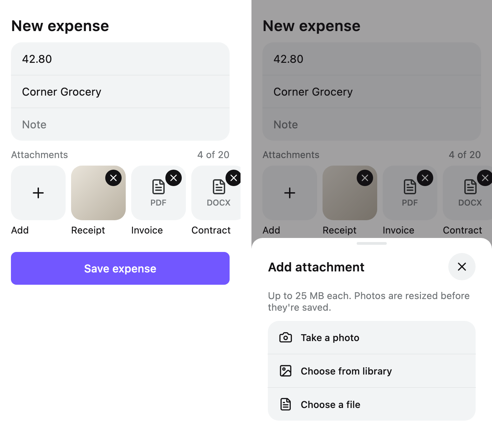

# `flow-attachments`

Parts for screens that attach files to something: a strip of files on a form or a record, rows,
the sheets that add and act on a file, and a full-screen viewer. They draw and report what was
pressed; picking, copying, uploading, downloading and sharing are the application's.

<picture>
  <source media="(prefers-color-scheme: dark)" srcset="../../docs/images/flow-attachments-dark.png">
  
</picture>

There is no `AttachmentsScreen`. Copy a [recipe](#recipes) and edit it.

## Install

```kotlin
implementation("dev.voir.areca:flow-attachments:<version>")
```

It brings `dev.voir.areca:foundation`, so the recipes' `ConfirmSheet`, `Settings` rows and `Button`
need nothing more. The `ArecaIcons` glyphs in them (`Trash`, `Paperclip`, `Plus`) need
`dev.voir.areca:icons`. Repository and credentials:
[Getting started](../../docs/getting-started.md).

## Quick start

A record's files as a strip that adds and removes, opening into the viewer:

```kotlin
import androidx.compose.runtime.Composable
import androidx.compose.runtime.getValue
import androidx.compose.runtime.mutableStateOf
import androidx.compose.runtime.remember
import androidx.compose.runtime.setValue
import dev.voir.areca.flow.attachments.AttachmentItem
import dev.voir.areca.flow.attachments.part.AttachmentStrip
import dev.voir.areca.flow.attachments.viewer.AttachmentViewer

@Composable
fun Attachments(
    files: List<AttachmentItem>,
    onAdd: () -> Unit,
    onRemove: (AttachmentItem) -> Unit,
) {
    var viewing by remember { mutableStateOf<Any?>(null) }

    AttachmentStrip(
        items = files,
        onOpen = { item -> viewing = item.key },
        onAdd = onAdd,
        onRemove = onRemove,
        title = "Attachments",
        addCaption = "Add",
    )

    if (viewing != null) {
        AttachmentViewer(items = files, initialKey = viewing, onDismiss = { viewing = null })
    }
}
```

Pictures need an image loader provided once; see [Pictures](#pictures).

## Parts

| Part | Use it for | Package |
| --- | --- | --- |
| `AttachmentThumbnail` | The square a file is recognised by: its picture, or its glyph and extension, and a mark for where its bytes are | `dev.voir.areca.flow.attachments.part` |
| `AttachmentTile` | One file in a strip: its square, a caption, an optional second line and remove mark | `dev.voir.areca.flow.attachments.part` |
| `AttachmentAddTile` | The square that adds a file, shaped like the files beside it | `dev.voir.areca.flow.attachments.part` |
| `AttachmentStrip` | A record's files as a sideways-scrolling row of squares, from none to many | `dev.voir.areca.flow.attachments.part` |
| `AttachmentIndicator` | A paperclip, and optionally a count, on something that has files | `dev.voir.areca.flow.attachments.part` |
| `AttachmentRow` | One file as a foundation `SettingsRow`, for lists read by name | `dev.voir.areca.flow.attachments.row` |
| `AttachmentSourceSheet` | Where a new file comes from: camera, library, files, or your own choices | `dev.voir.areca.flow.attachments.sheet` |
| `PendingAttachmentSheet` | Asked once a file is picked: the file, a question, and why it cannot be attached when it cannot | `dev.voir.areca.flow.attachments.sheet` |
| `AttachmentTagChips` | What a file is, chosen in one tap from the product's tags | `dev.voir.areca.flow.attachments.sheet` |
| `AttachmentOptionsSheet` | What can be done to one file: rename, share, save, open elsewhere, remove, retag | `dev.voir.areca.flow.attachments.sheet` |
| `AttachmentRenameSheet` | A new name, editing only the part before the extension | `dev.voir.areca.flow.attachments.sheet` |
| `AttachmentViewer` | A record's files one at a time, full screen and always dark: a pager, a heading, a filmstrip, a notice line | `dev.voir.areca.flow.attachments.viewer` |
| `AttachmentViewerPage` | One file in the viewer: a zoomable picture, zoomable PDF pages, or the file stated when it cannot be drawn | `dev.voir.areca.flow.attachments.viewer` |

The types the parts take:

| Type | Holds | Package |
| --- | --- | --- |
| `AttachmentItem` | One file, already worded; see [One file](#one-file) | `dev.voir.areca.flow.attachments` |
| `AttachmentState` | Where the file's bytes are | `dev.voir.areca.flow.attachments` |
| `AttachmentFormat` | How the file is drawn: a picture, a PDF, or a document; `AttachmentFormat.of(contentType, fileName)` | `dev.voir.areca.flow.attachments` |
| `AttachmentImageLoader`, `AttachmentImageState`, `LocalAttachmentImageLoader` | Deprecated: pictures load through media's `LocalMediaImageLoader`; see [Pictures](#pictures) | `dev.voir.areca.flow.attachments` |
| `AttachmentPdfRenderer`, `AttachmentPdfDocument`, `LocalAttachmentPdfRenderer` | How PDFs are drawn; see [PDFs](#pdfs) | `dev.voir.areca.flow.attachments` |
| `AttachmentTileStyle`, `LocalAttachmentTileStyle` | Colours and shape of every square | `dev.voir.areca.flow.attachments.part` |
| `AttachmentChoice`, `AttachmentSourceOptions`, `AttachmentOptions` | One choice on the source or options sheet; the ready-made ones | `dev.voir.areca.flow.attachments.sheet` |
| `PendingAttachment` | The file a pick handed back, before it is attached | `dev.voir.areca.flow.attachments.sheet` |
| `AttachmentViewerStyle`, `LocalAttachmentViewerStyle` | The viewer's ground and surfaces, dark whatever the theme | `dev.voir.areca.flow.attachments.viewer` |

To remove a file where removing is final, ask first with foundation's `ConfirmSheet`.

## One file

Every part draws an `AttachmentItem`: what the application knows about a file, worded.

```kotlin
AttachmentItem(
    key = attachment.id,
    fileName = "IMG_2041.jpg",
    label = stringResource(Res.string.kind_receipt), // defaults to the file name
    size = formatFileSize(attachment.size),           // worded by the application, or null
    format = AttachmentFormat.of(attachment.contentType, attachment.fileName),
    state = AttachmentState.Ready,
    model = attachment.localUri,                      // null while the bytes are not here
)
```

`AttachmentFormat.of` reads the format from the media type, and from the extension when the type is
missing or generic. A picture is drawn zoomable, a PDF page by page, anything else named and handed
to another application.

| `AttachmentState` | Means |
| --- | --- |
| `Adding` | Being saved: a veil and spinner over the square; it cannot be opened yet |
| `Uploading(progress)` | Here, on its way to the server; opens like `Ready` |
| `Ready` | Here |
| `Remote` | On the server only; opening it asks for it |
| `Downloading(progress)` | Arriving |
| `Waiting` | Wanted, but the server cannot be reached |
| `Unavailable` | Gone for good |

Report only the states your application has: one whose files never leave the device uses `Ready`
alone.

## Recipes

### The sheets and the viewer

The adding sheets, then the viewer with the sheets that act on a file inside it. Every screen that
shows files draws this once, beside whatever holds them; one owner, usually the screen's view
model, answers everything.

```kotlin
@Composable
fun AttachmentSheets(state: AttachmentsState, viewModel: AttachmentsViewModel, confirmRemoval: Boolean) {
    AttachmentSourceSheet(
        visible = state.choosingSource,
        options = picker.sources.map { source ->
            when (source) {
                Source.Camera -> AttachmentSourceOptions.camera { picker.launch(source) }
                Source.Library -> AttachmentSourceOptions.library { picker.launch(source) }
                Source.Files -> AttachmentSourceOptions.files { picker.launch(source) }
            }
        },
        onDismiss = viewModel::dismissSources,
        subtitle = stringResource(Res.string.attachment_limits, state.maxSize),
    )

    // The tag is asked, never guessed: nothing is chosen when the sheet opens, and Attach waits
    // for one — and for the copy.
    var tag by remember(state.pending?.fileName) { mutableStateOf<Kind?>(null) }
    PendingAttachmentSheet(
        file = state.pending,
        onAttach = { tag?.let(viewModel::attach) },
        onDismiss = viewModel::cancelPending,
        title = stringResource(Res.string.what_is_this),
        attachEnabled = tag != null,
        copyingText = stringResource(Res.string.adding),
        question = { AttachmentTagChips(Kind.entries, tag, { tag = it }, { it.label() }) },
    )

    if (state.viewing != null) {
        AttachmentViewer(
            items = state.items,
            initialKey = state.viewing,
            onDismiss = viewModel::closeViewer,
            onRequest = viewModel::download,
            onShare = handoff::share,
            onMore = viewModel::showOptions,
            notice = state.notice,
            onNoticeDismiss = viewModel::dismissNotice,
            page = { item ->
                AttachmentViewerPage(
                    item = item,
                    onRetry = { viewModel.download(item) },
                    onOpenElsewhere = { handoff.open(item) },
                    onSave = { saver.save(item) },
                    waitingText = stringResource(Res.string.downloads_when_online),
                )
            },
            sheets = {
                val item = state.optionsFor
                AttachmentOptionsSheet(
                    item = item,
                    choices = buildList {
                        add(AttachmentOptions.rename(onClick = viewModel::startRename))
                        if (item?.state == AttachmentState.Ready) add(AttachmentOptions.save { saver.save(item) })
                        add(AttachmentOptions.remove { viewModel.startRemove(confirm = confirmRemoval) })
                    },
                    onDismiss = viewModel::dismissOptions,
                    tagsTitle = stringResource(Res.string.type),
                    tags = { AttachmentTagChips(Kind.entries, kindOf(item), { viewModel.retag(item, it) }, { it.label() }) },
                )
                AttachmentRenameSheet(
                    item = state.renaming,
                    onRename = viewModel::rename,
                    onDismiss = viewModel::dismissRename,
                    canSave = { it.isNotBlank() },
                )
                ConfirmSheet(
                    visible = state.removing != null,
                    icon = ArecaIcons.Trash,
                    title = stringResource(Res.string.remove_attachment_title),
                    description = stringResource(Res.string.remove_attachment_description),
                    confirmText = stringResource(Res.string.remove),
                    onConfirm = viewModel::confirmRemove,
                    onDismiss = viewModel::dismissRemove,
                )
            },
        )
    }
}
```

`confirmRemoval` differs by screen: a saved record removes a file at once, so it asks first; a form
saves nothing until it is saved, so it does not. Where the device offers one source only — a
desktop picks files — start that pick from the add square instead of raising a sheet.

Nothing here changes for a tablet or a desktop: on a wide window every one of these sheets, and
foundation's `ConfirmSheet`, opens as a centred dialog by itself; see
[On a wide window](#on-a-wide-window).

### A form

The files of a record being written, in a strip under its fields, saved with the form:

```kotlin
Column(
    modifier = Modifier
        .fillMaxSize()
        .background(ArecaTheme.colors.bgCanvas)
        .verticalScroll(rememberScrollState())
        .windowInsetsPadding(WindowInsets.systemBars)
        .imePadding(),
) {
    Settings {
        Section {
            SettingsTextFieldRow(value = state.amount, onValueChange = viewModel::setAmount, placeholder = stringResource(Res.string.amount))
            SettingsTextFieldRow(value = state.merchant, onValueChange = viewModel::setMerchant, placeholder = stringResource(Res.string.merchant))
            SettingsTextFieldRow(value = state.note, onValueChange = viewModel::setNote, placeholder = stringResource(Res.string.note), singleLine = false)
        }
    }

    Spacer(Modifier.height(ArecaTheme.spacing.lg))

    // Full width, not inset: the strip scrolls under both screen edges while its first square
    // keeps to the gutter.
    val adding = stringResource(Res.string.adding)
    AttachmentStrip(
        items = files.items,
        onOpen = viewModel::open,
        onAdd = if (files.items.size < files.limit) viewModel::add else null,
        onRemove = viewModel::remove,
        title = stringResource(Res.string.attachments),
        counter = if (files.items.isEmpty()) null else stringResource(Res.string.count_of_limit, files.items.size, files.limit),
        emptyTitle = stringResource(Res.string.attachments_empty_title),
        emptyDescription = stringResource(Res.string.attachments_empty_description, files.maxSize),
        failure = files.failure,
        caption = { item -> if (item.state == AttachmentState.Adding) adding else item.label },
        addCaption = stringResource(Res.string.add),
    )

    Button(modifier = Modifier.fillMaxWidth().horizontalContentInsets(), loading = state.saving, onClick = viewModel::save) {
        Text(stringResource(Res.string.save))
    }
}

AttachmentSheets(files, viewModel, confirmRemoval = false)
```

The view model holds the files as a draft and saves them with the record. A file refused on the
way in says why on the pending sheet; a file that failed to save says why under the strip, in
`failure`.

### A record's details

The files of a saved record, larger and with their sizes, every change saved at once:

```kotlin
AttachmentStrip(
    items = files.items,
    onOpen = viewModel::open,
    title = stringResource(Res.string.attachments),
    failure = files.failure,
    tileSize = ArecaTheme.spacing.xl9,
    detail = { item -> item.size },
)

Settings {
    Section {
        SettingsRow(
            title = { Text(stringResource(Res.string.attach_file)) },
            leading = { SettingsRowIcon(ArecaIcons.Paperclip) },
            enabled = files.items.size < files.limit,
            onClick = viewModel::add,
        )
    }
}

AttachmentSheets(files, viewModel, confirmRemoval = true)
```

The strip adds and removes nothing here and draws nothing while there are no files: adding is a
row of the screen's own, removing is in the viewer's options. Inside a sheet already padded by the
gutter, pass `bleed = true`.

### On a tablet or desktop

The same record with its files beside it, in foundation's `SupportingPane`: the record is the main
content, in a column no wider than it reads well, and the files are the supporting content.

```kotlin
// Only read below 920dp, where the files are a sheet rather than a pane.
var filesOpen by remember { mutableStateOf(false) }

SupportingPane(
    supportingVisible = filesOpen,
    onSupportingDismissRequest = { filesOpen = false },
    modifier = Modifier
        .fillMaxSize()
        .background(ArecaTheme.colors.bgCanvas)
        .windowInsetsPadding(WindowInsets.systemBars),
    supportingHeader = {
        TopBar(
            title = stringResource(Res.string.attachments),
            subtitle = if (files.items.isEmpty()) null else stringResource(Res.string.count_of_limit, files.items.size, files.limit),
            size = TopBarSize.Compact,
            windowInsets = FlowModalHeaderInsets,
        )
    },
    main = {
        // The record stops at a readable width, centred in whatever room the files leave it.
        Column(
            modifier = Modifier
                .fillMaxSize()
                .verticalScroll(rememberScrollState())
                .wrapContentWidth()
                .widthIn(max = AdaptiveDefaults.ReadableWidth)
                .fillMaxWidth(),
        ) {
            Spacer(Modifier.height(ArecaTheme.spacing.xl3))

            // On the sections' own gutter, so the amount lines up with the cards under it.
            Column(modifier = Modifier.padding(horizontal = ArecaTheme.spacing.horizontalContentInsets)) {
                Text(
                    text = expense.amount,
                    modifier = Modifier.semantics { heading() },
                    style = ArecaTheme.typography.headingLarge,
                    color = ArecaTheme.colors.fgBase,
                )
                Text(
                    text = expense.summary,
                    style = ArecaTheme.typography.bodyMedium,
                    color = ArecaTheme.colors.fgMuted,
                )
            }

            Spacer(Modifier.height(ArecaTheme.spacing.xl3))

            Settings {
                Section {
                    SettingsRow(title = { Text(stringResource(Res.string.category)) }, value = { Text(expense.category) })
                    SettingsRow(title = { Text(stringResource(Res.string.account)) }, value = { Text(expense.account) })
                    SettingsRow(title = { Text(stringResource(Res.string.note)) }, value = { Text(expense.note) })
                }

                // Beside the record there is nothing to open; without the pane, this row is the
                // way to the files.
                if (!isSupportingInline) {
                    Section {
                        SettingsRow(
                            title = { Text(stringResource(Res.string.attachments)) },
                            leading = { SettingsRowIcon(ArecaIcons.Paperclip) },
                            value = { Text(files.items.size.toString()) },
                            onClick = { filesOpen = true },
                        )
                    }
                }
            }
        }
    },
    supporting = {
        // Squares that wrap rather than a strip that scrolls sideways: the pane is tall and narrow.
        // Adding is the last square; removing is in the viewer's options, as on a phone.
        FlowRow(
            modifier = Modifier
                .fillMaxWidth()
                .verticalScroll(rememberScrollState())
                .horizontalContentInsets()
                .padding(top = ArecaTheme.spacing.sm, bottom = ArecaTheme.spacing.xl3),
            horizontalArrangement = Arrangement.spacedBy(ArecaTheme.spacing.md),
            verticalArrangement = Arrangement.spacedBy(ArecaTheme.spacing.lg),
        ) {
            files.items.forEach { item ->
                key(item.key) {
                    AttachmentTile(item = item, onClick = { viewModel.open(item) }, detail = item.size)
                }
            }

            if (files.items.size < files.limit) {
                AttachmentAddTile(onClick = viewModel::add, caption = stringResource(Res.string.add))
            }
        }
    },
)

AttachmentSheets(files, viewModel, confirmRemoval = true)
```

`SupportingPane` decides by the width it is given, not the window's. From 920dp — a tablet in
landscape, a laptop, a desktop — the files are a pane at the end, always on screen, and the record
has no row for them. Narrower — a tablet held upright, an unfolded foldable, a phone — they open in
a sheet from the Attachments row, and `isSupportingInline` is what the record reads to offer it.
To keep a phone's files on the page itself instead, draw
[A record's details](#a-records-details)' strip in `main` where `isSupportingInline` is `false`.

`AttachmentSheets` is unchanged: on these windows every sheet in it opens as a dialog, and the
viewer has the whole window. The supporting pane needs foundation's adaptive layouts, which come
with this module; see foundation's [Adaptive layouts](../../ui/foundation/README.md#adaptive-layouts).

### Documents

A record with many files, read by name and grouped by tag:

```kotlin
Settings {
    Section(footer = { Text(stringResource(Res.string.files_count, files.items.size, files.limit)) }) {
        SettingsRow(
            title = { Text(stringResource(Res.string.add_document)) },
            leading = { SettingsRowIcon(ArecaIcons.Plus) },
            onClick = viewModel::add,
        )
    }

    Kind.entries.forEach { kind ->
        val ofKind = files.items.filter { kindOf(it) == kind }
        if (ofKind.isNotEmpty()) {
            Section(header = { Text(kind.label()) }) {
                ofKind.forEach { item ->
                    AttachmentRow(item = item, onClick = { viewModel.open(item) }, title = item.fileName, subtitle = item.size)
                }
            }
        }
    }
}

AttachmentSheets(files, viewModel, confirmRemoval = true)
```

Retagging a file in the viewer's options moves it to its new section.

### Cropping a photo before it's attached

The pending sheet offers Edit for the files the application crops; the crop is the application's
own `CropScreen`, built from `dev.voir.areca:crop` as in the [crop README](../../ui/crop/README.md),
and comes back as the file. A product that crops nothing never passes `onEdit`.

```kotlin
// The application's, once: what cropping an attachment means in this product.
val ReceiptCrop = CropSpec.Photo.copy(maxOutputDimension = 2048)

PendingAttachmentSheet(
    // Down while the crop screen has the file; back up with the crop.
    file = state.pending.takeIf { state.editing == null },
    onAttach = { tag?.let(viewModel::attach) },
    onDismiss = viewModel::cancelPending,
    title = stringResource(Res.string.what_is_this),
    attachEnabled = tag != null,
    copyingText = stringResource(Res.string.adding),
    // The application's rule, per file: photos can be cropped, PDFs and documents cannot.
    onEdit = if (state.pending?.format == AttachmentFormat.Image) viewModel::editPending else null,
    question = { AttachmentTagChips(Kind.entries, tag, { tag = it }, { it.label() }) },
)

// Shown however the application navigates: a destination, or over the screen in a CropDialog as here.
state.editing?.let { file ->
    CropDialog(onDismissRequest = viewModel::cancelEdit) {
        CropScreen(
            photo = decoder.decode(file.model),
            spec = ReceiptCrop,
            title = stringResource(Res.string.crop_photo),
            onCancel = viewModel::cancelEdit,
            // The crop replaces the copy: written to the application's storage, it becomes the
            // pending file's model, and the sheet comes back showing it.
            onDone = viewModel::replacePending,
        )
    }
}
```

What may be edited is the application's rule — by format, tag or screen — and each kind of picture
can open the crop screen with its own `CropSpec`.

## The strip

`AttachmentStrip` covers a record's files wherever they appear. `onAdd` draws the add square,
`onRemove` draws the remove marks; leave either out at a limit or where files are only shown.

On a form, where nothing is saved until the form is:

```kotlin
AttachmentStrip(
    items = files,
    onOpen = { item -> viewer.open(item.key) },
    onAdd = if (files.size < limit) viewModel::chooseSource else null,
    onRemove = { item -> viewModel.remove(item.key) },
    title = stringResource(Res.string.attachments),
    counter = if (files.isEmpty()) null else stringResource(Res.string.count_of_limit, files.size, limit),
    emptyTitle = stringResource(Res.string.attachments_empty_title),
    emptyDescription = stringResource(Res.string.attachments_empty_description, maxSize),
    failure = state.failure?.let { stringResource(it) },
    addCaption = stringResource(Res.string.add),
)
```

On a record's details — larger squares with sizes, nothing to add or remove, `bleed` inside an
already padded sheet:

```kotlin
AttachmentStrip(
    items = files,
    onOpen = { item -> viewer.open(item.key) },
    title = stringResource(Res.string.attachments),
    tileSize = ArecaTheme.spacing.xl9,
    detail = { item -> item.size },
    bleed = true,
)
```

- With no files, nothing to add and no failure, the strip draws nothing, title included. A
  `failure` is drawn under the squares, even with no files, and announced.
- Squares are captioned with `item.label` and read out with the file name, or with what
  `description` returns. To say a file is still being added, pass
  `caption = { item -> if (item.state == AttachmentState.Adding) adding else item.label }`.
- The squares are the subtle page grey. On a grey sheet, pass
  `style = AttachmentTileStyle.default(bg = ArecaTheme.colors.bgSurface)`, or provide it once; see
  [Styles](#styles).
- For a strip of your own, `AttachmentTile` and `AttachmentAddTile` are its squares, and
  `AttachmentThumbnail` the bare square; `marks = false` hides the state marks.

## Rows

`AttachmentRow` is a `SettingsRow`, so it goes in a `Section` beside the application's own rows —
for files read by name. A collection that grows without a limit belongs in a `LazyColumn` or a
`PagedContentList` of `ListItem` rows instead, since a section composes every row at once.

```kotlin
Settings {
    Section(header = { Text(stringResource(Res.string.documents)) }) {
        files.forEach { item ->
            AttachmentRow(
                item = item,
                onClick = { viewer.open(item.key) },
                title = item.fileName,
                // A file whose size is not known yet states its label alone.
                subtitle = listOfNotNull(item.label, item.size).joinToString(" · "),
            )
        }
    }
}
```

The row's square carries no marks; where the bytes are is said at the row's end, and a file still
being added shows the list's spinner there and cannot be pressed.

`AttachmentIndicator(count = "3")` marks a line — an activity row, a message — that has files. It
takes the colour and text style of the line it sits in.

## Adding a file

Three steps, each the application's to move on from: where the file comes from, the pick, and what
the file is.

```kotlin
AttachmentSourceSheet(
    visible = choosingSource,
    options = buildList {
        if (picker.canCapture) add(AttachmentSourceOptions.camera { pick(Source.Camera) })
        if (picker.canPickPhotos) add(AttachmentSourceOptions.library { pick(Source.Library) })
        add(AttachmentSourceOptions.files { pick(Source.Files) })
    },
    onDismiss = { choosingSource = false },
    subtitle = stringResource(Res.string.attachment_limits, maxSize),
)
```

List only the sources the platform can complete; with one left, skip the sheet. A choice of your
own — scan a document, import from a drive — is an `AttachmentChoice(label, icon, onClick)`.

The pick copies the file in and hands back a `PendingAttachment`. The sheet is up while the copy
runs (`isCopying`), and Attach shows its spinner and waits.

```kotlin
var tag by remember(pending?.fileName) { mutableStateOf<ReceiptKind?>(null) }

PendingAttachmentSheet(
    file = pending,
    onAttach = { tag?.let(viewModel::attach) },
    onDismiss = viewModel::cancelPending,
    title = stringResource(Res.string.what_is_this),
    attachEnabled = tag != null,
    copyingText = stringResource(Res.string.adding),
    question = {
        AttachmentTagChips(
            tags = ReceiptKind.entries,
            selected = tag,
            onSelect = { tag = it },
            label = { it.label() },
        )
    },
)
```

- Start with nothing chosen, so the kind is asked rather than guessed. A product that tags nothing
  leaves `question` out.
- Pass `onEdit` to offer Edit once the copy exists; see
  [Cropping a photo before it's attached](#cropping-a-photo-before-its-attached).
- A file that cannot be attached carries the reason, worded by the application, in
  `PendingAttachment.problem`. The sheet states it in place of the question, announces it, and
  offers only Close.
- On a wide window the source and pending sheets open as centred dialogs, with the same heading,
  question and Cancel and Attach; see [On a wide window](#on-a-wide-window).

## Acting on a file

`AttachmentOptionsSheet` is headed by the file and lists the choices you pass — offer share and
save only while the bytes are here. Where the product tags files, the tags lead the sheet and
change in one tap with the sheet staying up:

```kotlin
AttachmentOptionsSheet(
    item = optionsFor,
    choices = buildList {
        add(AttachmentOptions.rename { renaming = optionsFor; optionsFor = null })
        if (optionsFor?.state == AttachmentState.Ready) {
            add(AttachmentOptions.share { share(optionsFor) })
            add(AttachmentOptions.save { save(optionsFor) })
        }
        add(AttachmentOptions.remove { removing = optionsFor; optionsFor = null })
    },
    onDismiss = { optionsFor = null },
    tagsTitle = stringResource(Res.string.type),
    tags = { AttachmentTagChips(ReceiptKind.entries, kindOf(optionsFor), viewModel::changeKind, { it.label() }) },
)
```

- `AttachmentRenameSheet` edits the name without its extension and puts the extension back on
  save. It opens focused with the name selected. `canSave = { it.isNotBlank() }` refuses an empty
  name; `error` states what was wrong with the last attempt; `saving` shows the spinner.
- Every sheet is driven by state — a `visible` flag or the file it is about — reports `onDismiss`,
  and does not close itself when a choice is made.
- The source and options sheets close from the × in their heading. The pending and rename sheets
  have Cancel and Attach, or Cancel and Save, in the sheet's foot, which stays above the keyboard.

## On a wide window

Every sheet in the module — source, pending, options and rename — is a sheet rising from the
bottom edge on a phone, and a centred dialog where foundation's `AdaptiveDefaults.usesDialog` says
so for the whole window (`ArecaTheme.hostWindow`): from an expanded width up, unless the window is
too short for a dialog, as a phone on its side is. The bottom edge of a tablet in landscape or a
desktop is far from where the person is looking.

- Nothing to pass: the sheet reads the window it opens over, never the pane it was opened from, so
  a sheet raised from a narrow pane of a desktop window is still a dialog.
- The dialog has the sheet's heading, content and foot. The heading and the foot stay put and the
  content scrolls between them, so Attach and Save are never pushed off a short window.
- The scrim, Escape and the back gesture close it, and arrive as `onDismiss` like a drag down does.
  It is driven by the same state, and still does not close itself when a choice is made.
- Foundation's `ConfirmSheet`, which asks before a removal, follows the same rule.

## The viewer

`AttachmentViewer` opens on the pressed file and swipes to the rest. It is always dark and edge to
edge: the file sits on black, and its bar, pages, notices and the sheets in `sheets` are drawn in
foundation's `ArecaDarkTheme`. It paints the system bars black with foundation's `SystemBars`.
`AttachmentViewerPage` is dark on its own too, for a viewer of your own.

```kotlin
AttachmentViewer(
    items = files,
    initialKey = viewing,
    onDismiss = { viewing = null },
    onRequest = { item -> viewModel.download(item.key) },
    onShare = { item -> handoff.share(item) },
    onMore = { item -> optionsFor = item },
    notice = notice,
    onNoticeDismiss = { notice = null },
    page = { item ->
        AttachmentViewerPage(
            item = item,
            onRetry = { viewModel.download(item.key) },
            onOpenElsewhere = { handoff.open(item) },
            onSave = { saver.save(item) },
            waitingTitle = stringResource(Res.string.not_here_yet),
            waitingText = stringResource(Res.string.downloads_when_online),
        )
    },
    sheets = {
        AttachmentOptionsSheet(item = optionsFor, choices = …, onDismiss = { optionsFor = null })
        AttachmentRenameSheet(item = renaming, onRename = …, onDismiss = { renaming = null })
        ConfirmSheet(visible = removing != null, …)
    },
)
```

- **Opening a file asks for it.** When a `Remote` file settles on screen the viewer calls
  `onRequest`, once per landing and never for a file swiped past. Report `Downloading(progress)`
  while it arrives, `Waiting` when the server cannot be reached, and `Ready` with a `model` once it
  is here.
- **Sheets go in `sheets`**, so they open above the viewer rather than under its window.
- **`notice`** is a line over the file — "No app can open this file" — announced and cleared
  through `onNoticeDismiss` after `noticeDuration` (three seconds), or longer where the platform's
  accessibility settings ask.
- **Sharing** is offered only for a file whose bytes are here. When the last file is removed, the
  viewer closes itself.
- **Zoom.** A picture pinches and double-taps closer; a PDF scrolls down its pages and zooms the
  same way. A screen reader gets zoom in, zoom out and reset as actions (`zoomInLabel`,
  `zoomOutLabel`, `resetZoomLabel` on `AttachmentViewerPage`); the keyboard uses `+`, `−` and `0`;
  Ctrl with the mouse wheel zooms around the pointer.
- **A file the page cannot draw** — a document, an undecodable picture, a PDF with no renderer — is
  stated with its glyph, name and size, with `onOpenElsewhere` and `onSave` when you pass them.
- `style.topBar()` (on an `AttachmentViewerStyle`, for example `AttachmentViewerStyle.Default.topBar()`) is the viewer's heading bar style, for a viewer of your own.
- The viewer is media's `MediaViewer` with its bars docked above and below the file: a swipe down
  on a file at its fitted size closes it, Escape closes it and the arrow keys page. Its pictures zoom
  with media's zoom.
- **On a tablet or a desktop** the viewer still has the whole window: a file is what it is opened
  to look at. A picture fills the page at any size; a PDF's pages and a file stated rather than
  drawn stay centred and no wider than foundation's `AdaptiveDefaults.ReadableWidth`, so a page
  reads as a page. The sheets in `sheets` open as dialogs over it. A file's details belong to the
  record beside the files — see [On a tablet or desktop](#on-a-tablet-or-desktop).

## Pictures

Every part that draws a picture reads it from media's `LocalMediaImageLoader` — the one loader an
application provides for every picture, attachments, galleries and frames alike. Implement
`MediaImageLoader` once over your image library and provide it above everything; the Coil version
is in [ui/media](../../ui/media/README.md#provide-a-loader).

- `load(model, maxSize)` is for a picture drawn whole, such as the viewer's; `maxSize` is the
  longest edge it is drawn at.
- `loadSquare(model, side)` is for a picture cropped into a square; return one that covers the
  square, its shorter edge at least `side`. Left out, it asks `load` for twice the side.
- Decode no larger than either asks: a strip holds many photographs.
- A picture that is loading or fails draws the file's glyph and extension. With no loader, every
  picture fails, so every file draws as its kind.

`AttachmentImageLoader`, `AttachmentImageState` and `LocalAttachmentImageLoader` are deprecated.
An application that still provides `LocalAttachmentImageLoader` keeps working: attachments read
`LocalMediaImageLoader` first and fall back to it while media's is unprovided. Move the
implementation to `MediaImageLoader` — the same two functions, returning `MediaImageState`.

## PDFs

The viewer draws a PDF through `LocalAttachmentPdfRenderer`. With no renderer provided, a PDF is
offered to another application like any document — the right choice on the desktop.

- `AttachmentPdfRenderer.open(model)` returns an `AttachmentPdfDocument`, or `null` when it cannot.
- `AttachmentPdfDocument.render(index, width)` is called per page as it scrolls into view, at the
  column's width (twice that while zoomed). Draw on white, and return `null` for a page that cannot
  be drawn.
- `close()` is called on the main thread as the page leaves the screen, even while a page is being
  drawn; and an unfinished `open` is cancelled when the page is swiped past. Handle both.

On Android, `PdfRenderer` reads a seekable file and throws if closed while a page is open: drawing
and closing share one lock, a cancelled open closes what it opened, and a password-locked PDF is
reported as one that cannot be drawn.

```kotlin
class AndroidAttachmentPdfRenderer(
    private val read: suspend (model: Any) -> ByteArray?,
) : AttachmentPdfRenderer {
    override suspend fun open(model: Any): AttachmentPdfDocument? {
        val bytes = read(model) ?: return null
        var opened: AttachmentPdfDocument? = null
        return try {
            withContext(Dispatchers.IO) { openPdf(bytes).also { opened = it } }
        } catch (cancellation: CancellationException) {
            // The page left before the document reached it: nobody else will close it.
            opened?.close()
            throw cancellation
        }
    }
}

private fun openPdf(bytes: ByteArray): AttachmentPdfDocument? {
    // `java.io.tmpdir` is the application's cache directory. The copy is deleted as soon as it is
    // open — the descriptor keeps it readable — so none is left behind however the document ends.
    val file = File.createTempFile("attachment", ".pdf")
    val descriptor = try {
        file.writeBytes(bytes)
        ParcelFileDescriptor.open(file, ParcelFileDescriptor.MODE_READ_ONLY)
    } catch (failure: IOException) {
        return null
    } finally {
        file.delete()
    }

    return try {
        AndroidPdfDocument(descriptor, PdfRenderer(descriptor))
    } catch (notAPdf: IOException) {
        descriptor.close()
        null
    } catch (locked: SecurityException) {
        descriptor.close()
        null
    }
}

private class AndroidPdfDocument(
    private val descriptor: ParcelFileDescriptor,
    private val renderer: PdfRenderer,
) : AttachmentPdfDocument {
    private val lock = Any()
    private var closed = false

    override val pageCount: Int = renderer.pageCount

    override suspend fun render(index: Int, width: Int): ImageBitmap? = withContext(Dispatchers.Default) {
        synchronized(lock) {
            if (closed || width <= 0) return@withContext null
            renderer.openPage(index).use { page ->
                val height = (width.toLong() * page.height / page.width).toInt().coerceAtLeast(1)
                val bitmap = Bitmap.createBitmap(width, height, Bitmap.Config.ARGB_8888)
                bitmap.eraseColor(Color.WHITE)
                page.render(bitmap, null, null, PdfRenderer.Page.RENDER_MODE_FOR_DISPLAY)
                bitmap.asImageBitmap()
            }
        }
    }

    // Waits for a page being drawn, which is one page at the column's width.
    override fun close() {
        synchronized(lock) {
            if (closed) return
            closed = true
            renderer.close()
            descriptor.close()
        }
    }
}
```

On iOS, PDFKit reads the bytes from memory and draws a page as an image:

```kotlin
@OptIn(ExperimentalForeignApi::class)
class IosAttachmentPdfRenderer(
    private val read: suspend (model: Any) -> ByteArray?,
) : AttachmentPdfRenderer {
    override suspend fun open(model: Any): AttachmentPdfDocument? = withContext(Dispatchers.IO) {
        val bytes = read(model) ?: return@withContext null
        val data = bytes.usePinned { NSData.create(bytes = it.addressOf(0), length = bytes.size.toULong()) }
        PDFDocument(data = data).takeIf { it.pageCount > 0u }?.let(::IosPdfDocument)
    }
}

@OptIn(ExperimentalForeignApi::class)
private class IosPdfDocument(private val document: PDFDocument) : AttachmentPdfDocument {
    override val pageCount: Int = document.pageCount.toInt()

    override suspend fun render(index: Int, width: Int): ImageBitmap? = withContext(Dispatchers.Default) {
        val page = document.pageAtIndex(index.toULong()) ?: return@withContext null
        val (pageWidth, pageHeight) = page.boundsForBox(kPDFDisplayBoxMediaBox).useContents { size.width to size.height }
        if (pageWidth <= 0.0 || width <= 0) return@withContext null
        // PDFKit sizes in points and draws at the screen's scale.
        val points = width / UIScreen.mainScreen.scale
        val image = page.thumbnailOfSize(CGSizeMake(points, points * pageHeight / pageWidth), kPDFDisplayBoxMediaBox)
        val png = UIImagePNGRepresentation(image) ?: return@withContext null
        Image.makeFromEncoded(png.toByteArray()).toComposeImageBitmap()
    }

    override fun close() = Unit
}

@OptIn(ExperimentalForeignApi::class)
private fun NSData.toByteArray(): ByteArray =
    ByteArray(length.toInt()).also { copy -> if (copy.isNotEmpty()) copy.usePinned { memcpy(it.addressOf(0), bytes, length) } }
```

Provide the platform's renderer once, beside the image loader:

```kotlin
CompositionLocalProvider(
    LocalMediaImageLoader provides CoilMediaImageLoader,
    LocalAttachmentPdfRenderer provides platformPdfRenderer(read = attachments::read),
) {
    App()
}
```

## Styles

Each style has a `Default`, which reads the theme in scope, and a `default(…)` factory that
replaces any colour. A part given no `style` reads the style in scope from a composition local,
then falls back to `Default`:

| Style | Local | Read by |
| --- | --- | --- |
| `AttachmentTileStyle` | `LocalAttachmentTileStyle` | `AttachmentThumbnail`, `AttachmentTile`, `AttachmentAddTile`, `AttachmentStrip`, `AttachmentRow`, `PendingAttachmentSheet`'s square |
| `AttachmentViewerStyle` | `LocalAttachmentViewerStyle` | `AttachmentViewer`, `AttachmentViewerPage` |

`ArecaThemeProvider` does not provide these locals; provide them around the part of the
application that wants a different default:

```kotlin
CompositionLocalProvider(
    LocalAttachmentTileStyle provides AttachmentTileStyle.default(bg = ArecaTheme.colors.bgSurface),
) {
    // every square in here sits on white
}
```

With no style provided, `AttachmentRow` uses the settings list's tile shape on the inset fill
rather than `Default`, so a row reads against a section's card.

## Words

Every word a part draws is a parameter, and the application passes its own from its
`composeResources`.

- **Required words** — a sheet's title, a button's caption, the label of an icon-only control
  (`addLabel`, `removeLabel`, `closeLabel`, `shareLabel`, `moreLabel`) — default to plain English.
  Override every one in a localised application.
- **Optional words** — a subtitle, a hint, a counter, `copyingText`, `waitingText` — default to
  `null`, which draws nothing.
- **Words around a value** are functions: `removeLabel`, `description` and `stateDescription` on
  the strip, the viewer's `title`, `position`, `caption` and `filmstripLabel`, the page's
  `downloadingText`, `pageLabel` and `pageDescription`.
- A file's name, size and label arrive already worded, in `AttachmentItem`.

Every module's words in one place: [Localisation](../../docs/localisation.md).

## Accessibility

What the parts already do, and what to pass. General guidance:
[Accessibility](../../docs/accessibility.md).

- A file's square and the lines under it read as one button, named by label and file name —
  "Receipt, IMG_2041.jpg" — then its second line. Pass `description` to word it yourself. The add
  square and its caption are one button too.
- Where a file's bytes are is the square's and the row's state for assistive technology, said once;
  pass `stateDescription` to word it. The English default says nothing for a file that is simply
  here.
- The remove mark's target is the whole corner, at least 48 points, with its own `removeLabel`. The
  add square, the viewer's icon-only controls, the filmstrip's squares and the sheets' choices are
  at least 48 points too.
- Focus rings are drawn whole around what is focused. A zoomable picture or PDF takes keyboard
  focus and draws its ring inside its frame.
- A failure under the strip, a refusal on the pending sheet, the viewer's notice and a download
  that stopped are announced when they appear.
- The sheets' and the viewer's headings carry the heading role; the filmstrip is a group of tabs.
- The rename box opens focused with the editable part selected, does not capitalise or correct,
  and Done saves.
- A picture in the viewer is described by `pictureDescription` (the label by default), each PDF
  page by `pageDescription`.
- A square that is not pressable takes no `onClick`; a file still being added cannot be opened.

## Where to look

- **Playground:** under **Attachments flow → Screens**, the recipes as compiled code —
  [`AttachmentFormShowcase`](../../playground/src/commonMain/kotlin/dev/voir/areca/playground/flow/attachments/AttachmentFormShowcase.kt),
  [`AttachmentCroppingShowcase`](../../playground/src/commonMain/kotlin/dev/voir/areca/playground/flow/attachments/AttachmentCroppingShowcase.kt),
  [`AttachmentDetailsShowcase`](../../playground/src/commonMain/kotlin/dev/voir/areca/playground/flow/attachments/AttachmentDetailsShowcase.kt),
  [`AttachmentWideDetailsShowcase`](../../playground/src/commonMain/kotlin/dev/voir/areca/playground/flow/attachments/AttachmentWideDetailsShowcase.kt)
  (in a window of any size, from a phone to a desktop),
  [`AttachmentDocumentsShowcase`](../../playground/src/commonMain/kotlin/dev/voir/areca/playground/flow/attachments/AttachmentDocumentsShowcase.kt),
  with the shared sheets and viewer in
  [`AttachmentSheetsRecipe`](../../playground/src/commonMain/kotlin/dev/voir/areca/playground/flow/attachments/AttachmentSheetsRecipe.kt),
  driven by a sample application in
  [`SampleAttachments`](../../playground/src/commonMain/kotlin/dev/voir/areca/playground/flow/attachments/SampleAttachments.kt)
  that picks, copies, uploads and downloads offline. Every part has a page of its own in
  [`playground/flow/attachments`](../../playground/src/commonMain/kotlin/dev/voir/areca/playground/flow/attachments).
- **KDoc:** every part's parameters, in the sources under
  [`src/commonMain`](src/commonMain/kotlin/dev/voir/areca/flow/attachments).
- **For agents:** the `areca-ui-v1` skill's
  [`reference/flow-attachments.md`](../../skills/areca-ui-v1/reference/flow-attachments.md).
- **Related:** [`ui/crop`](../../ui/crop/README.md) for cropping a photo before it is attached;
  foundation's `ConfirmSheet` and settings list.

For contributors: [`../FLOWS.md`](../FLOWS.md) is the contract every flow module follows.
