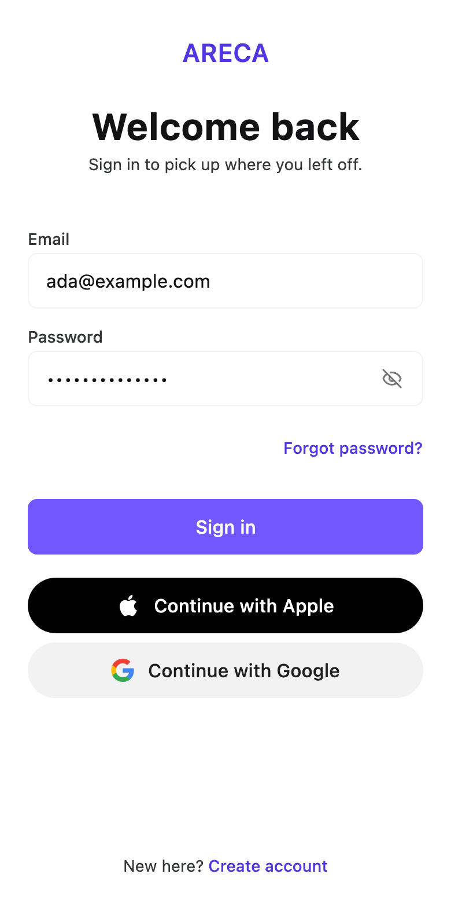

# `flow-auth`

Parts for sign-in, sign-up and verification screens: a scaffold, credential fields, provider
buttons, banners and links. They draw and report what was pressed; signing in, validating and
storing a credential are the application's.

<picture>
  <source media="(prefers-color-scheme: dark)" srcset="../../docs/images/flow-auth-dark.png">
  
</picture>

There is no `SignInScreen`. Copy a [recipe](#recipes) and edit it.

## Install

```kotlin
implementation("dev.voir.areca:flow-auth:<version>")
```

It brings `dev.voir.areca:foundation` with it. The provider marks are bundled; the `ArecaIcons`
glyphs some recipes draw need `dev.voir.areca:icons`. Repository and credentials:
[Getting started](../../docs/getting-started.md).

## Quick start

A complete sign-in screen. The state is the caller's; the parts draw it.

```kotlin
import androidx.compose.foundation.layout.Spacer
import androidx.compose.foundation.layout.fillMaxWidth
import androidx.compose.foundation.layout.height
import androidx.compose.runtime.Composable
import androidx.compose.runtime.getValue
import androidx.compose.runtime.mutableStateOf
import androidx.compose.runtime.remember
import androidx.compose.runtime.setValue
import androidx.compose.ui.Modifier
import dev.voir.areca.flow.auth.AuthProvider
import dev.voir.areca.flow.auth.part.AuthBanner
import dev.voir.areca.flow.auth.part.AuthEmailField
import dev.voir.areca.flow.auth.part.AuthHeader
import dev.voir.areca.flow.auth.part.AuthPasswordField
import dev.voir.areca.flow.auth.part.AuthScaffold
import dev.voir.areca.flow.auth.sso.SsoGroup
import dev.voir.areca.foundation.button.Button
import dev.voir.areca.theme.ArecaTheme

@Composable
fun SignIn(
    error: String?,
    busy: Boolean,
    onSignIn: (email: String, password: String) -> Unit,
    onProviderClick: (AuthProvider) -> Unit,
) {
    var email by remember { mutableStateOf("") }
    var password by remember { mutableStateOf("") }

    AuthScaffold {
        AuthHeader(title = "Welcome back", subtitle = "Sign in to continue.")
        Spacer(Modifier.height(ArecaTheme.spacing.xl6))

        AuthEmailField(value = email, onValueChange = { email = it }, enabled = !busy)
        Spacer(Modifier.height(ArecaTheme.spacing.xl))
        AuthPasswordField(
            value = password,
            onValueChange = { password = it },
            enabled = !busy,
            onImeAction = { onSignIn(email, password) },
        )
        Spacer(Modifier.height(ArecaTheme.spacing.xl2))

        AuthBanner(message = error)
        Button(
            text = "Sign in",
            onClick = { onSignIn(email, password) },
            modifier = Modifier.fillMaxWidth(),
            enabled = !busy,
            loading = busy,
        )
        Spacer(Modifier.height(ArecaTheme.spacing.xl2))

        SsoGroup(
            providers = listOf(AuthProvider.Apple, AuthProvider.Google),
            onProviderClick = onProviderClick,
            enabled = !busy,
            dividerText = "or",
        )
    }
}
```

## Parts

| Part | Use it for | Package |
| --- | --- | --- |
| `AuthScaffold` | The screen: window and keyboard insets, scrolling, the gutter, artwork, an optional `topBar`, a `footer` pinned to the bottom edge, an `overlay` slot, a column capped at `maxWidth` on larger windows | `dev.voir.areca.flow.auth.part` |
| `AuthHeader` | Title (with the heading role), subtitle and an optional mark above them | `dev.voir.areca.flow.auth.part` |
| `AuthNameField` | A full name, with autofill and keyboard set | `dev.voir.areca.flow.auth.part` |
| `AuthEmailField` | An email address, with autofill and keyboard set; `newAccount` for registration | `dev.voir.areca.flow.auth.part` |
| `AuthPasswordField` | A password with a reveal control; `newAccount` for registration | `dev.voir.areca.flow.auth.part` |
| `AuthCodeField` | A code sent by email or text message, one digit to a cell, with `onComplete` when the last digit lands | `dev.voir.areca.flow.auth.part` |
| `AuthIdentityChip` | The account a step is about — "ada@example.com" — with an optional way back to use another | `dev.voir.areca.flow.auth.part` |
| `AuthPasswordRequirements` | A new password's rules, ticked off while typing | `dev.voir.areca.flow.auth.part` |
| `AuthResendCode` | "Didn't get it? Send a new code", its confirmation and the cooldown | `dev.voir.areca.flow.auth.part` |
| `AuthBanner` | Why the last attempt failed or the form must wait, above the button; announced | `dev.voir.areca.flow.auth.part` |
| `AuthProgress` | One line saying what the screen is waiting on; announced | `dev.voir.areca.flow.auth.part` |
| `AuthTextLink` | A standalone link — "Forgot password?" — legible over artwork | `dev.voir.areca.flow.auth.part` |
| `AuthFooterPrompt` | A sentence ending in a link — "No account? Sign up" | `dev.voir.areca.flow.auth.part` |
| `LegalConsent` | Terms and privacy, pressable inside one translatable sentence | `dev.voir.areca.flow.auth.part` |
| `SsoGroup` | Provider buttons as a group, with an optional rule above, as buttons or icons | `dev.voir.areca.flow.auth.sso` |
| `SsoButton` | One labelled provider button | `dev.voir.areca.flow.auth.sso` |
| `SsoIconButton` | One icon-only provider button | `dev.voir.areca.flow.auth.sso` |

The types the parts take live in `dev.voir.areca.flow.auth`: `AuthBranding` (wordmark, hero,
layout), `AuthLayout`, `AuthProvider` (`Apple`, `Google`, `Facebook`, `Email`) and
`AuthLegalLinks`. `SsoLayout` is in `dev.voir.areca.flow.auth.sso`, and `AuthScaffoldDefaults`
beside the scaffold in `dev.voir.areca.flow.auth.part`.

`AuthCodeField` and `AuthPasswordRequirements` are built on foundation's `OtpField`
(`foundation.field`) and `RequirementList` (`foundation.feedback`), which work outside
authentication too.

## Recipes

### Sign in

An email and password form with a forgotten-password link, a failure banner, providers and a
sign-up footer. The state is the application's own:

```kotlin
data class SignInState(
    val email: String = "",
    val password: String = "",
    val emailError: String? = null,
    val passwordError: String? = null,
    val formError: String? = null,
    val submitting: Boolean = false,
    val busyProvider: AuthProvider? = null,
) {
    val busy: Boolean get() = submitting || busyProvider != null
}
```

```kotlin
@Composable
fun SignInScreen(
    state: SignInState,
    onStateChange: (SignInState) -> Unit,
    onSubmit: () -> Unit,
    onForgotPassword: () -> Unit,
    onProviderClick: (AuthProvider) -> Unit,
    onSignUp: () -> Unit,
) {
    val passwordFocus = remember { FocusRequester() }

    AuthScaffold(
        branding = AuthBranding(wordmark = { Wordmark() }),
        footer = {
            AuthFooterPrompt(
                prompt = stringResource(Res.string.sign_up_prompt),
                linkText = stringResource(Res.string.sign_up_link),
                onLinkClick = onSignUp,
            )
        },
    ) {
        AuthHeader(title = stringResource(Res.string.sign_in_title), subtitle = stringResource(Res.string.sign_in_subtitle))

        Spacer(Modifier.height(ArecaTheme.spacing.xl6))

        AuthEmailField(
            value = state.email,
            onValueChange = { onStateChange(state.copy(email = it, emailError = null)) },
            error = state.emailError,
            enabled = !state.busy,
            imeAction = ImeAction.Next,
            onImeAction = { passwordFocus.requestFocus() },
        )

        Spacer(Modifier.height(ArecaTheme.spacing.xl))

        AuthPasswordField(
            value = state.password,
            onValueChange = { onStateChange(state.copy(password = it, passwordError = null)) },
            error = state.passwordError,
            enabled = !state.busy,
            focusRequester = passwordFocus,
            imeAction = ImeAction.Done,
            onImeAction = onSubmit,
        )

        Spacer(Modifier.height(ArecaTheme.spacing.lg))

        Box(Modifier.fillMaxWidth(), contentAlignment = Alignment.CenterEnd) {
            AuthTextLink(stringResource(Res.string.forgot_password), onForgotPassword, enabled = !state.busy)
        }

        Spacer(Modifier.height(ArecaTheme.spacing.xl2))

        AuthBanner(message = state.formError)

        Button(
            modifier = Modifier.fillMaxWidth(),
            enabled = !state.busy,
            loading = state.submitting,
            onClick = onSubmit,
        ) {
            Text(stringResource(Res.string.sign_in_submit))
        }

        Spacer(Modifier.height(ArecaTheme.spacing.xl2))

        SsoGroup(
            providers = listOf(AuthProvider.Apple, AuthProvider.Google),
            onProviderClick = onProviderClick,
            enabled = !state.busy,
            busyProvider = state.busyProvider,
        )
    }
}
```

A field takes its complaint already worded, as `error: String?`, and draws it under the box. The
application decides it — on submit, from the server, or both:

```kotlin
// The application's view model. `getString` from Compose resources suspends.
fun submit() {
    viewModelScope.launch {
        val emailError = if (state.email.isBlank()) getString(Res.string.email_required) else null
        val passwordError = if (state.password.isEmpty()) getString(Res.string.password_required) else null
        state = state.copy(emailError = emailError, passwordError = passwordError, formError = null)
        if (emailError == null && passwordError == null) signIn(state.email, state.password)
    }
}
```

### On a tablet or desktop

The same sign-in screen, made for every window an application runs in by one value:
`AuthLayout.Split()`. From an expanded width (840dp) up, while the height is not compact — a tablet
on its side, a laptop, a desktop monitor — the artwork is a panel down the start side and the form
sits centred beside it. Anywhere smaller the screen draws the layout's `fallback`, `HeroTop()`
unless you name another. Nothing in the screen branches on the window; the scaffold reads
`ArecaTheme.window`. The playground's
[`SignInSplitShowcase`](../../playground/src/commonMain/kotlin/dev/voir/areca/playground/flow/auth/SignInSplitShowcase.kt)
draws it at every window:

```kotlin
@Composable
fun SignInScreen(
    state: SignInState,
    onStateChange: (SignInState) -> Unit,
    onSubmit: () -> Unit,
    onForgotPassword: () -> Unit,
    onProviderClick: (AuthProvider) -> Unit,
    onSignUp: () -> Unit,
) {
    val passwordFocus = remember { FocusRequester() }

    AuthScaffold(
        branding = AuthBranding(
            wordmark = { Wordmark() },
            hero = { Artwork() },
            layout = AuthLayout.Split(),
        ),
        footer = {
            AuthFooterPrompt(
                prompt = stringResource(Res.string.sign_up_prompt),
                linkText = stringResource(Res.string.sign_up_link),
                onLinkClick = onSignUp,
            )
        },
    ) {
        AuthHeader(title = stringResource(Res.string.sign_in_title), subtitle = stringResource(Res.string.sign_in_subtitle))

        Spacer(Modifier.height(ArecaTheme.spacing.xl6))

        AuthEmailField(
            value = state.email,
            onValueChange = { onStateChange(state.copy(email = it, emailError = null)) },
            error = state.emailError,
            enabled = !state.busy,
            imeAction = ImeAction.Next,
            onImeAction = { passwordFocus.requestFocus() },
        )

        Spacer(Modifier.height(ArecaTheme.spacing.xl))

        AuthPasswordField(
            value = state.password,
            onValueChange = { onStateChange(state.copy(password = it, passwordError = null)) },
            error = state.passwordError,
            enabled = !state.busy,
            focusRequester = passwordFocus,
            imeAction = ImeAction.Done,
            onImeAction = onSubmit,
        )

        Spacer(Modifier.height(ArecaTheme.spacing.lg))

        Box(Modifier.fillMaxWidth(), contentAlignment = Alignment.CenterEnd) {
            AuthTextLink(stringResource(Res.string.forgot_password), onForgotPassword, enabled = !state.busy)
        }

        Spacer(Modifier.height(ArecaTheme.spacing.xl2))

        AuthBanner(message = state.formError)

        Button(
            modifier = Modifier.fillMaxWidth(),
            enabled = !state.busy,
            loading = state.submitting,
            onClick = onSubmit,
        ) {
            Text(stringResource(Res.string.sign_in_submit))
        }

        Spacer(Modifier.height(ArecaTheme.spacing.xl2))

        SsoGroup(
            providers = listOf(AuthProvider.Apple, AuthProvider.Google),
            onProviderClick = onProviderClick,
            enabled = !state.busy,
            busyProvider = state.busyProvider,
            dividerText = stringResource(Res.string.or_continue_with),
        )
    }
}
```

- The artwork fills a tall panel on a large window and a wide band on a phone, so pass something
  that crops to any shape — `Image(…, contentScale = ContentScale.Crop, modifier =
  Modifier.fillMaxSize())`.
- `Split(fraction = …)` is the panel's share of the window width, 0.42 by default.
  `Split(fallback = AuthLayout.Plain)` drops the artwork on phones and the foldable;
  `AuthLayout.FullBleed` puts it behind the form there.
- On every window wider than a phone the column stops at `AuthScaffoldDefaults.MaxWidth` (480dp,
  gutters included), whatever the layout. Pass `maxWidth` to `AuthScaffold` to change it.
- A bar in `topBar` sits above the form, beside the panel, with its controls on the column's edge.

### Providers only, no form

The sign-in screen without fields or button, over full-bleed artwork:

```kotlin
AuthScaffold(
    branding = AuthBranding(hero = { Artwork() }, layout = AuthLayout.FullBleed),
    footer = { LegalConsent(links = legalLinks, onLinkClick = ::openDocument) },
) {
    AuthHeader(title = stringResource(Res.string.sign_in_title), subtitle = stringResource(Res.string.sign_in_subtitle))

    Spacer(Modifier.height(ArecaTheme.spacing.xl6))

    SsoGroup(
        providers = listOf(AuthProvider.Apple, AuthProvider.Google, AuthProvider.Email),
        onProviderClick = onProviderClick,
        // Nothing above it, so no rule.
        dividerText = null,
    )
}
```

`AuthProvider.Email` leads to the form; handle it by navigating, not by starting an exchange.

### Content above and below the form

The scaffold's body is an ordinary `ColumnScope`, so extra content and fields of your own go where
they belong. The playground's
[`ContentAroundFormShowcase`](../../playground/src/commonMain/kotlin/dev/voir/areca/playground/flow/auth/ContentAroundFormShowcase.kt)
draws this:

```kotlin
AuthScaffold(branding = branding, footer = { … }) {
    AuthHeader(title = stringResource(Res.string.sign_in_title))

    Spacer(Modifier.height(ArecaTheme.spacing.xl6))

    // Above the form.
    Text("You were invited to the Northwind workspace.", variant = TextVariant.BodySmall)
    Spacer(Modifier.height(ArecaTheme.spacing.xl))

    AuthEmailField(…)
    Spacer(Modifier.height(ArecaTheme.spacing.xl))
    AuthPasswordField(…)

    // A field the module does not have.
    Spacer(Modifier.height(ArecaTheme.spacing.xl))
    FieldGroup(label = "Workspace") { field -> TextField(value = workspace, onValueChange = { workspace = it }, field = field) }

    Spacer(Modifier.height(ArecaTheme.spacing.xl2))
    Button(modifier = Modifier.fillMaxWidth(), onClick = onSubmit) { Text("Sign in") }

    // Below the form.
    Spacer(Modifier.height(ArecaTheme.spacing.xl))
    Text("Trouble signing in? Contact your administrator.", variant = TextVariant.BodyExtraSmall)
}
```

### A way back, and steps

A back control, or a step counter with skip and progress, in `topBar`. The first screen of a flow
has no bar; every screen reached from another takes a foundation `TopBar`, pinned above the form.
The scaffold lines the bar's controls up with its `gutter` and, over `AuthLayout.FullBleed`
artwork, draws it as `TopBarStyle.Scrim`; pass a `size` or `style` to override either.

```kotlin
// Reached from sign-in: back, and nothing else.
AuthScaffold(
    branding = branding,
    topBar = { TopBar(modifier = Modifier.fillMaxWidth(), leading = { BackAction(onClick = onBack) }) {} },
) { … }

// One step of several: back, the step, a skip, and progress along the bar's edge.
AuthScaffold(
    branding = branding,
    topBar = {
        TopBar(
            title = stringResource(Res.string.step_of, step, steps),
            modifier = Modifier.fillMaxWidth(),
            size = (LocalTopBarSize.current ?: TopBarSize.Default).copy(bottomPadding = PaddingValues()),
            titleAlignment = TopBarTitleAlignment.Center,
            leading = { BackAction(onClick = onBack) },
            trailing = { TextAction(text = stringResource(Res.string.skip), onClick = onSkip, color = ActionColor.Neutral) },
            bottom = { TopBarProgress(progress = step / steps.toFloat()) },
        )
    },
) { … }
```

Start from `LocalTopBarSize` when changing the size, as above, so the scaffold's gutter survives.

### Email first

One address box first; the service decides what comes next — a password for a known account, a
code and then a password for a new one. Each step is its own screen, sequenced by the
application's state.

The address step, with single sign-on beside the form and a banner for a failed lookup:

```kotlin
AuthScaffold(
    branding = branding,
    footer = { LegalConsent(links = legalLinks, onLinkClick = ::openDocument) },
) {
    AuthHeader(
        title = "Continue to Areca",
        subtitle = "Sign in or create an account with your email.",
        icon = { FeaturedIcon(ArecaIcons.LogIn, contentDescription = null, style = FeaturedIconStyle.soft(ActionColor.Brand)) },
    )

    Spacer(Modifier.height(ArecaTheme.spacing.xl6))

    AuthBanner(
        message = state.banner,
        title = state.bannerTitle,
        // What a screen reader hears, worded and joined by the application.
        contentDescription = { title, message -> listOfNotNull("Error", title, message).joinToString(". ") },
    )

    AuthEmailField(
        value = state.email,
        onValueChange = onEmailChange,
        error = state.emailError,
        enabled = !state.busy,
        placeholder = "name@example.com",
        imeAction = ImeAction.Done,
        onImeAction = onContinue,
    )

    Spacer(Modifier.height(ArecaTheme.spacing.xl2))

    Button(text = "Continue", onClick = onContinue, modifier = Modifier.fillMaxWidth(), enabled = !state.busy, loading = state.lookingUp)

    Spacer(Modifier.height(ArecaTheme.spacing.xl2))

    SsoGroup(providers = providers, onProviderClick = onProviderClick, enabled = !state.busy, busyProvider = state.busyProvider, dividerText = "or")
}
```

The password step names the account with the way back beside it. A rate limit is a warning
banner and a disabled button that says how long:

```kotlin
AuthScaffold(
    branding = branding,
    topBar = { TopBar(modifier = Modifier.fillMaxWidth(), leading = { BackAction(onClick = onChangeEmail) }) {} },
) {
    AuthHeader(title = "Enter your password", subtitle = "Welcome back.", icon = { /* Lock mark */ })

    Spacer(Modifier.height(ArecaTheme.spacing.xl6))

    AuthIdentityChip(identifier = state.email, onChange = onChangeEmail, onChangeLabel = "Use a different email", enabled = !state.busy)

    Spacer(Modifier.height(ArecaTheme.spacing.xl))

    AuthBanner(
        message = if (state.limited) "For your security, wait 2 minutes or reset your password." else null,
        title = "Too many attempts",
        tone = NoticeTone.Warning,
        icon = ArecaIcons.Clock,
    )

    AuthPasswordField(
        value = state.password,
        onValueChange = onPasswordChange,
        error = state.passwordError,
        enabled = !state.busy && !state.limited,
        imeAction = ImeAction.Done,
        onImeAction = onSignIn,
    )

    Spacer(Modifier.height(ArecaTheme.spacing.lg))

    Box(Modifier.fillMaxWidth(), contentAlignment = Alignment.CenterEnd) {
        AuthTextLink(text = "Forgot password?", onClick = onForgotPassword, enabled = !state.busy)
    }

    Spacer(Modifier.height(ArecaTheme.spacing.xl2))

    if (state.limited) {
        Button(
            text = "Try again in ${state.retryIn}",
            onClick = null,
            modifier = Modifier.fillMaxWidth(),
            enabled = false,
            leading = { Icon(ArecaIcons.Clock, contentDescription = null) },
        )
    } else {
        Button(text = "Sign in", onClick = onSignIn, modifier = Modifier.fillMaxWidth(), enabled = !state.busy, loading = state.busy)
    }
}
```

The code step verifies itself when the last digit lands; the button stays for anyone who wants to
press something. The resend line shows the countdown in place of its link while another code
cannot be sent:

```kotlin
val codeFocus = remember { FocusRequester() }
LaunchedEffect(Unit) { codeFocus.requestFocus() }

AuthScaffold(branding = branding, topBar = { /* BackAction */ }) {
    AuthHeader(
        title = "Check your email",
        subtitle = "Enter the 6-digit code we sent to confirm your email. It expires in 10 minutes.",
        icon = { /* Mail mark */ },
    )

    Spacer(Modifier.height(ArecaTheme.spacing.xl6))

    AuthIdentityChip(identifier = state.email, onChange = onChangeEmail, enabled = !state.busy)

    Spacer(Modifier.height(ArecaTheme.spacing.xl))

    AuthCodeField(
        value = state.code,
        onValueChange = onCodeChange,
        onComplete = onVerify,
        error = state.codeError,
        enabled = !state.busy,
        focusRequester = codeFocus,
    )

    Spacer(Modifier.height(ArecaTheme.spacing.xl))

    AuthResendCode(
        onResend = onResend,
        prompt = "Didn't get it?",
        sent = if (state.resent) "New code sent." else null,
        cooldown = state.cooldown?.let { "You can ask for another in $it." },
        enabled = !state.busy,
    )

    Spacer(Modifier.height(ArecaTheme.spacing.xl2))

    Button(text = "Verify", onClick = { onVerify(state.code) }, modifier = Modifier.fillMaxWidth(), enabled = !state.busy, loading = state.busy)
}
```

The new account's password shows the service's rules under the box, worded by the application.
Report each unmet rule as `Pending` until the first submit and `Unmet` after:

```kotlin
AuthIdentityChip(identifier = state.email, verified = true)

Spacer(Modifier.height(ArecaTheme.spacing.xl))

AuthPasswordField(value = state.password, onValueChange = onPasswordChange, error = state.passwordError, newAccount = true)

Spacer(Modifier.height(ArecaTheme.spacing.md))

val unmet = if (state.triedToSubmit) RequirementState.Unmet else RequirementState.Pending
AuthPasswordRequirements(
    requirements = serviceRules.map { rule ->
        Requirement(rule.text, if (rule.accepts(state.password)) RequirementState.Met else unmet)
    },
    contentDescription = "Password requirements",
)
```

A step with nothing to fill in — signed in, a reset link sent, waiting on a provider's window,
turned away — is a header and a footer, with what to do next against the bottom edge:

```kotlin
AuthScaffold(
    branding = branding,
    footer = {
        Column(horizontalAlignment = Alignment.CenterHorizontally, verticalArrangement = Arrangement.spacedBy(ArecaTheme.spacing.xl)) {
            AuthProgress(text = "Waiting for Google…")
            Button(text = "Cancel", onClick = onCancel, modifier = Modifier.fillMaxWidth(), style = ButtonStyle.outlined(ActionColor.Neutral))
        }
    },
) {
    AuthHeader(
        title = "Continue with Google",
        subtitle = "Finish signing in in the Google window. This page updates when you're done.",
        icon = { /* LinkExternal mark */ },
    )
}
```

### Verify a code

One code screen for email, text message or an authenticator. What changes per channel is the
words, the grouping, whether there is a destination to show, and whether another code can be sent;
an authenticator offers a recovery code instead:

```kotlin
AuthScaffold(branding = branding, topBar = { /* BackAction */ }) {
    AuthHeader(title = title, subtitle = subtitle, icon = { /* the channel's mark */ })

    Spacer(Modifier.height(ArecaTheme.spacing.xl6))

    if (destination != null) {
        AuthIdentityChip(identifier = destination, onChange = onBack, enabled = !busy)
        Spacer(Modifier.height(ArecaTheme.spacing.xl))
    }

    // Match how the channel prints the code: 3 for a text message's two groups of three, null for one run.
    AuthCodeField(value = code, onValueChange = onCodeChange, onComplete = onVerify, error = codeError, groupSize = groupSize, enabled = !busy)

    if (onResend != null) {
        Spacer(Modifier.height(ArecaTheme.spacing.xl))
        AuthResendCode(onResend = onResend, prompt = "Didn't get it?", sent = sent, cooldown = cooldown, enabled = !busy)
    }

    Spacer(Modifier.height(ArecaTheme.spacing.xl2))

    Button(text = "Verify", onClick = { onVerify(code) }, modifier = Modifier.fillMaxWidth(), enabled = !busy, loading = busy)

    if (alternative != null) {
        Spacer(Modifier.height(ArecaTheme.spacing.xl))
        AuthTextLink(text = alternative, onClick = onAlternative, enabled = !busy)
    }
}
```

### Pages an emailed link opens

Reset a password, finish registering, accept an invitation, confirm a new address: the link is
checked, the page asks for the one thing the link was for, then says how it went.

While the link is checked, draw the shape of the form to come and say what the page is waiting on:

```kotlin
AuthScaffold(branding = branding, footer = { AuthProgress(text = "Checking your link…") }) {
    Column(horizontalAlignment = Alignment.CenterHorizontally, verticalArrangement = Arrangement.spacedBy(ArecaTheme.spacing.md)) {
        Skeleton(width = 48.dp, height = 48.dp)
        Skeleton(width = 220.dp, height = 28.dp)
        Skeleton(count = 2, textStyle = ArecaTheme.typography.bodySmall)
    }
    Spacer(Modifier.height(ArecaTheme.spacing.xl6))
    Skeleton(height = 48.dp)
}
```

The account comes from the link, so it is shown with a `label` rather than asked for:

```kotlin
AuthScaffold(branding = branding, footer = { Text("This link works once. Didn't ask for a reset? Close this page.", …) }) {
    AuthHeader(title = "Set a new password", subtitle = "You'll be signed out on every device.", icon = { /* Lock mark */ })

    Spacer(Modifier.height(ArecaTheme.spacing.xl6))

    AuthBanner(message = state.failure, title = "Something went wrong")

    AuthIdentityChip(identifier = account, label = "Account")

    Spacer(Modifier.height(ArecaTheme.spacing.xl))

    AuthPasswordField(value = state.password, onValueChange = onPasswordChange, error = state.passwordError, newAccount = true, label = "New password")

    Spacer(Modifier.height(ArecaTheme.spacing.md))

    AuthPasswordRequirements(requirements = requirements)

    Spacer(Modifier.height(ArecaTheme.spacing.xl2))

    Button(text = "Update password", onClick = onSubmit, modifier = Modifier.fillMaxWidth(), enabled = !state.busy, loading = state.busy)
}
```

Confirm a new address on an explicit press, not when the link opens: mail scanners open links too.

Every ending — done, already done (409), expired, incomplete, rate limited (429) — is the
nothing-to-fill-in step from [Email first](#email-first) with one button in the footer. A rate
limit disables the button and says how long on it.

### A custom footer

Any composable in `footer`; `AuthFooterPrompt` is only the common case:

```kotlin
AuthScaffold(
    branding = branding,
    footer = {
        Row(
            modifier = Modifier.fillMaxWidth(),
            horizontalArrangement = Arrangement.SpaceBetween,
        ) {
            AuthTextLink("English (UK)", onClick = ::pickLanguage)
            AuthTextLink("Need help?", onClick = ::openSupport)
        }
    },
) { … }
```

Pass `footer = null` for no bottom edge at all.

## Layouts

`AuthBranding(wordmark, hero, layout)` places the artwork; `AuthLayout` has six values:

| Layout | On a phone | On a wider window |
| --- | --- | --- |
| `Plain` | No artwork; the whole viewport for the form | The column centred across the window and down the space above the footer |
| `HeroTop(fraction)` | Artwork across the top, scrolling away with the content | The band still spans the window; the column under it is centred across it |
| `HeroBottom(fraction)` | Content on top, artwork below; buttons within thumb reach | The band still spans the window; the column above it is centred across it |
| `HeroInline` | Artwork sized by its own slot, above the heading — for an illustration | As `Plain`, the illustration inside the column |
| `FullBleed` | Artwork behind everything, content against the bottom edge | Artwork fills the window; the column is centred across it, still against the bottom edge |
| `Split(fraction, fallback)` | `fallback` — `HeroTop()` unless you name another | From 840dp wide, when the height is not compact: artwork as a panel down the start side, full height, the column centred in the rest. Narrower or shorter: `fallback` |

"A phone" is the compact width class — under 600dp, read from `ArecaTheme.window` — and draws every
layout exactly as it always has. On anything wider the column (wordmark, body and footer) stops at
`AuthScaffold`'s `maxWidth`, `AuthScaffoldDefaults.MaxWidth` (480dp with its gutters: a large
phone's form, not a page's) and the bar's controls line up with it. A form taller than the window
still starts at the top and scrolls. A phone on its side is wider than compact but too short for
`Split`, so it draws the capped column of the fallback.

`fraction` — the artwork's share of the height for `HeroTop` and `HeroBottom`, of the width for
`Split` — defaults to `AuthLayout.DefaultHeroFraction` (0.42) and is held between `MinHeroFraction`
and `MaxHeroFraction`. On a wide window a `HeroTop` band is a letterbox; `Split` usually suits the
same artwork better there.

`FullBleed` draws every foreground the parts put straight onto the background — headings, labels,
links, the rule, the legal line — in `fgOnContrast`. Use artwork dark enough to carry it, or put a
scrim inside the `hero` slot.

## Providers

The module draws the button and reports the press with the `AuthProvider`. Getting an identity
token — Credential Manager on Android, `ASAuthorization` on iOS — is the application's:

```kotlin
onProviderClick = { provider ->
    when (provider) {
        AuthProvider.Google -> scope.launch { googleTokens.request()?.let(viewModel::signIn) }
        AuthProvider.Email -> navigate(SignIn)
        else -> Unit
    }
}
```

- List only the providers the current platform can complete; one absent from `providers` is not
  drawn.
- `SsoLayout.Buttons` (the default) stacks labelled pills, for when single sign-on is the offer.
  `SsoLayout.Icons` is a row of circular marks, wrapping onto another centred row, for when it is
  the alternative to a form.
- `busyProvider` puts a spinner on that provider's button; `SsoButton` and `SsoIconButton` take
  `loading` directly.
- Provider colours follow each provider's button guidelines, not the theme: Apple is black on a
  light theme and white on a dark one, Google uses its neutral and dark themes with the four-colour
  "G" unchanged, Facebook is `#0866FF` in both. The marks are the `Social` icons of
  `dev.voir.areca:icons`. Check the result against each provider's current terms before shipping.
- An iOS app that offers Google or Facebook sign-in normally also offers `AuthProvider.Apple`, to
  meet App Store Review Guideline 4.8.

## Words

Every word a part draws is a parameter, and the application passes its own from its
`composeResources`:

```kotlin
AuthEmailField(
    value = state.email,
    onValueChange = onEmailChange,
    error = state.emailError,
    label = stringResource(Res.string.email),
    placeholder = stringResource(Res.string.email_placeholder),
)

SsoGroup(
    providers = providers,
    onProviderClick = onProviderClick,
    dividerText = stringResource(Res.string.or_continue_with),
    providerLabel = { provider -> providerLabels.getValue(provider) },
)
```

- **Required words** — a field's label, a provider button's text, the legal sentence, the password
  reveal labels (`revealDescription`, `hideDescription`) — default to plain English. Override every
  one in a localised application.
- **Optional words** — placeholders, `dividerText`, the identity chip's `onChangeLabel` — default
  to `null`, which draws nothing.
- **Joined words** are a function: `AuthBanner`'s `contentDescription` receives the title and the
  message and returns what a screen reader says.
- **Complaints** under the fields are always the application's, as `error: String?`.

`LegalConsent` takes one sentence with `%1$s` for the terms link and `%2$s` for the privacy link,
passed unformatted. A sentence missing either placeholder, or repeating one, is refused.

```kotlin
// <string name="legal_consent">By continuing, you agree to our %1$s and %2$s.</string>
LegalConsent(
    links = legalLinks,
    onLinkClick = ::openDocument,
    sentence = stringResource(Res.string.legal_consent),
    termsLabel = stringResource(Res.string.terms_of_service),
    privacyLabel = stringResource(Res.string.privacy_policy),
)
```

Every module's words in one place: [Localisation](../../docs/localisation.md).

## Accessibility

What the parts already do, and what to pass. General guidance:
[Accessibility](../../docs/accessibility.md).

- **Autofill.** Every credential box carries its content type — Android reads the `contentType`
  semantics, iOS the `UITextContentType` (`name`, `username`, `password`, `newPassword`,
  `oneTimeCode`). The desktop has no platform autofill.
- **`newAccount = true`** on the email and password fields makes a password manager offer to
  generate and save rather than fill. Set it on a registration form.
- **IME actions.** Without `onImeAction` a box keeps the platform's action (Next moves focus, Done
  closes the keyboard); with one, the callback runs instead. The email box turns autocorrection and
  capitalisation off.
- **Touch targets.** Every control pressed on its own, `AuthTextLink` included, reserves 48 dp. A
  link inside a sentence — the footer prompt, the legal line — is not padded.
- **Labels.** `AuthHeader`'s title has the heading role. Icon-only provider buttons keep their
  label while busy. The identity chip's "Change" keeps its caption as its name; `onChangeLabel`
  adds what pressing does.
- **Codes.** `AuthCodeField` is one field to a screen reader, carries the one-time-code autofill
  type, and is marked sensitive, as is the password box.
- **Announcements.** `AuthBanner`, the resend confirmation and `AuthProgress` are announced when
  they appear and when their text changes. The resend countdown is drawn, not announced.

## Where to look

- **Playground:** the **Auth flow** group has a page for every part and the recipes under
  **Screens**, as compiled code in
  [`playground/flow/auth`](../../playground/src/commonMain/kotlin/dev/voir/areca/playground/flow/auth):
  [`SignInShowcase`](../../playground/src/commonMain/kotlin/dev/voir/areca/playground/flow/auth/SignInShowcase.kt),
  [`SignInSplitShowcase`](../../playground/src/commonMain/kotlin/dev/voir/areca/playground/flow/auth/SignInSplitShowcase.kt)
  (drawn in a window of each size),
  [`EmailFirstShowcase`](../../playground/src/commonMain/kotlin/dev/voir/areca/playground/flow/auth/EmailFirstShowcase.kt),
  [`VerifyCodeShowcase`](../../playground/src/commonMain/kotlin/dev/voir/areca/playground/flow/auth/VerifyCodeShowcase.kt),
  [`EmailLinkShowcase`](../../playground/src/commonMain/kotlin/dev/voir/areca/playground/flow/auth/EmailLinkShowcase.kt),
  [`ContentAroundFormShowcase`](../../playground/src/commonMain/kotlin/dev/voir/areca/playground/flow/auth/ContentAroundFormShowcase.kt).
  `AuthFlowScreensRenderTest` draws every step of the last three, in both themes, to
  `playground/build/screens/auth-flow`.
- **KDoc:** every part's parameters, in the sources under
  [`src/commonMain`](src/commonMain/kotlin/dev/voir/areca/flow/auth).
- **For agents:** the `areca-ui-v1` skill's
  [`reference/flow-auth.md`](../../skills/areca-ui-v1/reference/flow-auth.md).
- **Related:** [`flow-profile`](../profile/README.md) for account screens after sign-in;
  foundation's `OtpField` and `RequirementList`.

For contributors: [`../FLOWS.md`](../FLOWS.md) is the contract every flow module follows.
