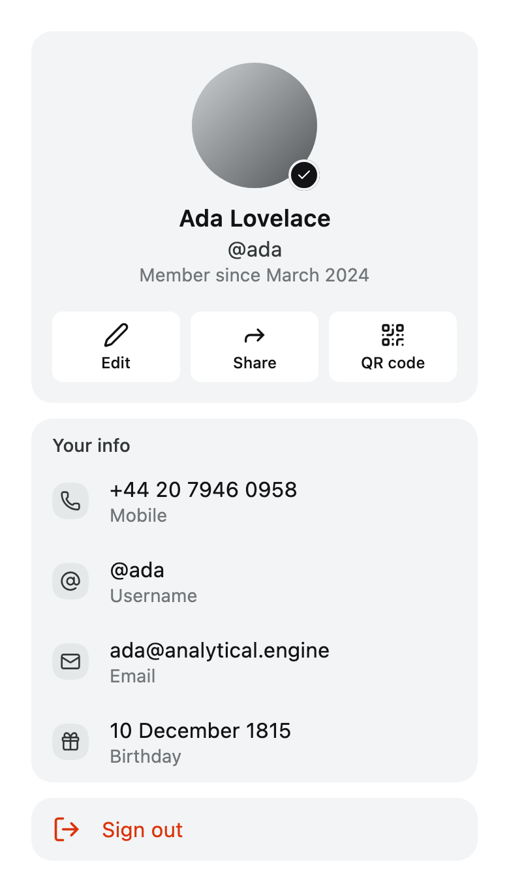

# `flow-profile`

Parts for account screens: the profile, its edit form, the username, the account menu and the
devices signed in. They draw and report what was pressed; loading the profile, saving it and
uploading a picture are the application's.

<picture>
  <source media="(prefers-color-scheme: dark)" srcset="../../docs/images/flow-profile-dark.png">
  
</picture>

There is no `ProfileScreen`. Copy a [recipe](#recipes) and edit it.

## Install

```kotlin
implementation("dev.voir.areca:flow-profile:<version>")
```

It brings `dev.voir.areca:foundation` and `dev.voir.areca:datetime` (for `BirthdayRow`, which puts
`kotlinx-datetime` on your API surface). The module's own glyphs are bundled; the `ArecaIcons`
glyphs the recipes draw — a phone, an at sign, a share arrow — need `dev.voir.areca:icons`.
Repository and credentials: [Getting started](../../docs/getting-started.md).

## Quick start

A profile: the header card, the account's details and a way out. The rows are foundation
`SettingsRow`s, so they go in a foundation `Settings` list.

```kotlin
import androidx.compose.foundation.background
import androidx.compose.foundation.layout.Column
import androidx.compose.foundation.layout.Spacer
import androidx.compose.foundation.layout.WindowInsets
import androidx.compose.foundation.layout.fillMaxSize
import androidx.compose.foundation.layout.height
import androidx.compose.foundation.layout.systemBars
import androidx.compose.foundation.layout.windowInsetsPadding
import androidx.compose.foundation.rememberScrollState
import androidx.compose.foundation.verticalScroll
import androidx.compose.runtime.Composable
import androidx.compose.ui.Modifier
import dev.voir.areca.flow.profile.ProfileSummary
import dev.voir.areca.flow.profile.part.ProfileHeaderCard
import dev.voir.areca.flow.profile.row.EmailRow
import dev.voir.areca.flow.profile.row.ProfileInfoRow
import dev.voir.areca.flow.profile.row.SignOutRow
import dev.voir.areca.foundation.settings.Section
import dev.voir.areca.foundation.settings.Settings
import dev.voir.areca.foundation.text.Text
import dev.voir.areca.theme.ArecaTheme
import dev.voir.areca.theme.horizontalContentInsets

@Composable
fun Profile(summary: ProfileSummary, phone: String, onSignOut: () -> Unit) {
    Column(
        modifier = Modifier
            .fillMaxSize()
            .background(ArecaTheme.colors.bgCanvas)
            .verticalScroll(rememberScrollState())
            .windowInsetsPadding(WindowInsets.systemBars),
    ) {
        ProfileHeaderCard(summary = summary, modifier = Modifier.horizontalContentInsets())

        Spacer(Modifier.height(ArecaTheme.spacing.lg))

        Settings {
            Section(header = { Text("Your info") }) {
                ProfileInfoRow(value = phone, label = "Mobile")
                EmailRow(email = summary.email, isVerified = summary.isVerified)
            }
            Section { SignOutRow(onClick = onSignOut) }
        }
    }
}

// The account, already worded by the application.
val ada = ProfileSummary(name = "Ada Lovelace", handle = "@ada", email = "ada@example.com", isVerified = true)
```

## Parts

| Part | Use it for | Package |
| --- | --- | --- |
| `ProfileAvatar` | The picture, or the initials, with an optional spinner | `dev.voir.areca.flow.profile.part` |
| `EditableAvatar` | The picture with a camera badge, one target for both | `dev.voir.areca.flow.profile.part` |
| `ProfileHeaderCard` | The card a profile opens with: picture, name, handle, caption and a row of actions | `dev.voir.areca.flow.profile.part` |
| `ProfileCardAction` | One icon-and-label tile in `ProfileHeaderCard`'s `actions` | `dev.voir.areca.flow.profile.part` |
| `ProfileCoverCard` | A cover band with the picture overlapping it, the name, handle, bio and caption | `dev.voir.areca.flow.profile.part` |
| `ProfileSummaryCard` | A compact pressable card that leads into the account, at the top of a menu | `dev.voir.areca.flow.profile.part` |
| `ProfileSummaryCardAction` | The trailing "Edit" affordance of `ProfileSummaryCard` | `dev.voir.areca.flow.profile.part` |
| `ProfileSummaryCaption` | A caption of your own in `ProfileSummaryCard`'s `caption` slot | `dev.voir.areca.flow.profile.part` |
| `ProfileGreeting` | The summary row with no card and no press tint, for a home screen | `dev.voir.areca.flow.profile.part` |
| `ProfileSummaryCardPlaceholder` | Loading stand-in for `ProfileSummaryCard`, at its final height | `dev.voir.areca.flow.profile.part` |
| `ProfileGreetingPlaceholder` | Loading stand-in for `ProfileGreeting` | `dev.voir.areca.flow.profile.part` |
| `AvatarUploadStatus` | What a picture change is doing: progress, or why it stopped | `dev.voir.areca.flow.profile.part` |
| `StaleDetailsNotice` | Says the details below were not just fetched | `dev.voir.areca.flow.profile.part` |
| `ProfileLoadFailure` | The whole-screen state for a profile that could not be loaded | `dev.voir.areca.flow.profile.part` |
| `ProfileInfoRow` | One fact: the value as the title, what it is under it — "@ada" over "Username" | `dev.voir.areca.flow.profile.row` |
| `BirthdayRow` | A birthday chosen from a calendar sheet, and removed | `dev.voir.areca.flow.profile.row` |
| `EmailRow` | The address, an "Unverified" badge until confirmed, an optional "Verify" | `dev.voir.areca.flow.profile.row` |
| `LinkedAccountRow` | One sign-in provider: link, unlink, or why it cannot be unlinked | `dev.voir.areca.flow.profile.row` |
| `DataExportRow` | "Download your data": idle, preparing, ready, failed | `dev.voir.areca.flow.profile.row` |
| `AccountRow` | One account in a switcher, the current one ticked | `dev.voir.areca.flow.profile.row` |
| `AddAccountRow` | "Add account" at the foot of a switcher | `dev.voir.areca.flow.profile.row` |
| `SignOutRow` | Signing out of this device, in the danger tone | `dev.voir.areca.flow.profile.row` |
| `DeleteAccountRow` | Deleting the account, in the danger tone | `dev.voir.areca.flow.profile.row` |
| `UsernameCheckFooter` | The line under a username field: hint, checking, available, taken, or a complaint | `dev.voir.areca.flow.profile.row` |
| `ActiveSessionsSections` | "This device" with "Sign out all other devices", then every other session, with loading, failure and empty states (a `SettingsScope` extension) | `dev.voir.areca.flow.profile.session` |
| `SessionRow` | One device: tile, name, client, where and when last seen | `dev.voir.areca.flow.profile.session` |
| `AvatarSourceSheet` | Where a new picture comes from: camera, library, remove, or your own choices | `dev.voir.areca.flow.profile.sheet` |
| `SignOutSheet` | Confirms signing out of this device | `dev.voir.areca.flow.profile.sheet` |
| `SignOutOthersSheet` | Confirms ending every other session | `dev.voir.areca.flow.profile.sheet` |
| `RevokeSessionSheet` | Confirms ending one session, naming the device | `dev.voir.areca.flow.profile.sheet` |
| `DeleteAccountSheet` | Confirms deletion, optionally behind a typed phrase | `dev.voir.areca.flow.profile.sheet` |

The state the parts draw:

| Type | Holds | Package |
| --- | --- | --- |
| `ProfileSummary` | Who the account is, already worded: name, handle, email, verified, avatar model, caption | `dev.voir.areca.flow.profile` |
| `AvatarImageLoader`, `AvatarImageState`, `LocalAvatarImageLoader` | How pictures are loaded; see [Pictures](#pictures) | `dev.voir.areca.flow.profile` |
| `AvatarUploadState` | `Idle`, `Uploading(progress)`, `Failed(message)` | `dev.voir.areca.flow.profile.part` |
| `DataExportState` | `Idle`, `Preparing`, `Ready`, `Failed(message)` | `dev.voir.areca.flow.profile.row` |
| `UsernameCheck` | `Idle`, `Checking`, `Available`, `Taken` | `dev.voir.areca.flow.profile.row` |
| `ActiveSessionsState`, `SessionItem`, `SessionDevice` | The device list: `Loading`, `Failed`, `Loaded(sessions)` | `dev.voir.areca.flow.profile.session` |
| `AvatarSourceOption`, `AvatarSourceOptions` | One picture source; the ready-made `camera`, `library` and `remove` | `dev.voir.areca.flow.profile.sheet` |

## On the settings list

The rows are foundation `SettingsRow`s and go in a `Settings` list's `Section`s, beside any row the
application writes. They take everything the settings list does: section cards, headers and
footers, the danger tone, a spinner while a change saves and a message when it fails
(`SettingsRowStatus`). Names and a bio are plain `SettingsTextFieldRow`s.

```kotlin
Settings {
    Section(header = { Text(stringResource(Res.string.your_info)) }, separated = false) {
        ProfileInfoRow(value = phone, label = stringResource(Res.string.mobile), leading = { SettingsRowIcon(ArecaIcons.Phone) })
        EmailRow(email = summary.email, isVerified = summary.isVerified)
        BirthdayRow(value = birthday, onValueChange = onBirthdayChange)
    }
}
```

- Where every row in a section carries a tile, pass `separated = false`.
- A row of your own beside them passes plain `Text` into the slots, so it matches.
- The cards — header, cover, summary — and the status bands take the section card's fill from
  `SettingsTheme`. Put them on the canvas, pad them with `Modifier.horizontalContentInsets()`, and
  space them from the list with `ArecaTheme.spacing.lg`.
- With restyled sections, compose the cards inside the same list, as its first children, so they
  take its fill and spacing:

```kotlin
Settings(styles = SettingsDefaults.styles(section = SettingsDefaults.sectionStyle(bg = surface))) {
    ProfileHeaderCard(summary = summary, modifier = Modifier.horizontalContentInsets())
    Section { … }
}
```

## Recipes

### The profile

A stale-data notice, the header card with three actions, the account's details and a link to
devices:

```kotlin
@Composable
fun ProfileScreen(
    summary: ProfileSummary,
    phone: String,
    staleReason: String?,
    onEdit: () -> Unit,
    onShare: () -> Unit,
    onQr: () -> Unit,
    deviceCount: Int,
    onDevices: () -> Unit,
) {
    Column(
        modifier = Modifier
            .fillMaxSize()
            .background(ArecaTheme.colors.bgCanvas)
            .verticalScroll(rememberScrollState())
            .windowInsetsPadding(WindowInsets.systemBars),
    ) {
        // Above everything it describes.
        if (staleReason != null) {
            StaleDetailsNotice(message = staleReason, modifier = Modifier.horizontalContentInsets())
            Spacer(Modifier.height(ArecaTheme.spacing.lg))
        }

        ProfileHeaderCard(
            summary = summary,
            modifier = Modifier.horizontalContentInsets(),
            actions = {
                ProfileCardAction(ArecaIcons.Edit, stringResource(Res.string.edit), onClick = onEdit, modifier = Modifier.weight(1f))
                ProfileCardAction(ArecaIcons.Share, stringResource(Res.string.share), onClick = onShare, modifier = Modifier.weight(1f))
                ProfileCardAction(ArecaIcons.QrCode, stringResource(Res.string.qr_code), onClick = onQr, modifier = Modifier.weight(1f))
            },
        )

        Spacer(Modifier.height(ArecaTheme.spacing.lg))

        Settings {
            // Every row carries a tile, and the tiles already separate the rows.
            Section(header = { Text(stringResource(Res.string.your_info)) }, separated = false) {
                ProfileInfoRow(value = phone, label = stringResource(Res.string.mobile), leading = { SettingsRowIcon(ArecaIcons.Phone) })
                summary.handle?.let { handle ->
                    ProfileInfoRow(value = handle, label = stringResource(Res.string.username), leading = { SettingsRowIcon(ArecaIcons.AtSign) })
                }
                EmailRow(email = summary.email, isVerified = summary.isVerified)
            }

            Section {
                SettingsRow(
                    title = { Text(stringResource(Res.string.devices)) },
                    value = { Text(deviceCount.toString()) },
                    leading = { SettingsRowIcon(ArecaIcons.Laptop) },
                    trailing = { ListItemChevron() },
                    onClick = onDevices,
                )
            }
        }
    }
}
```

A profile with a bio or a cover opens with `ProfileCoverCard` instead:

```kotlin
ProfileCoverCard(
    summary = summary,
    bio = bio,
    cover = { AsyncImage(model = coverUrl, contentDescription = null, contentScale = ContentScale.Crop) },
    actions = { Button(style = ButtonStyle.soft(ActionColor.Neutral), size = ButtonSize.Small, onClick = onEdit) { Text(stringResource(Res.string.edit_profile)) } },
    modifier = Modifier.horizontalContentInsets(),
)
```

When the profile cannot be loaded at all, the screen is the failure:

```kotlin
when (val state = uiState) {
    is Loaded -> ProfileScreen(…)
    is Failed -> ProfileLoadFailure(message = state.message, onRetry = viewModel::retry)
}
```

### Editing the profile

The picture with its upload status, the names, a bio, the details, Save, and deletion:

```kotlin
Column(
    modifier = Modifier
        .fillMaxSize()
        .background(ArecaTheme.colors.bgCanvas)
        .verticalScroll(rememberScrollState())
        .windowInsetsPadding(WindowInsets.systemBars)
        // The keyboard lifts the fields rather than covering them.
        .imePadding(),
) {
    EditableAvatar(
        summary = summary,
        busy = upload is AvatarUploadState.Uploading,
        onChangePhoto = onChangePhoto,
        modifier = Modifier.horizontalContentInsets(),
    )

    AvatarUploadStatus(state = upload, onRetry = onRetryUpload, onDismiss = onDismissUpload, modifier = Modifier.horizontalContentInsets())

    Spacer(Modifier.height(ArecaTheme.spacing.xl2))

    Settings {
        Section(
            header = { Text(stringResource(Res.string.your_name)) },
            // The application's complaint about the name, if it has one.
            footer = state.nameError?.let { error -> { Text(error, color = ArecaTheme.colors.fgDangerText) } },
        ) {
            SettingsTextFieldRow(
                value = state.firstName,
                onValueChange = viewModel::setFirstName,
                placeholder = stringResource(Res.string.first_name_placeholder),
                keyboardOptions = KeyboardOptions(capitalization = KeyboardCapitalization.Words, imeAction = ImeAction.Next),
            )
            SettingsTextFieldRow(value = state.lastName, onValueChange = viewModel::setLastName, placeholder = stringResource(Res.string.last_name_placeholder))
        }

        Section(footer = { Text(stringResource(Res.string.bio_footer)) }) {
            SettingsTextFieldRow(
                value = state.bio,
                onValueChange = viewModel::setBio,
                placeholder = stringResource(Res.string.bio_placeholder),
                maxLength = 140,
                singleLine = false,
            )
        }

        Section(header = { Text(stringResource(Res.string.your_info)) }, separated = false) {
            ProfileInfoRow(value = phone, label = stringResource(Res.string.change_phone_hint), onClick = onChangePhone, leading = { SettingsRowIcon(ArecaIcons.Phone) })
            ProfileInfoRow(value = summary.handle ?: stringResource(Res.string.username), label = stringResource(Res.string.username), onClick = onUsername, leading = { SettingsRowIcon(ArecaIcons.AtSign) }, trailing = { ListItemChevron() })
            BirthdayRow(value = state.birthday, onValueChange = viewModel::setBirthday)
        }
    }

    Button(modifier = Modifier.fillMaxWidth().horizontalContentInsets(), loading = state.saving, onClick = viewModel::save) {
        Text(stringResource(Res.string.save))
    }

    Settings {
        // A section of its own, with no header.
        Section { DeleteAccountRow(onClick = onDelete, enabled = !state.saving) }
    }
}

AvatarSourceSheet(visible = pickingAvatar, options = avatarOptions, onDismiss = onAvatarSheetDismissed)
DeleteAccountSheet(visible = confirmingDelete, confirmationPhrase = stringResource(Res.string.delete_phrase), onConfirm = onDeleteConfirmed, onDismiss = onDeleteDismissed)
```

The fields and their complaints are the screen's state. A new picture takes effect when its upload
finishes, without Save, so keep `AvatarUploadState` apart from the form's state.

### The username

A username field whose footer shows the service's verdict while the name is typed:

```kotlin
Settings {
    Section(
        header = { Text(stringResource(Res.string.username)) },
        footer = {
            UsernameCheckFooter(
                username = state.username,
                check = state.check,
                complaint = state.complaint,
                hint = stringResource(Res.string.username_rules),
            )
        },
    ) {
        SettingsTextFieldRow(
            value = state.username,
            onValueChange = viewModel::setUsername,
            placeholder = stringResource(Res.string.username),
            leading = { Text("@") },
            keyboardOptions = KeyboardOptions(autoCorrectEnabled = false, imeAction = ImeAction.Done),
        )
    }
}
```

- `check` is the service's verdict (`UsernameCheck`); `complaint` is the application's own
  objection — its rules, a failed save — and outranks the verdict; `hint` states the rules.
- With a `hint`, the line is there from the start and a verdict replaces it; with none, nothing is
  drawn until there is something to say.
- The line is neutral until there is an answer, and announced when there is one.

### The account menu

A summary card, sign-in methods, data export, an account switcher and the ways out:

```kotlin
ProfileSummaryCard(
    summary = summary,
    onClick = onOpenProfile,
    modifier = Modifier.horizontalContentInsets(),
    trailing = { ProfileSummaryCardAction(label = stringResource(Res.string.edit)) },
)

Spacer(Modifier.height(ArecaTheme.spacing.lg))

Settings {
    Section(header = { Text(stringResource(Res.string.sign_in_methods)) }) {
        EmailRow(email = summary.email, isVerified = summary.isVerified, onVerify = onVerify, onClick = onChangeEmail)
        LinkedAccountRow(
            name = "Google",
            icon = { Image(painterResource(Res.drawable.google), contentDescription = null) },
            isLinked = google != null,
            account = google?.email,
            canUnlink = signInMethods > 1,
            status = googleStatus,
            onLink = { onLink(Google) },
            onUnlink = { onUnlink(Google) },
        )
    }

    Section(header = { Text(stringResource(Res.string.your_data)) }) {
        DataExportRow(state = export, onRequest = onRequestExport, onDownload = onDownloadExport)
    }

    Section(header = { Text(stringResource(Res.string.accounts)) }) {
        AccountRow(account = summary, isCurrent = true, onClick = null)
        // Keyed, so a row's press and focus stay with its account when the list changes.
        otherAccounts.forEach { other ->
            key(other.id) {
                AccountRow(account = other.summary, onClick = { onSwitch(other) }, trailing = { ListItemChevron() })
            }
        }
        AddAccountRow(onClick = onAddAccount)
    }

    // Each way out in a section of its own.
    Section { SignOutRow(onClick = onSignOut) }
    Section { DeleteAccountRow(onClick = onDelete) }
}

SignOutSheet(visible = confirmingSignOut, confirming = signingOut, note = unsyncedNote, onConfirm = onSignOutConfirmed, onDismiss = onSignOutDismissed)
```

- `LinkedAccountRow` takes the provider's mark in its `icon` slot; the application supplies the
  artwork.
- `canUnlink = false` stops the row offering to remove the account's last way to sign in; pass
  `lockedReason` to say why. The application counts the sign-in methods.
- While the account loads, `ProfileSummaryCardPlaceholder()` stands in at the card's final height.
  A caption of your own — sync state, a plan name — goes in the card's `caption` slot as a
  `ProfileSummaryCaption`.
- On a home screen, `ProfileGreeting(summary, onClick, greeting = …)` draws the same row without a
  card; `ProfileGreetingPlaceholder()` stands in while it loads.

### Devices

This device, every other session, and an auto-sign-out setting, with the sheets that confirm:

```kotlin
Settings {
    ActiveSessionsSections(
        state = sessions,
        onSessionClick = { session -> revoking = session },
        onSignOutOthers = { confirmingSignOutOthers = true },
        onRetry = viewModel::reloadSessions,
        footer = stringResource(Res.string.devices_footer),
    )

    Section(header = { Text(stringResource(Res.string.auto_sign_out)) }) {
        SettingsSelectRow(
            title = { Text(stringResource(Res.string.if_inactive_for)) },
            options = inactivityOptions,
            selected = inactivity,
            onSelect = viewModel::setInactivity,
            optionLabel = { it.label },
        )
    }
}

RevokeSessionSheet(
    session = revoking,
    onConfirm = { session -> revoking = null; viewModel.revoke(session) },
    onDismiss = { revoking = null },
)
SignOutOthersSheet(
    visible = confirmingSignOutOthers,
    onConfirm = { confirmingSignOutOthers = false; viewModel.signOutOthers() },
    onDismiss = { confirmingSignOutOthers = false },
)
```

- Each sheet closes as soon as it is answered and the row's spinner shows the work
  (`SessionItem.isRevoking`, `ActiveSessionsState.Loaded.isSigningOutOthers`). To keep a sheet up
  with its spinner instead, pass `confirming` and clear the session or `visible` when the work
  ends.
- Signing out of this device is not in these sections; use `SignOutRow` in the account menu.
- `SessionRow` draws one session on its own, for a list of your own; it is pressable when given
  `onClick`.

### Changing the photo, with cropping

Pick, crop, upload. The module draws the first and last steps; the crop is the application's own
`CropScreen`, built from `dev.voir.areca:crop` as in the [crop README](../../ui/crop/README.md).
`flow-profile` does not depend on the cropper — leave the middle step out to upload the pick as it
is, as under [Picture choices](#picture-choices).

```kotlin
// The application's, once: what cropping an avatar means in this product.
val AvatarCrop = CropSpec.Avatar // or CropSpec.Avatar.copy(mask = SquircleShape(0.24f), maxOutputDimension = 1024)

var choosingSource by remember { mutableStateOf(false) }
var picked by remember { mutableStateOf<Painter?>(null) }

EditableAvatar(
    summary = summary,
    busy = upload is AvatarUploadState.Uploading,
    onChangePhoto = { choosingSource = true },
    changePhotoLabel = stringResource(Res.string.change_photo),
)
AvatarUploadStatus(state = upload, onRetry = viewModel::retryUpload, onDismiss = viewModel::dismissUploadFailure)

AvatarSourceSheet(
    visible = choosingSource,
    options = buildList {
        if (camera.isAvailable) {
            add(AvatarSourceOptions.camera { choosingSource = false; scope.launch { picked = camera.capture()?.decode() } })
        }
        add(AvatarSourceOptions.library { choosingSource = false; scope.launch { picked = picker.pick()?.decode() } })
        if (summary.avatar != null) add(AvatarSourceOptions.remove { choosingSource = false; viewModel.removeAvatar() })
    },
    onDismiss = { choosingSource = false },
)

// Shown however the application navigates: a destination, or over the screen in a CropDialog as here.
picked?.let { photo ->
    CropDialog(onDismissRequest = { picked = null }) {
        CropScreen(
            photo = photo,
            spec = AvatarCrop,
            title = stringResource(Res.string.move_and_scale),
            onCancel = { picked = null },
            onDone = { crop -> picked = null; viewModel.uploadAvatar(crop) },
            // Square and unmasked: EditableAvatar clips it to its circle wherever it is shown.
            applyMask = false,
        )
    }
}
```

Store the square (`applyMask = false`): `EditableAvatar` and `ProfileAvatar` clip to their circle,
and the stored picture then suits any shape drawn later. A different avatar shape is a different
`CropSpec`; the parts take the same arguments.

## Pictures

Every part that draws a picture reads it from `LocalAvatarImageLoader`. Provide a loader once,
above everything — here, one built on Coil:

```kotlin
object CoilAvatarImageLoader : AvatarImageLoader {
    @Composable
    override fun load(model: Any): AvatarImageState {
        val painter = rememberAsyncImagePainter(model)
        val state by painter.state.collectAsState()
        return when (state) {
            is AsyncImagePainter.State.Success -> AvatarImageState.Ready(painter)
            is AsyncImagePainter.State.Error -> AvatarImageState.Failed
            else -> AvatarImageState.Loading
        }
    }
}

CompositionLocalProvider(LocalAvatarImageLoader provides CoilAvatarImageLoader) {
    App()
}
```

`ProfileSummary.avatar` is whatever that loader understands — a URL, bytes, a file, a platform URI.

| `AvatarImageState` | Draws |
| --- | --- |
| `Loading` | The initials, under the avatar's spinner |
| `Ready(painter)` | The picture, cropped to the circle |
| `Failed` | The initials |

With no loader provided, `AvatarImageLoader.None` answers `Failed`, so every avatar draws initials.
To hand one avatar a decoded picture directly:
`ProfileAvatar(name = "Ada Lovelace", state = AvatarImageState.Ready(BitmapPainter(bitmap)))`.

`ProfileCoverCard`'s `cover` is a slot: draw the band with any image composable.

## Picture choices

`AvatarSourceSheet` offers exactly the options it is given. `AvatarSourceOptions` builds `camera`,
`library` and `remove` with the module's words and glyphs; anything else is an
`AvatarSourceOption` of your own. List only what the platform can complete:

```kotlin
var picking by remember { mutableStateOf(false) }

AvatarSourceSheet(
    visible = picking,
    options = buildList {
        if (camera.isAvailable) {
            add(AvatarSourceOptions.camera { picking = false; scope.launch { camera.capture()?.let(viewModel::upload) } })
        }
        add(AvatarSourceOptions.library { picking = false; scope.launch { picker.pick()?.let(viewModel::upload) } })
        add(AvatarSourceOption(label = stringResource(Res.string.avatar_set), icon = ArecaIcons.FaceSmile, onClick = { picking = false; onAvatarSet() }))
        if (summary.avatar != null) add(AvatarSourceOptions.remove { picking = false; viewModel.removeAvatar() })
    },
    onDismiss = { picking = false },
    title = stringResource(Res.string.change_photo),
)
```

The sheet reports the choice and does not close itself, so every choice clears the state that
shows it. Capturing, picking, cropping and uploading are the application's; `AvatarUploadStatus`
shows what happened next.

## Sheets

- **Driven by state.** Every sheet takes `visible` — `RevokeSessionSheet` takes the `session`
  itself — and reports `onDismiss` for the scrim, back and Cancel alike.
- **`confirming = true`** shows the confirming button's spinner and blocks further presses,
  the scrim's included; clear it when the work ends.
- **Answered once.** Only the first press while the sheet rests open counts. Answer `onConfirm` by
  closing the sheet or setting `confirming`.
- **Words.** `title`, `confirmText` and `cancelText` default to English; `description` and `note`
  default to none. `RevokeSessionSheet`'s `description` is a function of the session — by default
  its name, client and last-seen line joined by " · ".
- **`DeleteAccountSheet(confirmationPhrase = "DELETE")`** adds a box that must hold the phrase
  (case and surrounding spaces ignored) before the button enables. Say whether deletion is instant,
  scheduled or reversible in `description`.

## Colour

Nothing the module draws is in the brand colour except foundation's focus ring. Colour marks
meaning only: the danger tone on the ways out, danger and success in the username verdict, the
warning in a sign-out note. For brand accents, pass styles to the settings list through
`SettingsDefaults.styles`, and the rows follow.

## Birthdays

`BirthdayRow` takes a `kotlinx.datetime.LocalDate?` and opens a calendar sheet.

- The calendar is bounded by `minDate`–`maxDate`; `maxDate` is today by default. Move it back for
  an age requirement. A `null` limit falls back to the calendar's range, 1900 to 2100.
- A tap marks a day and Save (`applyLabel`) commits it; Save stays disabled until a day is tapped.
- The left action is Remove (`removeLabel`) while a date is set and Cancel (`cancelLabel`)
  otherwise; `removable = false` always shows Cancel.

## Words

Every word a part draws is a parameter, and the application passes its own from its
`composeResources`:

```kotlin
DeleteAccountRow(
    onClick = onDelete,
    title = stringResource(Res.string.delete_account),
    subtitle = stringResource(Res.string.delete_account_cost),
)

UsernameCheckFooter(
    username = state.username,
    check = state.check,
    hint = stringResource(Res.string.username_rules),
    availableText = { name -> stringResource(Res.string.username_available, name) },
)

BirthdayRow(
    value = birthday,
    onValueChange = onBirthday,
    formatDate = dateFormatter::format,
    calendarLabels = calendarLabels,
    startDayOfWeek = firstDayOfWeek,
)
```

- **Required words** — a row's title, a button's label, a sheet's question, `EditableAvatar`'s
  `changePhotoLabel`, `verifiedDescription`, `currentDescription` — default to plain English.
  Override every one in a localised application.
- **Optional words** — a subtitle, a footer, a sheet's description and note, a hint — default to
  `null`, which draws nothing.
- **Words around a value** are functions: `availableText`, `takenText`, `DeleteAccountSheet`'s
  `confirmationPrompt`, `RevokeSessionSheet`'s `description` and `AvatarUploadStatus`'s
  `formatProgress` are composable, so they can call `stringResource`; `formatDate` is a plain
  `(LocalDate) -> String`.
- **The calendar's words** come from `calendarLabels`, a `CalendarLabels` from
  `dev.voir.areca:datetime`, and its first day from `startDayOfWeek`. Both default to English and
  Monday.
- Device names, session details, captions and failure messages arrive already worded, in the
  state.

Every module's words in one place: [Localisation](../../docs/localisation.md).

## Accessibility

What the parts already do, and what to pass. General guidance:
[Accessibility](../../docs/accessibility.md).

- A fact row reads as one item — "@ada, Username" — and a pressable one as one button.
- The avatar and its camera badge are one target, announced with `changePhotoLabel`.
- The verified and current-account ticks are announced with `verifiedDescription` and
  `currentDescription`; pass your translations.
- Every pressable card and row takes an `onClickLabel`; `ActiveSessionsSections` takes
  `sessionClickLabel` and `signOutOthersClickLabel`. Pass them where the row's words do not say
  the action.
- `EmailRow`'s "Verify" is foundation's `SettingsRowLink`: underlined, with a 48 dp target.
- `ProfileGreeting` has no press tint but is a button to assistive technology and shows the focus
  ring.
- `AvatarUploadStatus`'s heading and the username verdict or complaint are announced when they
  appear and change; the upload percentage, the hint and the checking line are not.
- Placeholders read as one item each: `contentDescription` on `ProfileSummaryCardPlaceholder` and
  `ProfileGreetingPlaceholder`, `loadingDescription` on `ActiveSessionsSections`.
- `DeleteAccountSheet`'s box is labelled with its instruction ("Type DELETE to confirm.").
- A row with nothing to do takes no `onClick` and is not pressable — pass `onClick = null` for the
  account in use.
- Card and section headings carry the heading role.

## Where to look

- **Playground:** under **Profile flow → Screens**, the recipes as compiled code —
  [`ProfileShowcase`](../../playground/src/commonMain/kotlin/dev/voir/areca/playground/flow/profile/ProfileShowcase.kt),
  [`EditProfileShowcase`](../../playground/src/commonMain/kotlin/dev/voir/areca/playground/flow/profile/EditProfileShowcase.kt),
  [`ChangePhotoShowcase`](../../playground/src/commonMain/kotlin/dev/voir/areca/playground/flow/profile/ChangePhotoShowcase.kt),
  [`UsernameShowcase`](../../playground/src/commonMain/kotlin/dev/voir/areca/playground/flow/profile/UsernameShowcase.kt),
  [`AccountShowcase`](../../playground/src/commonMain/kotlin/dev/voir/areca/playground/flow/profile/AccountShowcase.kt),
  [`DevicesShowcase`](../../playground/src/commonMain/kotlin/dev/voir/areca/playground/flow/profile/DevicesShowcase.kt)
  — and a page for every part, in
  [`playground/flow/profile`](../../playground/src/commonMain/kotlin/dev/voir/areca/playground/flow/profile).
- **KDoc:** every part's parameters, in the sources under
  [`src/commonMain`](src/commonMain/kotlin/dev/voir/areca/flow/profile).
- **For agents:** the `areca-ui-v1` skill's
  [`reference/flow-profile.md`](../../skills/areca-ui-v1/reference/flow-profile.md).
- **Related:** [`flow-auth`](../auth/README.md) for signing in; [`ui/crop`](../../ui/crop/README.md)
  for cropping a new picture; [`ui/datetime`](../../ui/datetime/README.md) for `CalendarLabels`;
  foundation's settings list.

For contributors: [`../FLOWS.md`](../FLOWS.md) is the contract every flow module follows.
