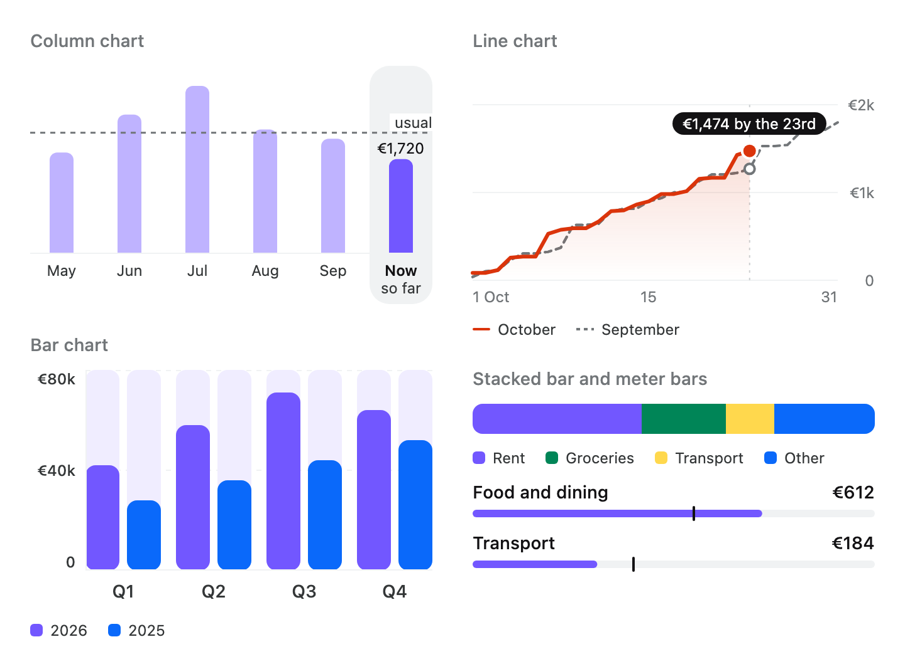

# Charts

Bar, stacked bar, column and line charts, a meter bar and a chart legend for Compose Multiplatform,
drawn with the Areca theme. The charts draw the numbers and strings they are handed: they do not
aggregate, round, pick tick values or format labels.

<picture>
  <source media="(prefers-color-scheme: dark)" srcset="../../docs/images/charts-dark.png">
  
</picture>

## Install

```kotlin
implementation("dev.voir.areca:charts:<version>")
```

`charts` passes `dev.voir.areca:foundation` on as an API dependency, so foundation comes with it.
Everything draws with the theme, so an `ArecaThemeProvider` must sit above the charts — usually the
one at the application's root. For the repository and credentials, see
[Getting started](../../docs/getting-started.md).

## Quick start

```kotlin
@Composable
fun WeeklySteps(steps: List<Pair<String, Float>>) {
    BarChart(
        groups = BarChartGroup.singleBars(
            steps.map { (day, count) -> BarChartBar(value = count, label = day) },
        ),
        modifier = Modifier.fillMaxWidth(),
        options = BarChartOptions(maxValue = 10_000f),
        yAxisLabels = listOf(
            BarChartYAxisLabel(0f, label = "0"),
            BarChartYAxisLabel(5_000f, label = "5k"),
            BarChartYAxisLabel(10_000f, label = "10k"),
        ),
    )
}
```

## Components

Everything is in `dev.voir.areca.charts`.

| Component | Use it for | Package |
| --- | --- | --- |
| `BarChart` | Values as vertical bars, in groups, against a scale with an axis, guides and tick labels | `dev.voir.areca.charts` |
| `StackedBarChart` | One horizontal bar split into the parts of a whole | `dev.voir.areca.charts` |
| `ColumnChart` | A scrolling row of periods, each a column of bars, that selects like tabs — a chart and a period picker in one | `dev.voir.areca.charts` |
| `LineChart` | Lines across a run of steps, such as a running total against last month's, with a rule and a bubble | `dev.voir.areca.charts` |
| `MeterBar` | One amount against a track, with an optional marker for a usual amount or a target | `dev.voir.areca.charts` |
| `ChartLegend` | The key to a chart's colours: a mark and a label per series | `dev.voir.areca.charts` |

---

## Bar chart

```kotlin
BarChart(
    groups = groups,
    modifier = Modifier,
    style = LocalBarChartStyle.current ?: BarChartStyle.Default,
    size = LocalBarChartSize.current ?: BarChartSize.Medium,
    options = BarChartOptions(),
    yAxisLabels = emptyList(),
    contentDescription = null,
    valueFormatter = BarChartBar.Companion::formatValue,
)
```

### Groups and bars

A chart is a list of `BarChartGroup`s, drawn start to end; each group is a list of `BarChartBar`s
drawn side by side, `BarChartSize.barGap` apart, with `groupGap` between groups.

```kotlin
val revenue = listOf(
    BarChartGroup(
        label = "Q1",
        bars = listOf(BarChartBar(42f, label = "2025"), BarChartBar(28.5f, label = "2024")),
    ),
    BarChartGroup(
        label = "Q2",
        bars = listOf(BarChartBar(51f, label = "2025"), BarChartBar(36f, label = "2024")),
    ),
)
```

`BarChartGroup.singleBars(bars)` puts each bar in a group of its own, for a chart of ungrouped bars.

- A bar's `label` is drawn under it, a group's `label` under the bar labels. A row is left out when
  nothing in it has a label. Bar labels wrap to `BarChartSize.xLabelMaxLines` lines (two) and group
  labels to `groupLabelMaxLines` (one), then end in an ellipsis.
- A group without bars is dropped. With no bars at all the chart still draws its empty plot at full
  size.

### The scale

`BarChartOptions.minValue` is the value at the bottom of the plot (`0f`); `maxValue` is the value
at the top, or `null` for the largest bar value.

- **Bars grow from zero**, clamped into the scale. With the default `minValue` a negative value draws
  no bar; to show negative values, state a negative `minValue` and bars below zero hang from a
  baseline partway up the plot. A value above the top is drawn full height.
- **State `maxValue` when there are tick labels.** The auto-scale puts the tallest bar at the top, so
  a tick label above it would be outside the scale and hidden. With no value above `minValue` the
  top is `minValue + 1f`.
- A bar off the baseline is at least `BarChartSize.minBarHeight` tall; a value on the baseline draws
  no bar.
- A `NaN` or infinite value means "no value": only the track is drawn, and the bar is left out of
  the auto-scale and the description.

```kotlin
BarChart(
    groups = BarChartGroup.singleBars(monthlyBalance),
    options = BarChartOptions(minValue = -500f, maxValue = 1_000f),
    yAxisLabels = listOf(
        BarChartYAxisLabel(-500f, label = "−500"),
        BarChartYAxisLabel(0f, label = "0"),
        BarChartYAxisLabel(1_000f, label = "1,000"),
    ),
)
```

### Axis, guides and tick labels

| `BarChartOptions` | What it draws (all on by default) |
| --- | --- |
| `showXAxis` | The horizontal axis line, on the baseline |
| `showYAxis` | The vertical axis line, on the plot's start edge |
| `showYGuides` | A dashed line across the plot at each visible tick label |
| `showBarTrack` | A full-height track behind each bar |

`yAxisLabels` are `BarChartYAxisLabel(value, label)`s, level with their value in a column
`BarChartSize.yLabelWidth` wide. A tick outside the scale is hidden with its guide; the column takes
no room while no tick is visible, and there are no guides without tick labels. A tick label is one
line, cut with an ellipsis — widen `yLabelWidth` with `BarChartSize.copy` for long numbers.

### Bar widths and alignment

| `BarChartOptions.barWidth` | Width of each bar |
| --- | --- |
| `BarChartBarWidth.Fill` | An equal share of the plot after the gaps. The default |
| `BarChartBarWidth.Fixed(width)` | `width`, or narrower when that many bars do not fit |
| `BarChartBarWidth.Range(min, max)` | `Fill`'s share kept within `min..max` while the bars fit |

When the bars are narrower than the plot, `horizontalAlignment` places them:
`BarChartHorizontalAlignment.Start`, `Center` (the default) or `End`.

```kotlin
BarChart(
    groups = BarChartGroup.singleBars(bars),
    modifier = Modifier.fillMaxWidth(),
    options = BarChartOptions(
        barWidth = BarChartBarWidth.Range(min = 12.dp, max = 32.dp),
        horizontalAlignment = BarChartHorizontalAlignment.Start,
    ),
)
```

Given unbounded width — inside a horizontally scrolling row — the chart takes the width its bars
need: a `Fill` bar is `BarChartSize.unboundedBarWidth` wide, a `Fixed` bar its width, a `Range` bar
its `max`.

```kotlin
Row(modifier = Modifier.horizontalScroll(rememberScrollState())) {
    BarChart(
        groups = BarChartGroup.singleBars(dailyTotals),
        options = BarChartOptions(barWidth = BarChartBarWidth.Fixed(width = 12.dp)),
    )
}
```

### Fills, tracks and shape

A bar takes the style's `bar` colour unless it has a `fill`, and its track the style's `track`
unless it has a `trackColor`:

```kotlin
BarChartBar(
    value = today,
    label = "Today",
    fill = BarChartFill.Solid(ArecaTheme.colors.bgWarnBase),
)
BarChartBar(
    value = total,
    fill = BarChartFill.Gradient(
        Brush.verticalGradient(listOf(ArecaTheme.colors.bgBrandBase, ArecaTheme.colors.bgInfoBase)),
    ),
)
```

A `Gradient` brush is sized to the whole plot, so every bar shades from one ramp.
`BarChartOptions.shape` is `BarChartShape.Rounded` (the default, by `BarChartSize.barCornerRadius`)
or `Square`; `contentPadding` insets everything inside the chart's background.

---

## Stacked bar

```kotlin
StackedBarChart(
    segments = listOf(
        StackedBarSegment(fraction = 0.52f, label = "Housing"),
        StackedBarSegment(fraction = 0.23f, label = "Food"),
        StackedBarSegment(fraction = 0.12f, label = "Transport"),
    ),
    modifier = Modifier.fillMaxWidth(),
)
```

Also takes `style`, `size`, `contentDescription` and `fractionFormatter` (a whole percentage by
default).

- Each `StackedBarSegment` takes `fraction` of the bar from the start edge, in order. Fractions
  summing to at most `1f` are drawn as given, the rest showing the style's `track`; fractions
  summing above `1f` are scaled down together, so raw counts work as long as they add up to the
  whole.
- A fraction that is zero, negative or not finite draws nothing and counts toward nothing.
- `StackedBarChartSize.segmentGap` puts track-coloured space between segments without growing the
  bar: `0.dp` in `Small`, `Medium` and `Large`, a hairline in `Tiny` and `ExtraSmall`.
- A segment without a `color` takes `palette[i % palette.size]` of the style, where `i` is its index
  in the list, drawn or not — so a category keeps its colour when its share falls to zero. Pass a
  palette with `StackedBarChartStyle.default(palette = …)`; it must not be empty.

The bar draws no text, so show a [legend](#legend) beside it.

---

## Column chart

```kotlin
ColumnChart(
    columns = columns,
    modifier = Modifier,
    selectedKey = null,
    onSelect = null,
    state = rememberColumnChartState(),
    referenceLines = emptyList(),
    valueLabels = ColumnChartValueLabels.Selected,
    layout = ColumnChartLayout.Scroll,
    maxValue = null,
    contentPadding = PaddingValues(0.dp),
    style = LocalColumnChartStyle.current ?: ColumnChartStyle.Default,
    size = LocalColumnChartSize.current ?: ColumnChartSize.Medium,
)
```

A row of columns, one per period, that reads as a chart and works as a period picker:

```kotlin
@Composable
fun SpendingMonths(
    months: List<MonthSpend>,
    selected: String,
    onSelect: (String) -> Unit,
) {
    ColumnChart(
        columns = months.map { month ->
            ColumnChartColumn(
                key = month.id,
                bars = listOf(
                    ColumnChartBar.of(month.spent),
                    ColumnChartBar.companion(month.spentAYearEarlier),
                ),
                label = month.shortName,
                sublabel = month.yearCaption,
                valueLabel = month.spentText,
                contentDescription = month.description,
            )
        },
        selectedKey = selected,
        onSelect = onSelect,
        referenceLines = listOf(ColumnChartReferenceLine(value = usualSpend, label = "usual")),
        contentPadding = PaddingValues(horizontal = ArecaTheme.spacing.xl),
    )
}
```

### Columns, bars and segments

- A `ColumnChartColumn<K>` has a `key` (unique in the chart; what `onSelect` reports and
  `selectedKey` matches), a one-line `label`, and an optional `sublabel` on a second line, reserved
  under every column once any has one. List columns oldest first.
- A column's `ColumnChartBar`s stand side by side. A bar is a list of `ColumnChartSegment`s: one is a
  plain bar, several stack from the baseline up with `ColumnChartSize.stackGap` between them.
  `ColumnChartBar.of(value)` builds a plain bar; `ColumnChartBar.companion(value)` a slim bar,
  `companionWidth` wide, for the same period a year earlier.
- `enabled = false` draws the column but makes it unselectable. `placeholder = true` stands in for
  missing history: dashed outlines, unselectable, skipped by assistive technology.

### Selection

The chart is controlled: it draws `selectedKey` and reports taps through `onSelect`, never for the
selected, a disabled or a placeholder column. The selected column gets a halo and an emphasised
label, and the others dim to `ColumnChartStyle.dimmedAlpha`. Without `onSelect` the columns are not
interactive and `selectedKey` only highlights one.

### Layout and scrolling

| `ColumnChartLayout` | How the columns take the width |
| --- | --- |
| `Scroll` | Each column is `ColumnChartSize.columnWidth` wide; the chart scrolls sideways and opens on its last column. The default |
| `Fill` | The columns share the width; nothing scrolls. For a handful of columns |

Under `Scroll`, a change of `selectedKey` scrolls the selected column into view; a refresh of the
same data or a resize does not move the chart. `contentPadding` is space at the start and end inside
the scroll, usually the screen gutter.

Hoist `rememberColumnChartState()` to scroll from outside or read the position. A new state is
pinned to the end and follows new columns until the user scrolls away; scrolling back to the end, or
`scrollToEnd`, pins it again. The state survives configuration change.

| `ColumnChartState` | |
| --- | --- |
| `isAtEnd`, `canScroll` | Where it stands |
| `firstVisibleIndex`, `lastVisibleIndex` | The first and last columns at least partly in view, `-1` before layout |
| `scrollToEnd(animate)` | Suspends; scrolls to the last column and pins |
| `scrollToColumn(index, animate)` | Suspends; brings a column fully into view by as little as it takes |

### Scale, reference lines and value labels

- Bars grow from zero against `maxValue`, or, when `null`, against the tallest bar (a stack counted
  whole) or the highest reference line. Zero, negative and non-finite values draw nothing. A
  positive bar is at least `ColumnChartSize.minBarHeight` tall.
- A `ColumnChartReferenceLine(value, label, color)` is a dashed line across the chart — the usual
  amount, a budget — labelled at the end edge on `ColumnChartStyle.referenceLabelBg`. It stays put
  while the columns scroll.
- A column's `valueLabel` is drawn above its tallest bar according to `valueLabels`:
  `ColumnChartValueLabels.None`, `Selected` (the default) or `All`.
- A segment without a `color` takes the style's palette colour by its index in the stack (or the
  bar's index among regular bars); companions take `ColumnChartStyle.companion`.

---

## Line chart

```kotlin
LineChart(
    series = listOf(
        LineChartSeries(
            points = septemberRunningTotal,
            label = "September",
            stroke = LineChartStroke.Dashed,
            endMarker = LineChartMarker.Hollow,
        ),
        LineChartSeries(points = octoberRunningTotal, label = "October", area = true),
    ),
    modifier = Modifier.fillMaxWidth(),
    xLabels = listOf(
        LineChartXLabel(0, "1 Oct"),
        LineChartXLabel(14, "15"),
        LineChartXLabel(30, "31"),
    ),
    yLabels = listOf(LineChartYLabel(1_000f, "€1k"), LineChartYLabel(2_000f, "€2k")),
    rule = today,
    tooltip = LineChartTooltip(series = 1, index = today, text = "€2,340 by the 23rd"),
    maxValue = 2_500f,
)
```

Also takes `style`, `size` and `contentDescription`. The chart reads; it does not select.

A `LineChartSeries` is one value per step from the start edge. A `null` (or non-finite) point is "no
value yet" and breaks the line; a lone point is drawn as a dot. Each series has:

| Property | |
| --- | --- |
| `label` | What it is, read aloud |
| `color` | Or `null` for the style's palette colour at the series' index |
| `stroke` | `LineChartStroke.Solid` for the subject, `Dashed` for a comparison |
| `area` | Shade under the line, fading to the baseline |
| `endMarker` | The dot on its last point: `LineChartMarker.Filled` (the default), `Hollow`, or `null` |

Series are drawn in order: put the comparison first and the subject last, on top.

- The scale runs from zero to `maxValue`, or to the largest point. State `maxValue` when there are
  y labels.
- `xLabels` are `LineChartXLabel(index, label)`s under the plot; `yLabels` are
  `LineChartYLabel(value, label)`s, a grid line with its label at the end edge.
- `rule` is a step to draw a dashed vertical rule at. `tooltip` is a
  `LineChartTooltip(series, index, text)` bubble over one point; a point without a value shows none.

---

## Meter bar

```kotlin
MeterBar(
    fraction = spent / budget,
    marker = usual / budget,
    contentDescription = "€612, usual €550",
)
```

Also takes `color`, `style` and `size`.

- The fill runs from the start edge to `fraction` of the track and the marker sits at `marker`, both
  clamped to `0f..1f`; a non-finite value draws nothing. A positive fill is never shorter than the
  bar is thick. The bar fills the width it is given.
- `color` replaces the style's fill for one bar — a category's own colour.
- The marker overhangs the bar by `MeterBarSize.markerOverhang` without taking space; leave that much
  room around it.

It measures an amount, not work: for progress, use foundation's `ProgressBar`.

---

## Legend

```kotlin
ChartLegend(
    items = listOf(
        ChartLegendItem("October", ChartSwatch.Line(ArecaTheme.colors.bgBrandBase)),
        ChartLegendItem("September", ChartSwatch.DashedLine(ArecaTheme.colors.fgMuted)),
    ),
)
```

Also takes `style` and `size`. Items wrap onto as many lines as they need. Each
`ChartLegendItem(label, swatch)` draws a `ChartSwatch` matching how its series is drawn:

| `ChartSwatch` | For |
| --- | --- |
| `Square(color)` | A bar or a stacked segment |
| `Dot(color)` | A figure's colour key |
| `Line(color)` | A solid line series |
| `DashedLine(color)` | A comparison series or a reference line |
| `Tick(color)` | A meter bar's marker |

Pass the colours the chart draws with — its style's palette or the segments' own.

---

## Styles and sizes

| Component | Style · local | Size · local |
| --- | --- | --- |
| `BarChart` | `BarChartStyle` · `LocalBarChartStyle` | `BarChartSize` · `LocalBarChartSize` |
| `StackedBarChart` | `StackedBarChartStyle` · `LocalStackedBarChartStyle` | `StackedBarChartSize` · `LocalStackedBarChartSize` |
| `ColumnChart` | `ColumnChartStyle` · `LocalColumnChartStyle` | `ColumnChartSize` · `LocalColumnChartSize` |
| `LineChart` | `LineChartStyle` · `LocalLineChartStyle` | `LineChartSize` · `LocalLineChartSize` |
| `MeterBar` | `MeterBarStyle` · `LocalMeterBarStyle` | `MeterBarSize` · `LocalMeterBarSize` |
| `ChartLegend` | `ChartLegendStyle` · `LocalChartLegendStyle` | `ChartLegendSize` · `LocalChartLegendSize` |

**Bar chart colours.** `BarChartStyle.of(color, …)` builds the colours for one `BarChartColor` —
`Neutral`, `Brand`, `Success`, `Warning`, `Danger` or `Info` — which sets the bars and their tracks;
`bg`, `plotBg`, `axis`, `guide` and the label colours can be overridden in the same call.
`BarChartStyle.Default` is `of(BarChartColor.Brand)`.

```kotlin
BarChartStyle.of(BarChartColor.Success, plotBg = ArecaTheme.colors.bgSubtle)
```

**Other styles.** `StackedBarChartStyle`, `ColumnChartStyle`, `LineChartStyle`, `MeterBarStyle` and
`ChartLegendStyle` each have `default(…)`, taking every colour as a parameter defaulting to the
theme, and `Default`, which is `default()`. A `palette` must not be empty; `dimmedAlpha` and
`areaAlpha` are within `0f..1f`.

**Size steps.**

| Step | `BarChartSize` | `StackedBarChartSize` | `ColumnChartSize` | `MeterBarSize` |
| --- | --- | --- | --- | --- |
| `Tiny` | — | 4dp capsule, hairline gaps: a proportion line under a pair of figures | — | — |
| `ExtraSmall` | — | 8dp capsule, hairline gaps: a split inside a summary block | — | — |
| `Slim` | — | — | — | 4dp: a nested row under its parent |
| `Small` | 160dp plot: a chart in a card | 12dp: a list row or beside a figure | 110dp plot, 48dp columns: a year of months across a card | — |
| `Medium` | 220dp plot. The default | 24dp. The default, above its legend | 150dp plot. The default | 6dp. The default |
| `Large` | 280dp plot: the subject of its screen | 40dp: the subject of its section | 200dp plot: the subject of its screen | 10dp: the subject of its section |

`LineChartSize` and `ChartLegendSize` have one step, `Default`, and a `default(…)` that overrides
single values. Change one value of the others with `copy`:
`BarChartSize.Small.copy(height = 120.dp)`, `ColumnChartSize.Medium.copy(columnWidth = 48.dp)`.

**Defaults in scope.** Each component's `style` and `size` default to its local, or to `Default` and
`Medium` (`Default` for the line chart and legend) when the local is `null`. `ArecaThemeProvider`
does not provide these locals; provide them around the screens that want other defaults:

```kotlin
CompositionLocalProvider(
    LocalBarChartStyle provides BarChartStyle.of(BarChartColor.Info),
    LocalBarChartSize provides BarChartSize.Small,
) {
    Dashboard()
}
```

---

## Accessibility

See [Accessibility](../../docs/accessibility.md) for the shared rules. In this module:

| Component | What assistive technology reads |
| --- | --- |
| `BarChart` | One node: `contentDescription`, or one generated from the data — `Q1: 2025 42, 2024 28.5; Q2: 2025 51, 2024 36`. Non-finite values and blank labels are left out |
| `StackedBarChart` | One node: `contentDescription`, or each segment's label and drawn share — `Housing 52%, Food 23%, Transport 12%` |
| `ColumnChart` | Each column: its `contentDescription`, or its label, sublabel and value label, announced as selected; with `onSelect`, a selectable group. Reference line labels are read once |
| `LineChart` | One node: `contentDescription`, or the series labels, then the bubble's text |
| `MeterBar` | `contentDescription` only, with no progress semantics. Pass `null` when the row's text already says the amount |
| `ChartLegend` | One sentence of its labels |

Write `contentDescription` for every column of real data ("October 2026, income €4,250, expenses
€2,340"), and for any chart whose point is a sentence ("Revenue rose every quarter").

**Right to left.** Every chart mirrors: the first bar, column, step or segment sits at the start
edge, tick and y labels move to the other side, and horizontal gradients mirror with the plot.

## Words

The charts ship no strings: every label is a string the application passes. The generated
descriptions use two formatters, neither localised:

- `BarChart(valueFormatter = …)` — the default, `BarChartBar.formatValue`, writes `42` or `28.5`
  with no grouping separators.
- `StackedBarChart(fractionFormatter = …)` — a whole percentage by default.

```kotlin
BarChart(
    groups = revenue,
    valueFormatter = { value -> "${value.roundToInt()} thousand euros" },
)
```

The punctuation joining the generated parts is English; pass `contentDescription` when it does not
suit the locale. See [Localisation](../../docs/localisation.md).

## Where to look

- **Playground**, under **Charts**: **Bar chart** (bar and stacked bar: colour families, sizes,
  palettes, legend and edge cases), **Column chart** (bar kinds, a period picker, filled layouts,
  placeholders, right to left), **Line chart** (a running total with a rule, a bubble and a legend)
  and **Meter bar** (colours, sizes and edge cases).
- **KDoc** on each type in `dev.voir.areca.charts`; the scale and description rules are tested in
  [`BarChartMathTest`](src/commonTest/kotlin/dev/voir/areca/charts/BarChartMathTest.kt),
  [`StackedBarChartTest`](src/commonTest/kotlin/dev/voir/areca/charts/StackedBarChartTest.kt),
  [`ColumnChartMathTest`](src/commonTest/kotlin/dev/voir/areca/charts/ColumnChartMathTest.kt) and
  [`LineChartMathTest`](src/commonTest/kotlin/dev/voir/areca/charts/LineChartMathTest.kt).
- **Related**: foundation's `ProgressBar` for progress; the [foundation README](../foundation/README.md).
- **Skill**: [`skills/areca-ui-v1/reference/charts.md`](../../skills/areca-ui-v1/reference/charts.md).
