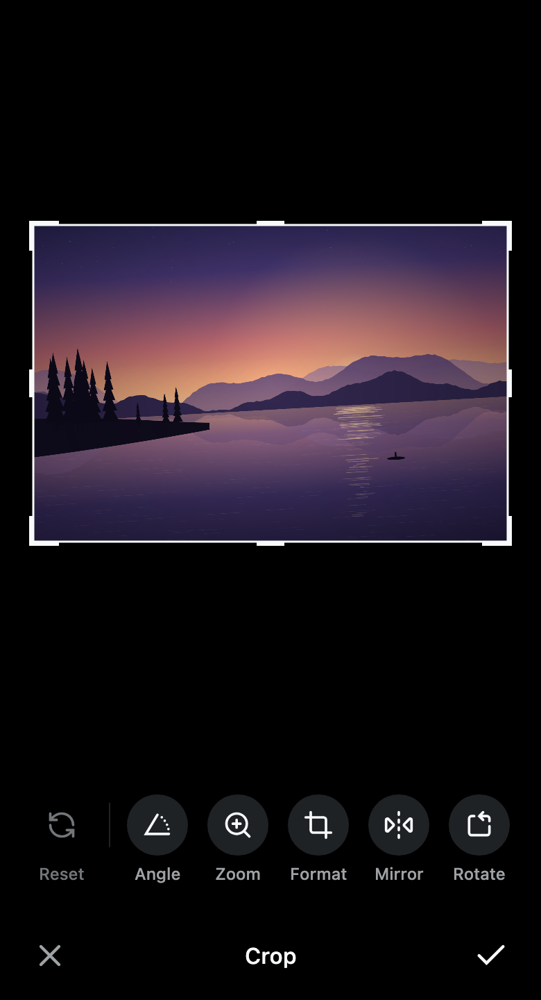

# Crop

An image cropper for Compose Multiplatform: frame a photo for an avatar, a cover or a post, with
straightening, zoom, aspect choices, mirroring, rotation and undo. It takes a `Painter` the
application decoded and returns a bitmap or a `CropResult` the application stores or sends.

<picture>
  <source media="(prefers-color-scheme: dark)" srcset="../../docs/images/crop-dark.png">
  
</picture>

## Install

```kotlin
implementation("dev.voir.areca:crop:<version>")
implementation("dev.voir.areca:foundation:<version>")
```

`crop` uses foundation internally but does not pass it on, so add foundation yourself: it holds
`ArecaThemeProvider`, which must sit above the cropper, and the `SystemBars`, `SquircleShape` and
`IconButton` used below. The `ArecaIcons.*` icons in [Your own controls](#your-own-controls) come
from `dev.voir.areca:icons`; add it only to use them. For the repository and credentials, see
[Getting started](../../docs/getting-started.md).

## Quick start

One crop screen, opened from every place the application crops with that place's `CropSpec`:

```kotlin
@Composable
fun CropScreen(
    photo: Painter,
    spec: CropSpec,
    title: String,
    onCancel: () -> Unit,
    onDone: (ImageBitmap) -> Unit,
    applyMask: Boolean = true,
) {
    val state = rememberImageCropState(spec, key = photo)

    Column(
        Modifier
            .fillMaxSize()
            .background(ImageCropperStyle.Default.stage)
            .windowInsetsPadding(WindowInsets.safeDrawing),
    ) {
        ImageCropper(
            painter = photo,
            state = state,
            contentDescription = "Photo being cropped",
            modifier = Modifier.weight(1f).fillMaxWidth(),
        )
        CropToolbar(
            state = state,
            title = title,
            onCancel = onCancel,
            onDone = { state.render(photo, applyMask)?.let(onDone) },
        )
    }
}
```

The stage, the toolbar and `render` all read the spec the state was made with. Cancel and Done sit
at the ends of the toolbar's bar, with the title between them.

- **Key the state on the photo** (`key = photo`), or a second photo of the same size opens on the
  first one's crop and undo history.
- **It survives rotation and process death.** The state saves the crop and its undo history; the
  toolbar saves its open tool and its discard question. The photo is not saved: keep what identifies
  it (a content URI, a file path) in the screen's saved state and decode it again.

## Components

| Component | Use it for | Package |
| --- | --- | --- |
| `ImageCropper` | The stage: the photo under a fixed frame, the outside veiled, with every gesture | `dev.voir.areca.crop` |
| `CropToolbar` | Reset, Angle, Zoom, Format, Mirror and Rotate over a Cancel and Done bar | `dev.voir.areca.crop` |
| `CropDial` | The straighten and zoom dial, for controls of your own | `dev.voir.areca.crop` |
| `CropDialog` | A window over everything, with the system bars painted the editor's black | `dev.voir.areca.crop` |

The state is `ImageCropState` from `rememberImageCropState(spec, key)`; the per-use settings are
`CropSpec`, `CropAspect` and `CropShapes`; the output is `CropResult`.

---

## The photo

- **Upright.** Apply the photo's EXIF orientation when decoding it.
- **A known size.** The painter's intrinsic size is the photo's size in pixels; a painter without
  one never shows.
- **Software bitmaps on Android.** Rendering cannot draw a hardware bitmap
  (`Bitmap.Config.HARDWARE`, Coil's default). Decode with hardware bitmaps off — for Coil,
  `allowHardware(false)` — or `render` throws an `IllegalArgumentException` that says so.
- **Display-sized on Android.** The stage cannot draw a bitmap over 100 MB (about 26 megapixels).
  Decode the stage's photo to about 4096 pixels on the longest side, and render from the
  full-resolution photo — see [Full resolution from a preview](#full-resolution-from-a-preview).

---

## The spec

```kotlin
CropSpec(
    aspect = CropAspect.Square,       // Free · Original · Ratio(w, h)
    isAspectLocked = true,            // frame keeps its aspect through rotation; no chips
    isResizable = false,              // no grips: frame the photo by moving and zooming it
    mask = CropShapes.Oval,           // any Shape: RectangleShape, RoundedCornerShape(12), SquircleShape(…), your own
    aspects = emptyList(),            // chips the toolbar offers, e.g. CropAspect.PhotoPresets
    maxZoom = 10f,
    maxOutputDimension = 512,         // longest side of the render; never scales a small crop up
)
```

| Use | Spec |
| --- | --- |
| Avatar | `CropSpec.Avatar` — square, locked, no grips, oval, 512 px |
| Avatar, squircle | `CropSpec.Avatar.copy(mask = SquircleShape(0.24f))` |
| Photo editor | `CropSpec.Photo` — free, every ratio on chips, grips, full detail |
| Cover banner | `CropSpec(CropAspect.Ratio(3, 1), isAspectLocked = true, maxOutputDimension = 1500)` |
| Badge with a custom shape | `CropSpec.Avatar.copy(mask = MyBadgeShape, maxOutputDimension = 1024)` |

- The mask is separate from the aspect. Use `CropShapes.Oval`, not `CircleShape`, which draws a pill
  on a frame that is not square.
- A spec that compares unequal starts a fresh crop. Define specs as top-level values, and give a
  custom mask a stable instance.

The flow recipes show picking, cropping and uploading end to end: `flow/profile` "Recipe: changing
the photo, with cropping" and `flow/attachments` "Recipe: cropping a photo before it's attached".

---

## Showing the crop screen

Open it as a navigation destination, or over the current screen in a `CropDialog`:

```kotlin
picked?.let { photo ->
    CropDialog(onDismissRequest = { picked = null }) {
        CropScreen(photo, PostCrop, title = "Crop photo", onCancel = { picked = null }, onDone = ::upload)
    }
}
```

`CropDialog` is a window of its own that draws behind the status and navigation bars, paints them
with the stage's black, asks for light bar icons, and dims nothing. Back (Escape on the desktop)
goes to the toolbar first: it closes an open tool, then asks before discarding changes, and only then
calls `onDismissRequest`. Pad the screen by `WindowInsets.safeDrawing`, as in the quick start. On iOS
the status bar's text keeps the style the view controller gives it.

In a navigation destination, call foundation's `SystemBars(ImageCropperStyle.Default.stage)` so the
system bars match the editor while it shows.

---

## Behaviour

- **The frame holds still; the photo moves.** Drag, pinch and scroll act on the photo; only the
  frame's grips resize the frame. The photo always covers the frame, and straightening zooms in just
  enough to hide the corners. A released grip re-centres the frame and zooms into the selection.
- **Guides while working.** A thirds grid shows while the user adjusts (a finer one while
  straightening), and the veil lifts.
- **The toolbar.** Reset puts everything back. Angle, Zoom and Format are tools: each replaces the
  row with its control and turns the bar into Undo, the tool's action (Level, Fit, Swap) and OK.
  Mirror is a toggle; Rotate turns a quarter turn left. A dot marks a tool whose value has changed.
  Format is left out when the spec locks the aspect or offers no choices.
- **Undo walks back the whole session**, one step at a time, across tools. A burst of scroll ticks or
  a held key is one step. For controls of your own: `state.undo()` and `state.canUndo`.
- **Values report the target.** `state.straighten`, `state.zoom`, `state.rotation`,
  `state.isMirrored`, `result()` and `render` hold an animation's end value from its first frame.
- **Leaving asks first** once anything has changed: Discard or Keep editing.

---

## The result

`state.render(painter)` returns an `ImageBitmap` cut to the spec's mask and no larger than its
`maxOutputDimension`. Pass `applyMask = false` to store the rectangular crop and mask it only where
it is shown. The mask is resolved as the stage drew it, at the frame's on-screen size, density and
layout direction.

`state.result()` describes the crop as a `CropResult`, in the source's own pixels, applied in this
order:

1. When `isMirrored`, flip the source left to right about the vertical line through `center`.
2. Rotate it clockwise by `rotation` degrees about `center`.
3. Cut the axis-aligned rectangle of `size` centred on `center`.

A server mapping output pixels back to the source reads the point at offset `q` from the output's
centre, in source pixels, from `center + M · R(−rotation) · q`, where `R(a)` turns clockwise by `a`
degrees with y pointing down — `(x, y) → (x·cos a − y·sin a, x·sin a + y·cos a)` — and `M` negates x
when `isMirrored`.

Render a result at a size of your choosing:

```kotlin
val result = state.result() ?: return
val thumbnail = result.render(painter, result.outputSize(maxDimension = 256), mask = CropShapes.Oval)
```

`CropResult.render` resolves a mask at the output's own size, so give it a proportional mask
(`CropShapes.Oval`, `RoundedCornerShape(percent = 12)`). `outputSize(maxDimension)` takes a positive
cap or `null`. Rendering runs on the calling thread and allocates `width × height × 4` bytes: move a
large render off the main thread.

### Full resolution from a preview

Show the stage a preview decoded to about 4096 pixels and pass the full-resolution photo to `render`;
the crop is scaled to it, capped by `maxOutputDimension`:

```kotlin
CropToolbar(
    state = state,
    onCancel = onCancel,
    onDone = { state.render(fullPhoto)?.let(onDone) },
)
```

`CropResult.scaledTo` does the same for a crop you render yourself:

```kotlin
val full = state.result()?.scaledTo(fullPhoto.intrinsicSize) ?: return
val bitmap = full.render(fullPhoto, full.outputSize(maxDimension = 2048))
```

Both copies must be the same picture in the same orientation; proportions that differ by more than
2% throw an `IllegalArgumentException`.

---

## Your own controls

Every command `CropToolbar` uses is public on `ImageCropState`, and `CropDial` is a component of its
own:

```kotlin
CropDial(
    value = state.straighten,
    onValueChange = state::setStraighten,
    valueRange = -45f..45f,
    contentDescription = "Angle",
    onAdjustStart = { state.startAdjusting(straightening = true) },
    onAdjustEnd = state::stopAdjusting,
)
IconButton(ArecaIcons.RotateCcwSquare, "Rotate", onClick = state::rotateLeft)
```

`IconButton` is foundation's; `ArecaIcons.RotateCcwSquare` is from `dev.voir.areca:icons`. Other
commands: `setZoom`, `reset`, `resetStraighten`, `resetZoom`, `undo`. Pair `startAdjusting` with
`stopAdjusting` around continuous changes so each records one undo step and shows the guides.

---

## Styles and sizes

The cropper is always dark: `ImageCropper`, `CropToolbar` and `CropDial` use the theme's dark
palette whatever the application's theme, and the toolbar draws its buttons in foundation's
`ArecaDarkTheme`. Nothing needs wrapping in a dark `ArecaThemeProvider`.

| Component | Style · local | Size · local |
| --- | --- | --- |
| `ImageCropper` | `ImageCropperStyle` · `LocalImageCropperStyle` | `ImageCropperSize` · `LocalImageCropperSize` |
| `CropToolbar` | `CropToolbarStyle` · `LocalCropToolbarStyle` | `CropToolbarSize` · `LocalCropToolbarSize` |
| `CropDial` | `CropDialStyle` · `LocalCropDialStyle` | `CropDialSize` · `LocalCropDialSize` |

`ImageCropperStyle.default(…)`, `CropToolbarStyle.default(…)` and `CropDialStyle.default(…)` take
colour overrides; the sizes have constructor defaults. Each component falls back to the type's
`Default` when its local is `null`. `ArecaThemeProvider` does not provide these locals; provide them
yourself:

```kotlin
CompositionLocalProvider(
    LocalImageCropperStyle provides ImageCropperStyle.default(veil = Color.Black.copy(alpha = 0.8f)),
    LocalCropDialStyle provides CropDialStyle.default(indicator = Color.White),
) {
    CropScreen(photo, PostCrop, title = "Crop photo", onCancel = onCancel, onDone = onDone)
}
```

The defaults follow each other: `CropToolbarStyle.default()` takes its `bg` from the provided
cropper stage and its `dial` from `LocalCropDialStyle`, `CropToolbarSize.Default` its `dial` from
`LocalCropDialSize`, and `CropDialog` its colour from the provided stage.

---

## Accessibility

See [Accessibility](../../docs/accessibility.md) for the shared rules. In this module:

- **The stage** takes the arrow keys (Shift for further), `+` and `−`, and `[` and `]`; a mouse click
  focuses it. For assistive technology it offers actions to move the photo, zoom in and out, and, on
  a resizable `Free` frame, widen or heighten the frame. Give it a `contentDescription` that names
  the photo.
- **The dial** takes the arrow keys and Home and is an adjustable control.
- **The toolbar**: Rotate and Reset are buttons, Mirror a switch, the aspect chips a radio group
  (36dp tall in a 48dp touch target), and the title a heading. The stage and dial show foundation's
  focus ring in their style's `focusRing` colour.

## Words

Every word the toolbar draws or reads is a property of `CropToolbarLabels`, with an English default:
the options (`reset`, `angle`, `zoom`, `format`, `mirror`, `rotate`), the bar (`cancel`, `done`,
`undo`, `ok`), the tool actions (`level`, `fit`, `swapOrientation`), the discard question
(`discardTitle`, `discardDescription`, `discard`, `keepEditing`), the `free` and `original` chips, and
the stage's actions (`moveLeft`, `moveRight`, `moveUp`, `moveDown`, `zoomIn`, `zoomOut`,
`widenFrame`, `heightenFrame`). Values are written by `angleValue` (`+3.2°`), `zoomValue` (`2.5×`) and
`rotationValue` (`90°`).

Pass the same labels to `CropToolbar` and `ImageCropper` as `labels`, as a top-level value; the
screen title is the `title` parameter. Ratio chips read their numbers (`4:3`).

```kotlin
val GermanCropLabels = CropToolbarLabels(
    angle = "Winkel",
    zoomValue = { zoom -> "${(zoom * 10).roundToInt() / 10f}-fach".replace('.', ',') },
)
```

See [Localisation](../../docs/localisation.md).

## Where to look

- **Playground**, under **Crop**: **Image cropper**, **Crop toolbar** and **Crop dial**.
  [`CropScreen`](../../playground/src/commonMain/kotlin/dev/voir/areca/playground/crop/CropScreen.kt)
  is the quick start as compiled code; **Profile flow → Change photo** and **Attachments flow →
  Cropping** open it.
- **KDoc** on each type in `dev.voir.areca.crop`.
- **Related**: `EditableAvatar` in [flow/profile](../../flow/profile/README.md) reports
  `onChangePhoto` and `PendingAttachmentSheet` in [flow/attachments](../../flow/attachments/README.md)
  reports `onEdit` — where an application opens its crop screen.
- **Skill**: [`skills/areca-ui-v1/reference/crop.md`](../../skills/areca-ui-v1/reference/crop.md).
