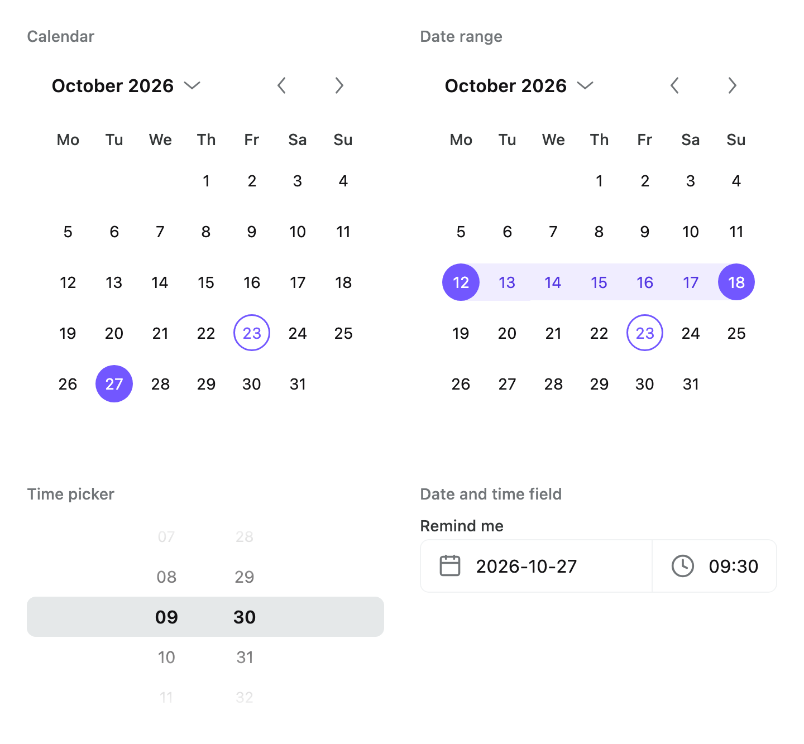

# Date and time

Calendars, a date range picker, a month and year picker, a month grid, a time picker, a date-time
field and a date tile for Compose Multiplatform, drawn with the Areca theme. The calendars, pickers
and field are controlled: they draw the value they are given and report what the user did.

<picture>
  <source media="(prefers-color-scheme: dark)" srcset="../../docs/images/datetime-dark.png">
  
</picture>

## Install

```kotlin
implementation("dev.voir.areca:datetime:<version>")
```

`datetime` passes on two API dependencies:

- **`dev.voir.areca:foundation`** — its signatures use foundation types (`FieldStyle`,
  `WheelPickerStyle`, `ButtonStyle`). Everything draws with the theme, so an `ArecaThemeProvider`
  must sit above it.
- **`org.jetbrains.kotlinx:kotlinx-datetime`** — parameters and results are `LocalDate`,
  `LocalTime`, `LocalDateTime`, `YearMonth`, `DayOfWeek`, `Month` and `TimeZone`, and "today" comes
  from a `kotlin.time.Clock`.

**Supported: kotlinx-datetime 0.8.x, from 0.8.0.** Adding `datetime` moves an application on an older
kotlinx-datetime up to 0.8.0. Keep the application on 0.8.x: a later 0.x or 1.0 forced in by another
dependency can fail at run time until a `datetime` release compiled against it ships.

For the repository and credentials, see [Getting started](../../docs/getting-started.md).

## Quick start

```kotlin
@Composable
fun DeliveryDay() {
    var day by remember { mutableStateOf<LocalDate?>(null) }

    Calendar(
        selection = CalendarSelection.Single(day),
        onDateClick = { day = it },
    )
}
```

## Components

| Component | Use it for | Package |
| --- | --- | --- |
| `Calendar` | A swipeable month grid that picks one day, several, or shows a range | `dev.voir.areca.datetime.calendar` |
| `CalendarDay` | One day cell, for a custom `day` slot | `dev.voir.areca.datetime.calendar` |
| `MonthHeader` | The default header: the month, which opens the month picker, and back and forward chevrons | `dev.voir.areca.datetime.calendar` |
| `WeekdayHeader` | The row of weekday headings | `dev.voir.areca.datetime.calendar` |
| `TodayButton` | A header control that returns to today | `dev.voir.areca.datetime.calendar` |
| `CalendarHeatDay` | A day cell shaded by how much it held — spending or activity by day | `dev.voir.areca.datetime.calendar` |
| `CalendarHeatLegend` | The key to a heat map's shades | `dev.voir.areca.datetime.calendar` |
| `MonthYearPicker` | Month and year wheels | `dev.voir.areca.datetime.calendar` |
| `MonthGrid` | Months as tiles, a year to a block, for picking a whole month | `dev.voir.areca.datetime.calendar` |
| `DateRangeCalendar` | A calendar that picks a run of days in two taps, under length limits | `dev.voir.areca.datetime.calendar.range` |
| `DateRangeDay` | One day cell of a range calendar, for a custom `day` slot | `dev.voir.areca.datetime.calendar.range` |
| `TimePicker` | Hour, minute and AM/PM wheels | `dev.voir.areca.datetime` |
| `DateTimeField` | One field with a date half and a time half, each opening its picker | `dev.voir.areca.datetime` |
| `DateTile` | A date as a small month-over-day tile, leading a row | `dev.voir.areca.datetime` |

`DateTimeLocale` and the labels types are in `dev.voir.areca.datetime`; `CalendarLabels` is in
`dev.voir.areca.datetime.calendar` and `DateRangeLabels` in `dev.voir.areca.datetime.calendar.range`.

---

## Calendar

```kotlin
Calendar(
    modifier = Modifier,
    state = rememberCalendarState(),
    selection = CalendarSelection.Empty,
    onDateClick = null,
    dateRule = CalendarDateRule.All,
    startDayOfWeek = DateTimeLocale.Current.firstDayOfWeek,
    labels = CalendarLabels.English,
    showAdjacentMonths = false,
    fixedWeekCount = true,
    style = LocalCalendarStyle.current ?: CalendarStyle.Default,
    size = LocalCalendarSize.current ?: CalendarSize.Default,
    header = { MonthHeader() },
    weekdayHeader = { WeekdayHeader() },
    day = { day -> CalendarDay(day = day) },
)
```

### Selection

The calendar never changes its selection: it reports the tapped day through `onDateClick` and draws
the `CalendarSelection` it is handed back.

| `CalendarSelection` | What it holds |
| --- | --- |
| `Single(date)` | One day, or `null`. `CalendarSelection.Empty` is `Single()` |
| `Multiple(dates)` | Any set of days |
| `Range(range)` | A `CalendarDateRange`, both ends inclusive, or `null` — for drawing a range picked elsewhere. To pick one, use [`DateRangeCalendar`](#date-range) |

```kotlin
var days by remember { mutableStateOf(emptySet<LocalDate>()) }

Calendar(
    selection = CalendarSelection.Multiple(days),
    onDateClick = { date ->
        days = when {
            date in days -> days - date
            days.size < 5 -> days + date
            else -> days
        }
    },
)
```

With `onDateClick = null` (the default) the calendar is read-only: it pages and announces its days,
and nothing is tappable or focusable.

### State and today

```kotlin
rememberCalendarState(
    initialMonth = null,
    bounds = CalendarBounds.Default,
    clock = Clock.System,
    timeZone = TimeZone.currentSystemDefault(),
)
```

Hoist a `CalendarState` to drive the calendar from outside:

| `CalendarState` | |
| --- | --- |
| `animateTo(month)`, `scrollTo(month)`, `animateToNextMonth()`, `animateToPreviousMonth()`, `animateToToday()` | Suspend; launch from `rememberCoroutineScope()`. Clamped into the bounds |
| `visibleMonth` | The month the header names; flips halfway through a swipe |
| `settledMonth` | Changes only once paging comes to rest — read it to load a month's events |
| `canScrollBackward`, `canScrollForward` | Whether an earlier or later month exists |
| `expandMonthPicker()`, `collapseMonthPicker()`, `toggleMonthPicker()`, `isMonthPickerExpanded` | Swap the grid for the month picker |
| `today`, `bounds` | The day drawn as today, and the months the calendar can reach |

Use `scrollTo` for a move that is not the user's, such as following a typed date:

```kotlin
val state = rememberCalendarState()

LaunchedEffect(typedDate) {
    typedDate?.let { state.scrollTo(it.yearMonth) }
}
Calendar(state = state, selection = CalendarSelection.Single(typedDate), onDateClick = onPick)
```

The visible month is saved across configuration change and process death. Changing `bounds` builds
a new state; changing `initialMonth` does not.

**Today is read once, from `clock`**, when the state is created. Pin it in a test or screenshot with
a fixed `kotlin.time.Clock`:

```kotlin
val fixedClock = object : Clock {
    override fun now(): Instant = Instant.parse("2026-09-15T09:00:00Z")
}

Calendar(
    state = rememberCalendarState(clock = fixedClock, timeZone = TimeZone.UTC),
    selection = CalendarSelection.Single(LocalDate(2026, 9, 18)),
)
```

### Bounds and date rules

| | Decides | A refused day |
| --- | --- | --- |
| `CalendarBounds` (on the state) | Which months exist | Is never paged to; edge days of a partial first or last month are drawn unavailable |
| `CalendarDateRule` (`dateRule`) | Which drawn days accept a tap | Is greyed, announced as unavailable, and refuses the tap |
| `DateRangeConstraints` (range only) | How long a range may be | See [Date range](#date-range) |

**Bounds** are inclusive days, `CalendarBounds(minDate, maxDate)`. Put a booking window here rather
than in a rule, so the user cannot page through empty months. `CalendarBounds.Default` runs from
1 January 1900 to 31 December 2100; `CalendarBounds.around(today, years)` gives whole years either
side of a day; `CalendarBounds.of(minDate, maxDate)` takes nullable ends.

```kotlin
val today = remember { Clock.System.todayIn(TimeZone.currentSystemDefault()) }
val state = rememberCalendarState(
    bounds = CalendarBounds(minDate = today, maxDate = today.plus(90, DateTimeUnit.DAY)),
)
```

**Rules** are a predicate, `CalendarDateRule { date -> … }`, or a ready-made one — `All` (the
default), `None`, `allowing(dates)`, `blocking(dates)`, `inRange(range)`, `byDayOfWeek(predicate)` —
combined with `+`, which requires both:

```kotlin
val weekend = setOf(DayOfWeek.SATURDAY, DayOfWeek.SUNDAY)
val workingDays = CalendarDateRule.byDayOfWeek { it !in weekend } +
    CalendarDateRule.blocking(publicHolidays)
```

A rule runs for every drawn cell: keep it to a set lookup or a comparison.

### Layout and slots

| Parameter | |
| --- | --- |
| `startDayOfWeek` | The first column; from the locale by default |
| `showAdjacentMonths` | Fill the cells before the 1st and after the last with the neighbouring months' days, muted |
| `fixedWeekCount` | Six rows for every month, so paging does not resize the calendar. On by default |
| `header` | The band above the grid, `MonthHeader()` by default; `null` removes it |
| `weekdayHeader` | The weekday row, `WeekdayHeader()` by default; `null` removes it |
| `day` | One cell, from a `CalendarDayState`: `date`, `month`, `isAdjacent`, `isToday`, `isSelected`, `isEnabled` |

The slots run in a `CalendarScope`, which carries `state`, `labels` and `startDayOfWeek`, and offers
`nextMonth()`, `previousMonth()`, `goTo(month)`, `jumpTo(month)`, `goToToday()`,
`toggleMonthPicker()` and `collapseMonthPicker()`, with `canGoBack`, `canGoForward`, `visibleMonth`
and `isMonthPickerExpanded`.

`MonthHeader(showControls = false)` drops the chevrons, and `showMonthPicker = false` leaves the
month as plain text. `TodayButton()` returns to today, disabled while today's month is showing:

```kotlin
Calendar(
    state = state,
    selection = selection,
    onDateClick = onPick,
    header = {
        Row(verticalAlignment = Alignment.CenterVertically) {
            MonthHeader(modifier = Modifier.weight(1f))
            TodayButton()
        }
    },
)
```

A custom `day` slot should draw through `CalendarDay`, which carries the grid position and keyboard
behaviour; decorate around it. `CalendarDay` ignores `onClick` on an unavailable day.

```kotlin
Calendar(
    selection = selection,
    onDateClick = onPick,
    day = { day ->
        Box(contentAlignment = Alignment.BottomCenter) {
            CalendarDay(day = day, onClick = { onPick(day.date) })
            if (day.date in eventDays && !day.isAdjacent) {
                Box(
                    Modifier
                        .padding(bottom = 4.dp)
                        .size(4.dp)
                        .background(ArecaTheme.colors.accentBase, CircleShape),
                )
            }
        }
    },
)
```

### Heat-map days

`CalendarHeatDay` is a `day` slot cell that shades a day by how much it held, with its number over a
short amount. It keeps `CalendarDay`'s keyboard, selection and tap behaviour.
`CalendarHeatLegend(lowLabel, highLabel)` is its key.

```kotlin
val steps = ArecaTheme.colors.accentScale.size

Column(verticalArrangement = Arrangement.spacedBy(ArecaTheme.spacing.lg)) {
    Calendar(
        selection = CalendarSelection.Single(picked),
        onDateClick = { picked = it },
        dateRule = CalendarDateRule { it <= today },
        day = { day ->
            val spent = spentOn(day.date)
            CalendarHeatDay(
                day = day,
                level = calendarHeatLevel(spent, max = busiestDay, steps = steps),
                amount = if (spent > 0f) formatShort(spent) else null,
                onClick = { picked = day.date },
            )
        },
    )
    CalendarHeatLegend(lowLabel = "€0", highLabel = "€280", emptyLabel = "nothing spent")
}
```

- A day with a `level` is filled with that shade of `CalendarHeatStyle.ramp` (the theme's
  `accentScale`), with ink that reads on it. A day with `level = null` is an empty ringed cell. A
  day the `dateRule` refuses — still to come — is a flat pale tile with no amount. Today and the
  selected day are ringed.
- `calendarHeatLevel(value, max, steps)` maps a value to a level: zero, negative and non-finite
  values have none; a positive value takes one of the shades after the faintest, so a small value
  still shows. Pass the ramp's size as `steps` (at least two).
- `CalendarHeatLegend` draws the low label, `steps` shades (four by default), the high label and,
  with `emptyLabel`, the ringed mark.
- Keep the amount short (`€84`, `€1.2k`): it is one clipped line.

---

## Date range

```kotlin
var stay by remember { mutableStateOf<DateRangeSelection>(DateRangeSelection.Empty) }

DateRangeCalendar(
    selection = stay,
    onSelectionChange = { stay = it },
    constraints = DateRangeConstraints(
        dateRule = CalendarDateRule.blocking(bookedNights),
        minDays = 3,
        maxDays = 15,
    ),
    showAdjacentMonths = true,
)
stay.range?.let { range -> Text(DateRangeLabels.English.length(range)) }
```

`DateRangeCalendar` takes `Calendar`'s `state`, `startDayOfWeek`, `labels`, `showAdjacentMonths`,
`fixedWeekCount`, `style`, `size`, `header`, `weekdayHeader` and `day`, and adds `constraints`,
`onRangeComplete`, `rangeLabels` and `rangeStyle`.

- **`DateRangeSelection`** is `Empty`, `Started(anchor)` or `Complete(range)`; `range` is the
  `CalendarDateRange` once complete. The calendar is controlled: `onSelectionChange` receives the
  selection a tap produces. Pass `null` for a read-only range.
- **Two taps.** From `Empty` or `Complete`, a tap starts a new range. From `Started`, a later day the
  constraints allow completes it; an earlier day becomes the new anchor. The rule is the pure
  function `DateRangeSelection.select(date, constraints, bounds)`, for tests.
- **`onRangeComplete`** is called after `onSelectionChange` when a tap finishes a range — to close a
  popup or run a search. Under a mouse, hovering previews the range.

`DateRangeConstraints`:

| Parameter | |
| --- | --- |
| `minDays`, `maxDays` | Length in days, both ends included (`CalendarDateRange.dayCount`): a two-night minimum is `minDays = 3`. `maxDays = null` is no limit |
| `dateRule` | The per-day rule. Pass it here, not to the calendar |
| `blockedDays` | `BlockedDayPolicy.StopAtBlocked` (the default) stops a range at the first refused day; `AllowGaps` lets it span refused days without starting or ending on one |

Once an anchor is picked, days the range can no longer reach are drawn unavailable.
`constraints.endWindow(anchor, bounds)` returns the window the far end may fall in. With
`StopAtBlocked`, state a `maxDays` or narrow the bounds, since finding that window walks day by day.
`DateRangeLabels.length(range)` writes a range's extent (`3 nights`) for a footer of your own.

A custom `day` slot draws through `DateRangeDay`, from a `DateRangeDayState` (`date`, `position`,
`isPreview`, `isToday`, `isEnabled`), and applies the tap itself:

```kotlin
val state = rememberCalendarState()

DateRangeCalendar(
    selection = stay,
    onSelectionChange = { stay = it },
    state = state,
    constraints = constraints,
    day = { day ->
        DateRangeDay(
            day = day,
            onClick = {
                val next = stay.select(day.date, constraints, state.bounds)
                if (next != stay) stay = next
            },
        )
    },
)
```

---

## Month and year picker

`MonthHeader` opens a `MonthYearPicker` in place of the grid, at the grid's height. It also works on
its own, controlled: it reports the month the wheels rest on and follows `month` while idle. The month
wheel holds only the months `bounds` allows in the chosen year.

```kotlin
var month by remember { mutableStateOf(YearMonth(2026, 9)) }

MonthYearPicker(
    month = month,
    onMonthChange = { month = it },
    bounds = CalendarBounds.around(today, years = 5),
)
```

---

## Month grid

```kotlin
var month by remember { mutableStateOf<YearMonth?>(null) }

MonthGrid(
    years = listOf(2026, 2025),
    selected = month,
    onSelect = { month = it },
    enabled = { it < thisMonth },
) { m -> Text(if (m < thisMonth) totalFor(m) else "") }
```

- Each year in `years`, in the order given, gets a heading and its twelve months in rows of
  `columns` (four by default).
- Controlled: draws `selected` and reports taps through `onSelect`. A month `enabled` refuses is
  drawn flat and takes no tap.
- The trailing `content` is a tile's second line — a total, "this" for the current month.
- `labels` is a `CalendarLabels`: `year` for headings, `shortMonth` for tiles, `monthHeader` for what
  is read aloud.

---

## Date tile

```kotlin
ListItem(
    leading = { DateTile(date = payment.expectedOn, contentDescription = payment.dateText) },
    title = { Text(payment.payee) },
    value = { Text(payment.amount) },
)
```

A date as a small tile, `Nov` over `22`, leading a row about something on that date. `labels` is a
`CalendarLabels`: `shortMonth` draws the month and `dayNumber` the day.

---

## Time picker

```kotlin
var alarm by remember { mutableStateOf(LocalTime(7, 30)) }

TimePicker(
    initialTime = alarm,
    onTimeChange = { alarm = it },
    format = TimeFormat.Hours12,
)
```

- The picker owns its wheels: `initialTime` seeds them once. To reset, key it:
  `key(resetCount) { TimePicker(…) }`.
- `onTimeChange` fires when the wheels come to rest after the user turns them — not on first
  composition.
- `format` is `TimeFormat.Hours24` or `TimeFormat.Hours12`, from the locale by default. The hour and
  minute wheels wrap. The result has minute precision.
- `itemContent`, `centerContent`, `columnWidth` and `columnSpacing` customise the columns. `style`,
  `size` and `scroll` are foundation's `WheelPickerStyle`, `WheelPickerSize` and `WheelPickerScroll`.

---

## Date-time field

```kotlin
var start by remember { mutableStateOf<LocalDateTime?>(null) }

DateTimeField(
    value = start,
    onValueChange = { start = it },
    format = DateTimeFieldFormat(
        date = { date -> date.format(DayMonthYear) },
        time = { time -> time.format(LocalTime.Formats.ISO) },
    ),
    defaultTime = LocalTime(10, 0),
    dateRule = CalendarDateRule.byDayOfWeek { it != DayOfWeek.SUNDAY },
)

val DayMonthYear = LocalDate.Format {
    day()
    char(' ')
    monthName(MonthNames.ENGLISH_ABBREVIATED)
    char(' ')
    year()
}
```

A foundation `FieldRow` with two halves: the date half opens a `Calendar` in a dropdown, the time
half a `TimePicker`. They share one border, focus and `status`, and take a `field` from an enclosing
`FieldGroup`. Opening one picker closes the other.

- `value` is `null` until something is chosen; `onValueChange` always receives a whole
  `LocalDateTime`. A date picked on an empty field takes `defaultTime` (09:00 unless given).
- A time picked before any date is held as a draft and taken by the first date picked. A change to
  `value` drops it.

| Parameter | |
| --- | --- |
| `format` | The two strings shown. Default `DateTimeFieldFormat.numeric(timeFormat, timeLabels)`: `2026-09-13` and `14:30` or `2:30 PM`. Pass the application's own |
| `timeFormat`, `startDayOfWeek` | From the locale by default |
| `labels`, `calendarLabels`, `timeLabels` | The text; see [Words](#words) |
| `calendarState` | The dropdown calendar's state — for bounds or a fixed clock |
| `dateRule` | Which days can be picked |
| `datePlaceholder`, `timePlaceholder` | Default `Pick a date` and `--:--` |
| `timeWidth` | Fixes the time half's width, so a column of fields lines up |
| `leading` | The calendar glyph; `null` removes it |
| `enabled`, `readOnly` | `false` disables both halves; `readOnly` shows the value and opens nothing |
| `placement`, `dropdownStyle` | Position and colours of the dropdowns |

---

## Styles and sizes

| Component | Style · local | Size · local |
| --- | --- | --- |
| `Calendar`, `MonthHeader`, `WeekdayHeader`, `TodayButton`, `CalendarDay` | `CalendarStyle` · `LocalCalendarStyle` | `CalendarSize` · `LocalCalendarSize` |
| `DateRangeCalendar`, `DateRangeDay` | `DateRangeStyle` · `LocalDateRangeStyle`, with `CalendarStyle` | `CalendarSize` · `LocalCalendarSize` |
| `CalendarHeatDay`, `CalendarHeatLegend` | `CalendarHeatStyle` · `LocalCalendarHeatStyle` | `CalendarHeatSize` · `LocalCalendarHeatSize` |
| `MonthGrid` | `MonthGridStyle` · `LocalMonthGridStyle` | `MonthGridSize` · `LocalMonthGridSize` |
| `DateTile` | `DateTileStyle` · `LocalDateTileStyle` | `DateTileSize` · `LocalDateTileSize` |
| `MonthYearPicker` | foundation's `WheelPickerStyle` · `LocalWheelPickerStyle` | `WheelPickerSize`, from `CalendarSize.monthPicker` |
| `TimePicker` | foundation's `WheelPickerStyle` · `LocalWheelPickerStyle` | `WheelPickerSize` · `LocalWheelPickerSize` |
| `DateTimeField` | foundation's `FieldStyle` · `LocalFieldStyle` | `FieldSize` · `LocalFieldSize` |

- `CalendarStyle.default(…)` takes every colour as a parameter — day, selected, today, unavailable
  and adjacent fills and numbers, header labels, and the month controls. `DateRangeStyle.default(…)`
  does the same for the band, the end caps and their variants.
- `CalendarSize.Default` is the full calendar; `CalendarSize.Compact` tightens it for a dropdown or
  sidebar (the `DateTimeField` dropdown uses it). `CalendarSize.default(…)` overrides single values.
- `CalendarHeatStyle.default(…)` takes the shade `ramp` (not empty) and the empty, future, ink and
  ring colours. `CalendarHeatSize`, `MonthGridStyle`, `MonthGridSize`, `DateTileStyle` and
  `DateTileSize` each have a `Default` and a `default(…)`.

The module's locals are `null` unless provided, and each component then uses the type's `Default`.
`ArecaThemeProvider` provides foundation's wheel and field locals but not these; provide them around
the screens that want other defaults:

```kotlin
CompositionLocalProvider(
    LocalCalendarStyle provides CalendarStyle.default(selectedBg = ArecaTheme.colors.bgSuccessBase),
    LocalCalendarSize provides CalendarSize.Compact,
) {
    BookingScreen()
}
```

---

## Accessibility

See [Accessibility](../../docs/accessibility.md) for the shared rules.

**Keyboard.** A calendar grid is one tab stop. Tab lands on the day the keyboard last rested on, else
the first selected day, else today, else the 1st. Moves that leave the month page the calendar, and
stop at the bounds. Unavailable days take focus but refuse Enter; adjacent-month days stay out of the
tab order; a read-only calendar has no focusable days.

| Key | Moves to |
| --- | --- |
| Left / Right | The previous / next day — swapped in a right-to-left layout |
| Up / Down | The same weekday a week earlier / later |
| Home / End | The first / last day of the week |
| Page Up / Page Down | The same day a month earlier / later |
| Shift + Page Up / Page Down | The same day a year earlier / later |

**Screen readers.**

- A calendar page is a table; each day is a selectable cell reading `CalendarLabels.dayDescription`
  (`Tuesday 15 September 2026`), announced as unavailable when refused. A range day adds
  `DateRangeLabels.position` (`start of range`, `in range`, `end of range`); a hover preview is never
  announced as selected. Weekday headings read full names.
- Each month the calendar settles on is announced. The month control reads the month and
  `monthPickerAction` with an expanded or collapsed state; the chevrons read `previousMonthAction`
  and `nextMonthAction`.
- `CalendarHeatDay` reads its day's description and then the amount; `CalendarHeatLegend` reads
  `contentDescription` or its labels in order.
- `MonthGrid` tiles are radio buttons in one group, reading `monthHeader` and the tile's content;
  year headings are headings.
- `DateTile` reads `contentDescription` or the whole date (`Sunday 22 November 2026`).
- The time picker's wheels read `hour`, `minute` and `period`; a twelve-hour hour is read with its
  period (`2 PM`). Each half of `DateTimeField` is a button reading its name and value, expanded or
  collapsed.

## Words

See [Localisation](../../docs/localisation.md) for the approach across modules. Two things vary by
locale.

**Conventions — `DateTimeLocale`.** `firstDayOfWeek` and `timeFormat`. `DateTimeLocale.Current`
reads them from the platform, including the user's 24-hour setting on Android and iOS.
`Calendar`, `DateRangeCalendar`, `TimePicker` and `DateTimeField` default to it. Pass the parameter
to override one component, or provide `LocalDateTimeLocale` to pin a subtree;
`DateTimeLocale.Iso` is Monday weeks and a 24-hour clock:

```kotlin
CompositionLocalProvider(LocalDateTimeLocale provides DateTimeLocale.Iso) {
    BookingScreen()
}
```

**Text — the labels objects**, each with an English default:

| Labels | Used by | Holds |
| --- | --- | --- |
| `CalendarLabels` | `Calendar`, `DateRangeCalendar`, `MonthYearPicker`, `MonthGrid`, `DateTile`, `DateTimeField` (`calendarLabels`) | Weekday headings and names, month headings and names, the spoken day, control names, digits |
| `DateRangeLabels` | `DateRangeCalendar` (`rangeLabels`), `DateRangeDay` | A day's place in the range, and a range's length |
| `TimePickerLabels` | `TimePicker`, `DateTimeField` (`timeLabels`) | Wheel names, AM and PM, how an hour is read with its period |
| `DateTimeFieldLabels` | `DateTimeField` (`labels`) | The halves' names and states, and the placeholders |

`CalendarLabels.English` draws `Mo` and `September 2026`; `CalendarLabels.EnglishNarrow` draws
single-letter weekdays. Labels that compute text are functions:

```kotlin
val GermanMonths = listOf(
    "Januar", "Februar", "März", "April", "Mai", "Juni",
    "Juli", "August", "September", "Oktober", "November", "Dezember",
)
val GermanWeekdays = listOf(
    "Montag", "Dienstag", "Mittwoch", "Donnerstag", "Freitag", "Samstag", "Sonntag",
)

val GermanCalendarLabels = CalendarLabels(
    weekday = { day -> GermanWeekdays[day.ordinal].take(2) },
    monthHeader = { month -> "${GermanMonths[month.month.ordinal]} ${month.year}" },
    pickerMonth = { month -> GermanMonths[month.ordinal] },
    shortMonth = { month -> GermanMonths[month.ordinal].take(3) },
    dayDescription = { date ->
        val weekday = GermanWeekdays[date.dayOfWeek.ordinal]
        "$weekday, ${date.day}. ${GermanMonths[date.month.ordinal]} ${date.year}"
    },
    monthPickerAction = "Monat und Jahr wählen",
    monthPickerMonth = "Monat",
    monthPickerYear = "Jahr",
    previousMonthAction = "Vorheriger Monat",
    nextMonthAction = "Nächster Monat",
    todayAction = "Heute",
    monthPickerExpanded = "Ausgeklappt",
    monthPickerCollapsed = "Eingeklappt",
    weekdayName = { day -> GermanWeekdays[day.ordinal] },
)
```

Keep label sets as top-level values, so they compare equal across recompositions. kotlinx-datetime's
formats know no locale, so a translated `DateTimeField` passes its own `format`. Some spoken text
still joins its parts with `", "`, and the time wheels read Western digits.

## Where to look

- **Playground**, under **Date & time**: **Calendar**, **Date range calendar**, **Time picker**,
  **Date & time field**, **Month grid** and **Date tile**, each with recipes and edge cases — bounded
  paging, weeks starting on Sunday, keyboard navigation, a spending heat map, a minimum stay, blocked
  days.
- **KDoc** on each type in `dev.voir.areca.datetime` and its `calendar` packages.
- **Related**: `flow/profile`'s `BirthdayRow` ([flow/profile/README.md](../../flow/profile/README.md))
  opens a `Calendar` in a sheet; foundation's wheel and field types
  ([foundation README](../foundation/README.md)).
- **Skill**: [`skills/areca-ui-v1/reference/datetime.md`](../../skills/areca-ui-v1/reference/datetime.md).
