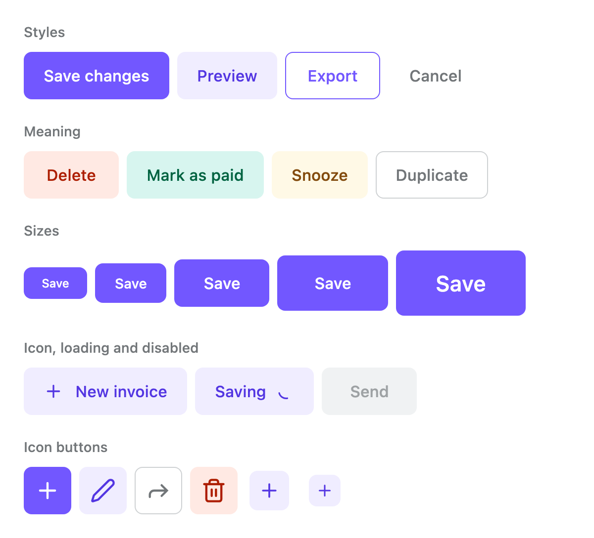
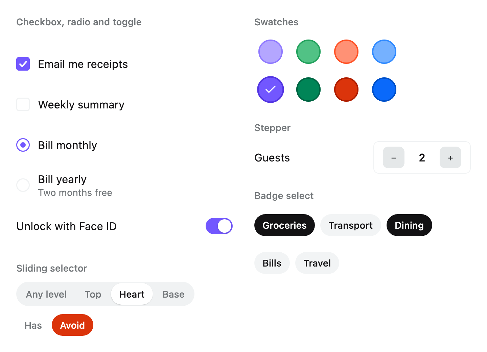
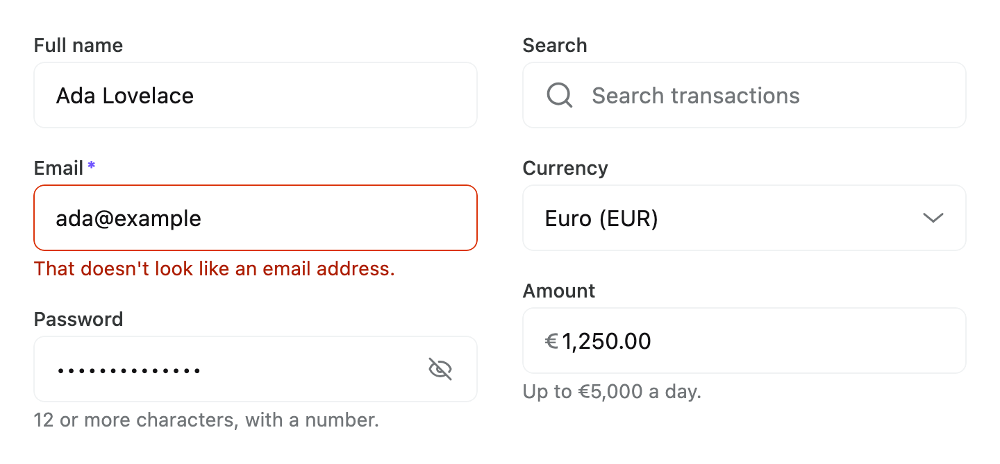
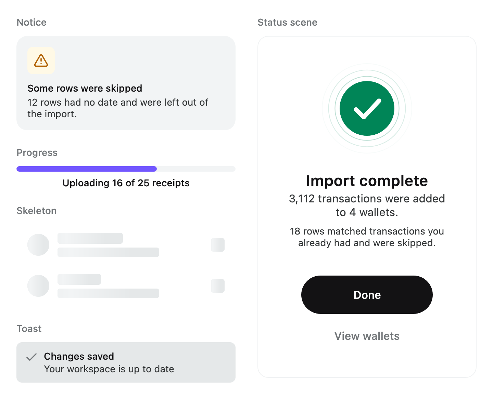
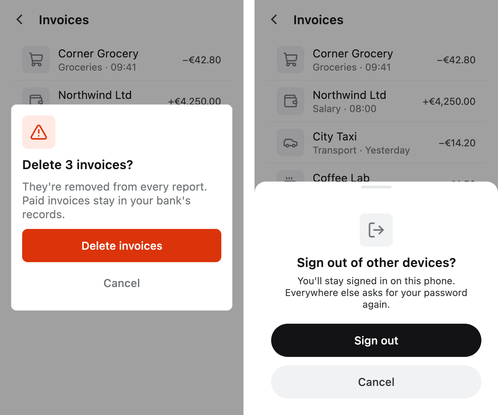
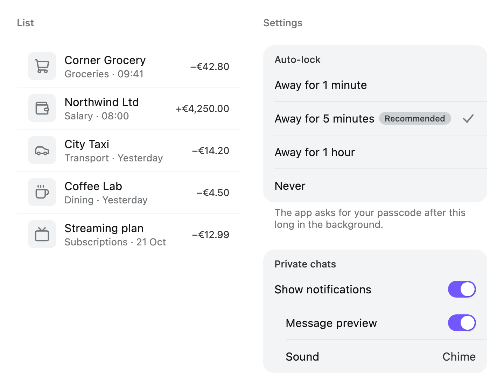
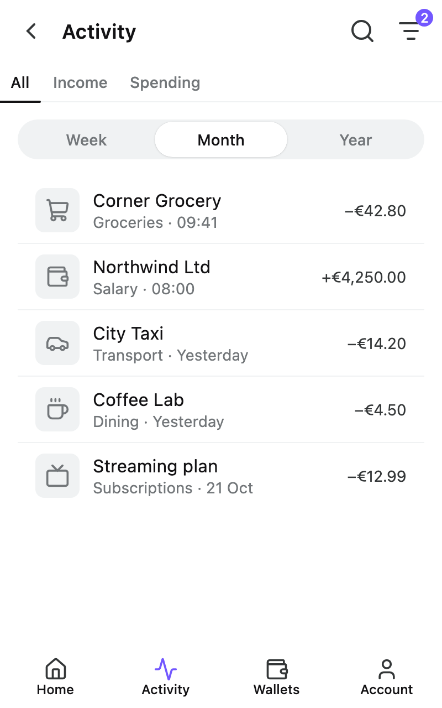

# Foundation

The Areca theme and every component built on it — buttons, text, fields, selection controls, lists
and settings, overlays, navigation and feedback — for Compose Multiplatform on Android, iOS and the
JVM. Every other `ui` and `flow` module draws with it.

The whole set, one row per component and with pictures, is the
[component catalogue](../../docs/components.md).

## Install

```kotlin
implementation("dev.voir.areca:foundation:<version>")
```

It brings `compose-runtime`, `compose-foundation` and `compose-ui` as API dependencies, and nothing
else. The snippets below use `ArecaIcons.*` from the separate, optional icon set,
`dev.voir.areca:icons` ([README](../../standalone/icons/README.md)). Areca is published to GitHub
Packages, so the build needs its repository first; see
[Getting started](../../docs/getting-started.md).

## Quick start

Wrap the application once in `ArecaThemeProvider`, then build screens from the components:

```kotlin
@Composable
fun App(onSignOut: () -> Unit) {
    ArecaThemeProvider(darkTheme = isSystemInDarkTheme()) {
        var push by remember { mutableStateOf(true) }

        BaseLayout(
            bg = ArecaTheme.colors.bgCanvas,
            contentWindowInsets = WindowInsets.safeDrawing,
            topBar = { TopBar("Account") },
        ) { padding ->
            Column(
                modifier = Modifier.padding(padding).horizontalContentInsets(),
                verticalArrangement = Arrangement.spacedBy(ArecaTheme.spacing.xl),
            ) {
                Settings {
                    Section(header = { Text("Notifications") }) {
                        SettingsToggleRow(
                            checked = push,
                            onCheckedChange = { push = it },
                            title = { Text("Push notifications") },
                        )
                    }
                }
                Button("Sign out", onClick = onSignOut, style = ButtonStyle.soft(ActionColor.Danger))
            }
        }
    }
}
```

`ArecaThemeProvider`, `ArecaTheme` and `horizontalContentInsets` are in `dev.voir.areca.theme`; each
component is in `dev.voir.areca.foundation.<family>` — here `layout`, `topbar`, `settings`, `text`
and `button`.

## Theme and customising

- **[Theme](../../docs/theme.md)** — the tokens (colour, typography, spacing, radius, elevation,
  motion), changing the theme through `ArecaThemeProvider`, regions that are always dark with
  `ArecaDarkTheme` and `SystemBars` (in `dev.voir.areca.platform`) to colour the system bars around
  them, and reading tokens through `ArecaTheme`.
- **[Customising components](../../docs/customising.md)** — every component's `style: XStyle` and
  `size: XSize`, the `Default` values, presets and `default(...)`, defaults provided for a subtree,
  `ActionColor`, parameter order, interaction and focus, and touch targets.

## Window classes

`ArecaTheme.window` is the space a composable is laid out in, classified, in
`dev.voir.areca.window`. Lay a screen out by it, never by a device check: a tablet in a narrow split
view is a compact window and gets the phone layout.

| Part | Holds |
| --- | --- |
| `WidthClass` | `Compact` under 600dp, `Medium` from 600, `Expanded` from 840, `Large` from 1200, `ExtraLarge` from 1600. Ordered, so `width >= WidthClass.Medium` reads as "at least medium" |
| `HeightClass` | `Compact` under 480dp (a phone on its side), `Medium` from 480, `Expanded` from 900 |
| `InputMode` | `Touch` or `Pointer`: what presses the controls. Touch on Android and iOS, a pointer on the desktop, unless `ArecaThemeProvider(inputMode = …)` says otherwise |
| `WindowProfile` | A familiar name for the combination: `PhonePortrait`, `PhoneLandscape`, `TabletPortrait`, `TabletLandscape`, `Desktop`. Under touch a tablet's is decided by its shape: at least `WindowClass.WideAspectRatio` (1.25) times as wide as tall is `TabletLandscape`, anything squarer — a tablet held upright, an unfolded foldable either way round — `TabletPortrait` |
| `ActionReach` | Where a screen's actions are within reach: `Header` beside the title (a pointer, a phone on its side, a touch window at least 1.25 times as wide as tall) or `Thumb` at the foot of the window (a phone, a tablet held upright, an unfolded foldable). Read it from `ArecaTheme.hostWindow`: the hands hold the device, not the pane |
| `WindowFold` | A foldable's fold or hinge: `orientation` (`FoldOrientation.Vertical` or `Horizontal`), `bounds`, `state` (`FoldState.Flat` or `HalfOpened`) and `isSeparating`. Reported on Android; `null` on iOS and the desktop |
| `WindowClass` | `size`, `width`, `height`, `input`, `profile`, `actionReach`, `isLandscape` and `fold` together |

| Composable | Use it for |
| --- | --- |
| `adaptive(compact, medium, expanded, large, extraLarge)` | A value for the width class in scope — a column count, a gutter. Only `compact` is required; each wider step defaults to the one below |
| `AdaptiveContent(compact, medium, expanded, large, extraLarge)` | One of several layouts for the width class in scope, with the same fallback |
| `WindowClassBox` | A box that reports its own size as the class of its content, so a pane answers for the pane |
| `ProvideWindowClass` | A given class for a subtree: a preview or a test at a chosen window |

```kotlin
AdaptiveContent(
    compact = { MessageList(onOpen = navigateToMessage) },
    medium = {
        Row(Modifier.fillMaxSize()) {
            WindowClassBox(Modifier.width(adaptive(compact = 280.dp, expanded = 320.dp)).fillMaxHeight()) {
                MessageList(onOpen = select)
            }
            VerticalDivider()
            WindowClassBox(Modifier.weight(1f).fillMaxHeight()) { MessageDetail(selected) }
        }
    },
)
```

`ArecaTheme.hostWindow` is the whole window's class whatever `WindowClassBox` is in between — what
opens over the window (a sheet, a dialog, a menu) chooses its form by it.
`AdaptiveDefaults.usesDialog(ArecaTheme.hostWindow)` is the rule `AdaptiveSheet` and `ConfirmSheet`
follow: a dialog from an expanded width up, unless the window is too short; a sheet of your own can
follow it too.

The outermost provider reads the window's size from `LocalWindowInfo`; a nested provider, such as
`ArecaDarkTheme`, keeps the class above it. Until the window is measured the size is unspecified,
which reads as `Compact` width and `Medium` height. `WidthClass.select` and `HeightClass.select` pick
a value outside composition.

On Android the outermost provider also reads the window's fold from Jetpack WindowManager, and
follows the device as it is opened, closed and propped up. A `WindowClassBox` sees the fold in its
own coordinates once it is placed, and none when the fold does not cross it, so a pane beside the
fold has `fold == null`. Keep text and controls off `fold.bounds`; while `fold.state` is
`HalfOpened`, lay each half out for itself. `ListDetail` and `SupportingPane` meet at a vertical
fold and the `EdgeColumn` keeps its clusters either side of a horizontal one by themselves. To
preview a foldable, give `ProvideWindowClass` a class with a fold — `WindowFold.vertical(at, height)`
or `WindowFold.horizontal(at, width)` — measured from the provider's own top-left corner.

## Components

One section per family. Each component's KDoc is the reference for every parameter; this is the
map and the options that matter.

| Family | Packages under `dev.voir.areca.foundation` |
| --- | --- |
| [Buttons and actions](#buttons-and-actions) | `button`, `topbar` |
| [Text](#text) | `text` |
| [Icons](#icons) | `icon` |
| [Badges and avatars](#badges-and-avatars) | `badge`, `avatar` |
| [Stats](#stats) | `stat` |
| [Selection controls](#selection-controls) | `selection` |
| [Fields](#fields) | `field`, `field.select` |
| [Feedback](#feedback) | `feedback` |
| [Notices and status](#notices-and-status) | `notice`, `status` |
| [Overlays](#overlays) | `overlay` |
| [Layout and surfaces](#layout-and-surfaces) | `layout` |
| [Slot rows](#slot-rows) | `slot` |
| [Lists and settings](#lists-and-settings) | `list`, `settings` |
| [Collections](#collections) | `collection` |
| [Tables](#tables) | `table` |
| [Navigation, tabs, tab bar and top bar](#navigation-tabs-tab-bar-and-top-bar) | `navigation`, `tabs`, `tabbar`, `topbar` |
| [Wheel picker](#wheel-picker) | `wheel` |
| [Adaptive layouts](#adaptive-layouts) | `adaptive` |

### Buttons and actions

<picture>
  <source media="(prefers-color-scheme: dark)" srcset="../../docs/images/foundation-buttons-dark.png">
  
</picture>

| Component | Use it for |
| --- | --- |
| `Button` | An action with a label, and optionally an icon either side |
| `IconButton` | An action shown by an icon alone. Always give it a `contentDescription`; under a pointer it shows as a tooltip |

```kotlin
Button("Continue", onClick = onContinue, modifier = Modifier.fillMaxWidth(), loading = saving)

IconButton(
    ArecaIcons.Trash,
    contentDescription = "Delete draft",
    onClick = onDelete,
    style = IconButtonStyle.plain(ActionColor.Danger),
)
```

`enabled = false` says the action is unavailable. `loading = true` says it is under way: the press
is blocked, a spinner replaces the trailing slot, and assistive technology hears
`loadingStateDescription`. Button sizes run `ExtraSmall` (32dp) to `ExtraLarge` (64dp), icon button
sizes `Tiny` (20dp) to `ExtraLarge`; `Medium`, 48dp, is the default for both. Those are the touch
heights; under a pointer every step is smaller — `Medium` is 36dp — and reserves no touch target (see
[Customising](../../docs/customising.md#touch-and-pointer-sizes)). The style factories
`solid`, `soft`, `outlined` and `plain` take an `ActionColor`; see
[Customising](../../docs/customising.md).

**Top bar controls.** Inside a `TopBar`'s or `LargeTopBar`'s `leading` and `trailing` slots, use the
bar's own controls rather than icon buttons. They share one size, one hit target and one distance
from the edge, and take their look from the bar's `TopBarActionStyle`.

| Component | Use it for |
| --- | --- |
| `BackAction` | Go back. A chevron, with an optional `label` |
| `CloseAction` | Dismiss a sheet or a full-screen task |
| `DoneAction` / `CancelAction` | Finish or abandon a task, as a word: "Done", "Save"; "Cancel", "Discard" |
| `TextAction` | Any other control written as a word |
| `IconAction` | Any other control shown as one icon |
| `SearchAction`, `ShareAction`, `EditAction`, `DeleteAction`, `AddAction`, `SettingsAction`, `DownloadAction` | The common verbs, each with its icon and an English `contentDescription` |
| `NotificationsAction` / `FilterAction` | Open notifications or filters, with a count in `badge` |
| `FavoriteAction` | Mark and unmark a favourite; reports its `selected` state as a toggle |
| `MenuAction` / `OverflowAction` | Open a navigation drawer; open everything the bar had no room for |
| `AvatarAction` | Who is signed in, normally opening an account menu |
| `Action` | A control holding any mark, sized and aligned like the rest |

```kotlin
TopBar(
    "Photo",
    leading = { BackAction(onClick = onBack) },
    trailing = {
        FavoriteAction(selected = favourite, onClick = { favourite = !favourite })
        ShareAction(onClick = onShare)
        OverflowAction(onClick = onMore)
    },
)
```

### Text

| Component | Use it for |
| --- | --- |
| `Text` with a `TextVariant` | All text. The variant names a role — `HeadingSmall`, `BodyMedium`, `Caption`, `LabelLarge` — and `TextColor` a foreground: `Base`, `Subtle`, `Muted`, `Danger`, … |
| `Text` with a `TextStyle` | Text that inherits `LocalTextStyle` and `LocalContentColor` — inside a component's slot |
| `Heading` | A section's title with an optional supporting line and trailing content, announced as a heading |
| `TextLink` | A standalone pressable label — "Forgot password?" |
| `TextLinkPrompt` | A sentence with one pressable part — "No account? Sign up" |
| `SensitiveText` | A value hidden under a veil until revealed — a balance, a card number |

```kotlin
Text("Recent activity", variant = TextVariant.HeadingSmall)
Text("Updated 2 minutes ago", variant = TextVariant.Caption, color = TextColor.Muted)

Heading(
    title = { Text("Billing") },
    supportive = { Text("Invoices go to the account owner.") },
)

SensitiveText("€4,210.50", revealed = revealed, onRevealedChange = { revealed = it })
```

A plain `Text("…")` inside a component's slot takes the slot's type and colour; pass no style.

### Icons

| Component | Use it for |
| --- | --- |
| `Icon` | A glyph inline with text, tinted with `LocalContentColor` and sized by `LocalIconSize` |
| `FeaturedIcon` | A glyph in a shaped container that gives a block its subject — an empty state, a dialog header |
| `Chevron` | A chevron that turns when its direction changes — a disclosure, a dropdown |

```kotlin
Icon(ArecaIcons.Bell, contentDescription = null)

FeaturedIcon(
    ArecaIcons.Inbox,
    contentDescription = null,
    style = FeaturedIconStyle.soft(ActionColor.Brand),
    size = FeaturedIconSize.Large,
)

Chevron(if (expanded) ChevronDirection.Up else ChevronDirection.Down)
```

Pass `contentDescription = null` when the icon repeats something already said beside it, and
`tint = Color.Unspecified` for a multicolour mark. `IconSize` steps run `ExtraSmall` (12dp) to
`ExtraLarge` (32dp).

### Badges and avatars

| Component | Use it for |
| --- | --- |
| `Badge` | A short label — a status, a tag, a filter. Pressable with `onClick` |
| `NotificationBadge` | A count, usually overlaid on something else |
| `IndicatorDot` | A status carried by colour alone: presence, unread |
| `BadgeSelect` / `LazyBadgeSelect` / `FlowBadgeSelect` | A group of chips that select something: one line, one scrolling line, or wrapping lines |
| `Avatar` | A person or entity: an image, initials from `letters`, or an empty shape |

```kotlin
Badge(style = BadgeStyle.Success, soft = true) { Text("Paid") }

NotificationBadge("3", contentDescription = "3 unread messages")

LazyBadgeSelect(
    filters,
    onSelect = { selected = listOf(it.value) },
    selected = selected,
    style = BadgeStyle.Chip,
    size = BadgeSize.Chip,
)
```

`BadgeStyle.Chip` leaves unchosen chips as bare words; `BadgeStyle.FilledChip` puts them on the
subtle fill, for a row that must read as tappable before anything is chosen. A badge group does not
hold its selection: `onSelect` reports the chip pressed and the caller updates `selected`. With
`BadgeSelectionMode.Single` the chips are radio buttons, with `Multiple` checkboxes.

```kotlin
Avatar(letters = "Ada Lovelace", contentDescription = "Ada Lovelace")

Avatar(contentDescription = "Ada Lovelace", size = AvatarSize.Large) {
    Image(
        photo,
        contentDescription = null,
        modifier = Modifier.fillMaxSize(),
        contentScale = ContentScale.Crop,
    )
}
```

The avatar's slot takes any image loader's output and clips it. `letters` is reduced to at most two
initials. Without a `contentDescription` the avatar is decorative — right when the name is printed
beside it.

### Stats

| Component | Use it for |
| --- | --- |
| `Stat` | One figure with what it is and, optionally, what it means: "Spent · €2,140 · a month" |
| `StatGrid` | Stats in equal columns, read as a set |

```kotlin
Stat(
    label = "October so far",
    value = "€2,340",
    note = "€218 under your usual pace",
    size = StatSize.Large,
    trailing = { Badge(style = BadgeStyle.Success, soft = true) { Text("−4%") } },
)

StatGrid(columns = 2) {
    Stat(label = "Earned", value = "€4,180", note = "a month")
    Stat(label = "Spent", value = "€2,140", note = "a month")
    Stat(label = "Kept", value = "41%")
    Stat(label = "A day", value = "€71", note = "weekends 1.8× weekdays")
}
```

`label`, `value` and `note` are plain strings; the style and size decide type and ink, and the value
uses tabular digits. `StatSize.Default` is a figure in a grid, `StatSize.Large` the figure a section
is about, with its change in `trailing`. Give a stat `onClick` to open what the figure is about; it
keeps no visible container and its hit area is at least the minimum touch target. `StatGrid` gives
every cell an equal width and every cell of a row the row's height; pass the stats in reading order.

### Selection controls

<picture>
  <source media="(prefers-color-scheme: dark)" srcset="../../docs/images/foundation-selection-dark.png">
  
</picture>

| Component | Use it for |
| --- | --- |
| `Checkbox` | A value that is part of a form and saved later. `indeterminate` shows a checked parent of mixed children |
| `Radio` | One option of several. Put `Modifier.selectableGroup()` on the group |
| `Toggle` | A setting that applies the moment it is flipped. `ToggleState` with `BinaryToggleCycle` or `TriStateToggleCycle` |
| `NumberStepper` | A whole number nudged by one between bounds |
| `SlidingSelector` | A row of options with one thumb sliding to the chosen one: a segmented choice, words with a moving pill, a three-state toggle |
| `Swatch` / `SwatchPicker` | One colour sample; a scrolling set of them with a single selection |

These are the bare controls. With a label and a row-wide tap target, use the list rows
(`CheckboxListItem`, `RadioListItem`, `ToggleListItem`) or the settings rows.

```kotlin
Checkbox(accepted, onCheckedChange = { accepted = it })

Toggle(sync, onToggle = { sync = it })

NumberStepper(
    guests,
    onValueChange = { guests = it },
    minValue = 1,
    maxValue = 12,
    labels = NumberStepperLabels(decrease = "Fewer guests", increase = "More guests"),
)
```

`enabled = false` greys a control out as unavailable; `readOnly = true` keeps its colours and
refuses changes, for a value that is real but not the user's to change. `Checkbox` and `Radio` share
`SelectionStyle`; `Toggle` draws from the same `SelectionColors` through its `ToggleStyle`.

`SlidingSelector` takes `SelectorItem`s, each any content, and moves one thumb between their
measured bounds, so options may differ in width. The look is a `SlidingSelectorStyle` preset —
`Segmented` (the default: a track and a raised capsule), `Pill` (no track, a capsule under the chosen
words), `Underline` or `Button` — and the metrics a `SlidingSelectorSize` (`Small`, `Default`,
`Large`). `layout` is `SelectorLayout.Fill` (equal shares, the default), `Hug` or `Scroll` (keeps the
chosen option in view); `orientation` is `Horizontal` or `Vertical`.

```kotlin
SlidingSelector(
    items = listOf("Any level", "Top", "Heart", "Base").map { SelectorItem(it) { Text(it) } },
    selected = level,
    // Never null in the default SelectorMode.Required.
    onSelect = { if (it != null) level = it },
)
```

`mode = SelectorMode.Optional` allows nothing chosen: tapping the chosen option calls `onSelect(null)`,
and the options are announced as switches rather than radio buttons. A `SelectorItem` can give its
own `thumb` and `contentSelected` colours, which the thumb cross-fades between as it moves, and a
`contentDescription` for content that does not name it alone:

```kotlin
SlidingSelector(
    items = listOf(
        SelectorItem(Note.Has, thumb = ArecaTheme.colors.fgBase, contentDescription = "Has iris") {
            Text("Has")
        },
        SelectorItem(Note.Avoid, thumb = ArecaTheme.colors.bgDangerBase, contentDescription = "Avoid iris") {
            Text("Avoid")
        },
    ),
    selected = iris,
    onSelect = { iris = it },
    mode = SelectorMode.Optional,
    style = SlidingSelectorStyle.Pill,
    layout = SelectorLayout.Hug,
)
```

The thumb opens in place, slides on the theme's `motion.slide()` spring (`SlidingSelectorStyle.motion`
changes it), grows in at a first choice and shrinks away when cleared. With
`ArecaMotion.reduceMotion` it fades between places instead. `Tabs` and `FloatingTabBar` are built on
it, so every one of them moves the same way. See the [pickers recipe](../../docs/recipes/pickers.md).

### Fields

<picture>
  <source media="(prefers-color-scheme: dark)" srcset="../../docs/images/foundation-fields-dark.png">
  
</picture>

Every field is a `Field` container with an editor or a value inside. Put it in a `FieldGroup` for
its label and its message.

| Component | Use it for |
| --- | --- |
| `TextField` | Free text. `format` changes the display without touching your state |
| `PasswordField` | A secret, with a reveal control |
| `SearchField` | A query, with a magnifier, a clear control and the keyboard's search action |
| `AffixTextField` | A value with a fixed prefix or suffix — a currency sign, a unit |
| `OtpField` | A one-time code, one character to a cell, with `onComplete` when the last one lands |
| `SelectField` | A value chosen from a dropdown anchored to the field |
| `SelectFlowModal` | A long list chosen from in a sheet, with optional search and an apply button |
| `FieldRow` | Several parts sharing one border and one status — a dialling code and a number |
| `TextSegment` / `SelectSegment` | The parts of a `FieldRow`: one typed into, one chosen from a dropdown |
| `FieldGroup` | The label above, beside or inside the control, and one assistive or error line |
| `FieldGroupLayout` | `FieldGroup`'s arrangement with the label and message as slots, for renderers of your own |
| `Field` | The bare container, for a value no stock field holds |

```kotlin
FieldGroup(label = "Email", required = true, error = emailError) { field ->
    TextField(
        email,
        onValueChange = { email = it },
        modifier = Modifier.fillMaxWidth(),
        field = field,
        singleLine = true,
        placeholder = { FieldDefaults.Placeholder("you@example.com") },
        keyboardOptions = KeyboardOptions(
            keyboardType = KeyboardType.Email,
            imeAction = ImeAction.Next,
        ),
    )
}
```

**Forward the scope.** The group hands its control a `FieldScope` holding the status, the label and
the focus handle. A field given it draws the error state, announces the label and the error, and
takes focus when the label is tapped. `labelPlacement = FieldLabelPlacement.Inside` draws the label
inside the box, and works only through the scope. The group decides the status from `error`.

**Looks.** Fields default to `FieldDefaults.style` and `FieldDefaults.size`, which read
`LocalFieldStyle` and `LocalFieldSize`. The looks are factories: `outlined()` (the theme's default),
`filled()`, `soft()`, `solidNeutral()`, `underlined()` and `inline()`, for a field inside a surface
that already draws the boundary. Provide one look for a whole form:

```kotlin
CompositionLocalProvider(LocalFieldStyle provides FieldStyle.filled()) {
    SignUpForm()
}
```

**Select fields.** `SelectField`, `SelectFlowModal` and `SelectSegment` are in
`dev.voir.areca.foundation.field.select` and take their options as `SelectOption(key, value, label)`.
Selection is controlled: `onChange` reports the values that should be selected next, and nothing
moves until your state comes back.

**Compound fields.** A `FieldRow` holds segments that share its border, status and focus ring:

```kotlin
FieldGroup(label = "Phone number") { field ->
    FieldRow(modifier = Modifier.fillMaxWidth(), field = field) {
        SelectSegment(
            values = setOf(dialCode),
            onChange = { codes -> codes.firstOrNull()?.let { dialCode = it } },
            options = dialCodes,
        )
        TextSegment(
            phone,
            onValueChange = { phone = it },
            keyboardOptions = KeyboardOptions(keyboardType = KeyboardType.Phone),
        )
    }
}
```

A `TextSegment` takes the leftover width (`weight = 1f`); a `SelectSegment` sizes to its selection
unless given a `width` or a `weight`.

**Your own label or message.** `FieldGroupLayout` arranges a label slot, the control and a message
slot the way `FieldGroup` does, but leaves the status to you — for a label with a counter opposite
it, or a message with an icon:

```kotlin
FieldGroupLayout(
    label = { Text("Bio", variant = TextVariant.LabelMedium) },
    message = { Text("${bio.length} / 160", variant = TextVariant.Caption, color = TextColor.Muted) },
) {
    TextField(bio, onValueChange = { bio = it }, modifier = Modifier.fillMaxWidth())
}
```

### Feedback

<picture>
  <source media="(prefers-color-scheme: dark)" srcset="../../docs/images/foundation-feedback-dark.png">
  
</picture>

| Component | Use it for |
| --- | --- |
| `Spinner` | Work of unknown length |
| `ProgressBar` | Work with a known total; `progress = null` for indeterminate |
| `StepIndicator` | Which of a handful of steps the user is on — the bar atop a setup flow |
| `Skeleton` | Placeholder bars where content is still loading |
| `RequirementList` | The rules a value must meet, each ticked off as it is met |
| `Fallback` | Part of a screen standing in for missing content: empty, failed, offline |
| `ToastHost` / `Toast` | A brief message about something that just happened. `Toast` is one toast's surface, drawn by the host |
| `AnnounceOnChange` | A sentence spoken by the screen reader when it appears or changes, without moving focus |

```kotlin
ProgressBar(0.64f, label = "64%", contentDescription = "Uploading report.pdf")

Fallback(
    top = { FeaturedIcon(ArecaIcons.Inbox, contentDescription = null) },
    heading = { Text("No messages yet") },
    body = { Text("Messages from your team appear here.") },
    content = { Button("Invite a teammate", onClick = onInvite) },
)
```

Toasts queue in a `ToastState` and show one at a time in a `ToastHost`, which fills its parent and
keeps clear of the window insets:

```kotlin
val toasts = rememberToastState()

Box(Modifier.fillMaxSize()) {
    Button("Archive", onClick = { toasts.show("Conversation archived") })
    ToastHost(toasts)
}
```

`show` returns the toast's id for `dismiss(id)`. A toast's duration is lengthened by the platform's
accessibility timeout; `duration = null` keeps it until dismissed, which a toast carrying an action
needs. `AnnounceOnChange` is in `dev.voir.areca.foundation`; see [Accessibility](#accessibility).

### Notices and status

| Component | Use it for |
| --- | --- |
| `Notice` | A block set off from the page to say one thing — a banner with a title, or a one-line note |
| `NoticeText` | A line of a notice's body; `quiet = true` for a secondary line |
| `AnimatedNotice` | A notice that is present only while there is something to say |
| `StatusScene` | A whole screen given over to one piece of work: running, done, or stopped |
| `StatusMark` | The disc a status scene shows — working, then success or stopped |
| `StatusSceneActions` | A status scene's primary and secondary buttons |

```kotlin
Notice("Payment failed", icon = ArecaIcons.AlertTriangle, tone = NoticeTone.Danger) {
    NoticeText("Your card was declined.")
    NoticeText("Try another card or contact your bank.", quiet = true)
}

StatusScene(
    "Import complete",
    mark = { StatusMark(StatusMarkState.Success, contentDescription = null) },
    message = "248 contacts were added.",
    actions = { StatusSceneActions("Done", onPrimary = onDone) },
)
```

A notice takes its colours from `tone` and `emphasis` through `NoticeStyle.of(...)`; a danger notice
is filled by default, every other tone subtle. A style provided through `LocalNoticeStyle` replaces
the tone's for every notice in the subtree. A status scene *is* the screen and stages its entrance;
a `Fallback` stands in for part of one and appears at once. Their slots line up one for one.

### Overlays

<picture>
  <source media="(prefers-color-scheme: dark)" srcset="../../docs/images/foundation-overlays-dark.png">
  
</picture>

| Component | Use it for |
| --- | --- |
| `ConfirmSheet` | A yes-or-no question answered with a thumb: sign out, delete, discard. A centred dialog on a window from expanded up |
| `ConfirmationDialog` | The same question as a centred dialog, with `suspend` handlers that show progress |
| `Dialog` | A centred window for a short task — rename, pick one thing. End it with `ModalDefaults.Actions` |
| `FlowModal` | A bottom sheet the user can drag between heights and away — a form, a picker, a filter |
| `FlowModalActionBar` | A sheet's footer: the commit button, and an optional secondary action in `leading` |
| `FlowModalSecondaryAction` | The secondary button in a `FlowModalActionBar` — "Cancel", "Reset" |
| `TooltipBox` | A short label naming its content when the pointer rests on it or keyboard focus reaches it. Never under touch |
| `DropdownPopup` | A surface hanging off the control that opened it — a menu |

```kotlin
ConfirmSheet(
    visible = confirmingSignOut,
    icon = null,
    title = "Sign out?",
    description = "You'll need your password to sign back in.",
    confirmText = "Sign out",
    onConfirm = {
        confirmingSignOut = false
        onSignOut()
    },
    onDismiss = { confirmingSignOut = false },
)
```

A `ConfirmSheet` is a `FlowModal` underneath, so the sheet defaults in scope — `LocalFlowModalStyle`,
`LocalFlowModalSize`, an `ArecaDarkTheme` — reach it.

A sheet spans the window unless `FlowModalSize.maxWidth` caps it; a capped sheet is centred along
the bottom edge and its scrim still covers the window. The sheet opens in its own window, so an app
that draws a phone-wide column on a tablet caps its sheets the same way, once, where it provides its
theme:

```kotlin
CompositionLocalProvider(
    LocalFlowModalSize provides FlowModalSize.default(maxWidth = 480.dp),
) {
    AppContent()
}
```

A `FlowModal` is driven by a `FlowModalController` from `rememberFlowModal`. Give it a `TopBar` as
`header` and a `FlowModalActionBar` as `footer`. The drag handle floats over the top of the sheet
and the header starts at the sheet's top edge, so a header's fill runs under the handle; pass the
`TopBar` `windowInsets = FlowModalHeaderInsets` to keep its title clear of the handle. Without a
header, the body starts below the handle:

```kotlin
val filters = rememberFlowModal(autoHeight = true)

Button("Filters", onClick = { filters.show() })

FlowModal(
    filters,
    header = {
        TopBar(
            "Filters",
            windowInsets = FlowModalHeaderInsets,
            trailing = { CloseAction(onClick = { filters.hide() }) },
        )
    },
    footer = { FlowModalActionBar("Apply", onConfirm = { filters.hide() }) },
) {
    FilterOptions()
}
```

The action bar's `layout` decides how its two ends share the width:
`FlowModalActionBarLayout.Trailing`, the default, keeps the commit at its own width against the end
edge; `Split(secondaryWeight, confirmWeight)` — `1f` and `2f` by default — stretches both across the
bar, with a `FlowModalSecondaryAction` in `leading` taking its share. `showDivider = false` drops
the hairline above the buttons.

A `DropdownPopup` positions itself against the control marked with `Modifier.anchored`, and flips to
the other side when it would run off screen:

```kotlin
val menu = rememberDropdownPopup()

Box {
    Button("Sort", onClick = { menu.toggle() }, modifier = Modifier.anchored(menu.anchorState))
    DropdownPopup(menu, onDismissRequest = { menu.dismiss() }) {
        SortOptions()
    }
}
```

`Dialog` and `FlowModal` open in their own platform window, above everything, with one scrim.

### Layout and surfaces

| Component | Use it for |
| --- | --- |
| `BaseLayout` | A screen's frame: top and bottom bars drawn over full-height content that is handed their height as padding |
| `CollapsingHeaderLayout` | A header that scrolls away above a strip that stays — artwork over tabs — optionally into a compact band that stays |
| `PullToRefreshLayout` / `PullToRefreshIndicator` | Pull-to-refresh around scrolling content, and its default indicator. [Experimental](#experimental-api) |
| `Card` | A surface that groups content, optionally pressable or expandable, with an optional footer for its status and actions |
| `Expandable` | A section that opens and closes under a trigger you supply |
| `HorizontalDivider` / `VerticalDivider` | A rule, optionally labelled — "or" between two choices |
| `RelativePositionLayout` | A companion on one of eight sides of its content — a label above a bar |
| `Overlay` | A tint over a `Box`'s content without changing its size — a loading veil |
| `VerticalScrollbar` / `HorizontalScrollbar` | A draggable scrollbar beside a scrolling element of your own, drawn under a pointer and never under touch. Areca's lists, grids and tables draw their own |

```kotlin
BaseLayout(
    contentWindowInsets = WindowInsets.safeDrawing,
    topBar = { TopBar("Inbox") },
) { padding ->
    LazyColumn(contentPadding = padding) {
        items(messages) { message -> MessageRow(message) }
    }
}
```

The content is laid out under the bars and must apply the padding it is handed — normally as a lazy
list's `contentPadding` — or the bars hide its first and last items. A `Card`'s content is handed the
card's padding the same way, so a full-bleed image can ignore it.

A card's status and actions go in its `footer`, a strip along the bottom filled by a
`CardFooterStyle`: `plain()` with a hairline, `soft(ActionColor)` tinted, `solid(ActionColor)`
filled, or `of(bg, content)` in colours of your own. Text and buttons in the footer take its ink and
a matching borderless button style.

```kotlin
Card(
    modifier = Modifier.fillMaxWidth(),
    style = CardStyle.Outlined,
    footerStyle = CardFooterStyle.soft(ActionColor.Danger),
    footer = {
        Text("Payment failed on 3 November", modifier = Modifier.weight(1f))
        Button(onClick = onUpdateCard) { Text("Update card") }
    },
) { padding ->
    Heading(
        title = { Text("Team plan") },
        supportive = { Text("Visa ending 4242") },
        modifier = Modifier.padding(padding),
    )
}
```

A `CollapsingHeaderLayout` given a `collapsed` band collapses into it rather than out of sight: the
header stops at the band's height and the band fades in over it. Give the band an opaque ground.
Hoist `rememberCollapsingHeaderState()` into its `state` to read `collapsedFraction`, `0f` fully
shown to `1f` collapsed.

`Overlay` is a `BoxScope` extension; declare it last so it draws over what came before:

```kotlin
Box {
    ReportPreview()
    if (refreshing) {
        Overlay(color = ArecaTheme.colors.bgOverlayDark) {
            Spinner(contentDescription = "Refreshing")
        }
    }
}
```

### Slot rows

| Component | Use it for |
| --- | --- |
| `SlotRow` | A row of a start slot, a required centre and an end slot — the row buttons, badges, list rows and bars are built on. Build a row of your own with it so it lines up with theirs |

```kotlin
SlotRow(
    layout = SlotRowLayout.Auto.copy(gap = ArecaTheme.spacing.lg),
    start = { Avatar(letters = person.name, size = AvatarSize.Small) },
    center = {
        Column {
            Text(
                text = person.name,
                modifier = Modifier.firstLineCenter(ArecaTheme.typography.labelLarge),
                variant = TextVariant.LabelLarge,
            )
            Text(text = person.handle, variant = TextVariant.BodySmall, color = TextColor.Muted)
        }
    },
    end = { Chevron(ChevronDirection.Right) },
)
```

Pick the `SlotRowLayout` by the text in the centre: `Center` for one or two lines, `Top` for three
or more, `FirstLine` for a marker no taller than a line, and `Auto`, which picks `Center` or `Top`
from the lines `Modifier.firstLineCenter(textStyle)` reports. Every list and settings row uses
`Auto`. `SlotSize.Fixed` keeps a start slot's width when it is empty, so a column of rows lines up
with or without icons; `SlotRowLayout.Centered` keeps the centre on the row's centre line, for a
title between two controls.

### Lists and settings

<picture>
  <source media="(prefers-color-scheme: dark)" srcset="../../docs/images/foundation-lists-dark.png">
  
</picture>

| Component | Use it for |
| --- | --- |
| `List` / `LazyList` | A grouped list declared with `item(...)` and `divider(...)`: eager for a short list, lazy for a long one |
| `ListItemColumn` | A group of row composables, with the separators drawn for you |
| `ListItem` | A row: overline, title, subtitle, caption, value, leading and trailing slots |
| `NavigationListItem` | A row that opens something, with a chevron |
| `CheckboxListItem` / `RadioListItem` / `ToggleListItem` / `CheckmarkListItem` | A row that is a selection control; the row reports the state |
| `ExpandableListItem` | A row that discloses content under it, optionally on a soft ground shared with what it reveals |
| `ListItemSkeleton` | A row-shaped placeholder |
| `ListItemChevron` / `ListItemCheckmark` | The trailing chevron and check mark of a row you compose, taking colour, size and timing from the row |
| `Settings` / `Section` | A settings screen: sections of rows, each section on its own card |
| `SettingsRow` | A settings row: a value, a navigation, or an action |
| `SettingsToggleRow` / `SettingsSelectRow` / `SettingsOptionRow` / `SettingsTextFieldRow` | A row that is a switch, a choice from a dropdown, one option of a set, or a field typed in place |
| `SettingsRowIcon` / `SettingsRowTile` | A row's leading glyph on a tile; any other leading visual cropped to the same tile |
| `SettingsRowLink` | A second action at the end of a pressable settings row — "Verify" beside an address |
| `SettingsBlock` | Free content on a section card, inset like a row — a preview, a swatch picker |
| `SettingsRowSkeleton` | A settings-row-shaped placeholder |

```kotlin
List {
    item(
        key = "profile",
        title = { Text("Profile") },
        onClick = onProfile,
        trailing = { ListItemChevron() },
    )
    item(key = "devices", title = { Text("Devices") }, value = { Text("3") }, onClick = onDevices)
    divider(label = "Danger zone")
    item(key = "delete", title = { Text("Delete account") }, onClick = onDelete)
}
```

```kotlin
Settings {
    Section(header = { Text("Notifications") }, footer = { Text("Applies to this device.") }) {
        SettingsToggleRow(
            checked = push,
            onCheckedChange = { push = it },
            title = { Text("Push") },
            leading = { SettingsRowIcon(ArecaIcons.Bell) },
        )
        SettingsRow(title = { Text("Sound") }, value = { Text("Chime") }, onClick = onSound)
    }
    Section(header = { Text("Email") }) {
        if (loading) {
            SettingsRowSkeleton(showSubtitle = true)
        } else {
            SettingsRow(
                title = { Text(email) },
                subtitle = { Text("Unverified") },
                trailing = { SettingsRowLink("Verify", onClick = onVerify) },
                onClick = onEditEmail,
            )
        }
    }
    Section(header = { Text("Appearance") }) {
        SettingsBlock { ThemePreview() }
    }
}
```

A list owns the group's surface and the hairlines between its rows; never draw a divider between two
rows by hand. A row is one accessibility node. `Settings` hands its rows the styles and sizes from
`SettingsDefaults.styles()` and `SettingsDefaults.sizes()`; it does not scroll, so put it in a
scrolling container.

A row's slots are roles with one size and one ink each, so pass plain `Text`: the `title`, the
`subtitle` under it, a `caption` under that for detail such as when a device was last seen, and the
`value` at the end. Leading visuals in a section share one size and shape — glyphs on
`SettingsRowIcon` tiles, anything else in `SettingsRowTile`. A section's closing action goes on its
`band`, a strip at the bottom of the card in `bandColor`.

An `ExpandableListItem` with `container = ExpandableListItemContainer.Soft` sits on a `bgSoft` block
while expanded, behind the row and what it reveals. `showChevron = false` drops the chevron when the
row already says it opens. Its `bottom` slot holds content that belongs to the row itself — a meter
under a category's name.

A settings section is for a short, bounded group — options, a form typed in place, a few actions.
A collection that can grow without limit belongs in a `LazyList` or a `PagedContentList` of
`ListItem` rows. See the [settings recipe](../../docs/recipes/settings.md).

### Collections

| Component | Use it for |
| --- | --- |
| `ContentList` / `GroupedContentList` | A set loaded in one go, inside a scrolling parent, with loading, empty and error faces |
| `PagedContentList` / `GroupedPagedContentList` | A set loaded a page at a time, composed lazily, with load-more, end-of-list and pull-to-refresh |
| `LazyVerticalGroupedGrid` / `LazyHorizontalGroupedGrid` | A grid broken into labelled groups |

```kotlin
PagedContentList(
    state,
    onLoadNextPage = onLoadMore,
    onRefresh = onRefresh,
    itemKey = { it.id },
) { message ->
    ListItem(title = { Text(message.subject) }, onClick = { onOpen(message) })
}
```

The state is plain data — `LimitedContentListState` or `PagedContentListState` — that your view
model produces; the list picks the face to show from it. `ContentListLabels` holds the default
faces' copy. A paged list's `contentPadding` — the `padding` a `BaseLayout` hands its content —
insets the items, which scroll under the bars, and the loading, empty and error faces. See the
[list recipe](../../docs/recipes/list.md).

### Tables

| Component | Use it for |
| --- | --- |
| `Table` | Rows and columns of data, every row composed in one pass |
| `LazyTable` | The same for a long set, composing rows on demand |

```kotlin
Table(
    invoices,
    columns = listOf(
        TableColumn(id = "number", title = "Invoice", value = { it.number }),
        TableColumn(id = "amount", title = "Amount", width = 120.dp, value = { it.amount }),
    ),
)
```

A `TableColumn` is fixed when given a `width`, otherwise as wide as its widest content, sharing the
leftover space by `expandWeight`. Both tables scroll sideways when the columns are wider than the
table.

### Navigation, tabs, tab bar and top bar

<picture>
  <source media="(prefers-color-scheme: dark)" srcset="../../docs/images/foundation-navigation-dark.png">
  
</picture>

| Component | Use it for |
| --- | --- |
| `TopBar` | A screen's heading bar: a title between controls, with an optional band underneath |
| `LargeTopBar` | A large title that collapses into a `TopBar` as the content scrolls |
| `TopBarProgress` | A hairline of progress along the bar's bottom edge, in its `bottom` band |
| `Tabs` | A strip of tabs switching the content below it: underlined, as buttons, or segmented in a track |
| `TabBar` / `FloatingTabBar` | An application's primary destinations, docked to the bottom edge or floating above it |
| `FloatingTabBarItemContent` | A floating tab bar item's icon and optional label |
| `NavList` | A sidebar of destinations, with expandable sections |
| `NavItem` | One destination row, for a sidebar you compose yourself |
| `SwipePager` / `PagerControls` / `PageIndicator` | Pages swiped sideways with their dots and a next button — an onboarding tour |
| `PageCounter` | Where the page on screen sits among the rest as a count ("3 / 9") — a picture's corner, a viewer's bar |

The controls in a bar's `leading` and `trailing` slots are under
[Buttons and actions](#buttons-and-actions).

```kotlin
TopBar(
    "Settings",
    scrollState = topBarScroll,
    leading = { BackAction(onClick = onBack) },
    trailing = { SearchAction(onClick = onSearch) },
)

TopBar(
    "Importing",
    size = TopBarSize.Default.copy(bottomPadding = PaddingValues()),
    leading = { CloseAction(onClick = onClose) },
    bottom = { TopBarProgress(progress, contentDescription = "Importing contacts") },
)
```

A bar handed a `rememberTopBarScrollState()` follows the content through the state's
`nestedScrollConnection`, attached to the scrolling content with `Modifier.nestedScroll`. It then
shows its rule once content is under it, and with `TopBarScrollBehavior.EnterAlways` or
`ExitUntilCollapsed` it moves out of the way. `TopBarStyle` sets the bar's look and
`TopBarActionStyle` (`Plain`, `Tonal`, `Floating`, `Scrim`) its controls'. `TopBarProgress` with
`progress = null` runs indeterminately.

```kotlin
Tabs(
    listOf(
        TabItem(value = "inbox") { Text("Inbox") },
        TabItem(value = "archive") { Text("Archive") },
    ),
    selectedValue = tab,
    onValueSelected = { tab = it },
)
```

`TabsVariant.Underline`, the default, switches views within a screen. `Button` and `Segmented`
switch a setting: `Segmented` sets the tabs in a track (`TabsStyle.track`) and slides a raised thumb
(`TabsStyle.thumb`) to the selected one; `Button` slides a flat fill (`TabsStyle.bgSelected`). Pair
`Segmented` with `size = TabsSize.Segmented`. Tabs are built on `SlidingSelector`: the indicator
moves on the theme's `motion.slide()` spring unless `TabsSize.indicatorDuration` is changed from the
theme's `motion.medium`, which makes it a tween of that length. For a setting that is not a view —
or one that can be left unset — reach for `SlidingSelector` itself.
`fillWidth = true` shares the width equally between the tabs; the strip then does not scroll, so
every tab must fit:

```kotlin
Tabs(
    listOf(
        TabItem(value = Period.Month) { Text("Month") },
        TabItem(value = Period.Year) { Text("Year") },
    ),
    selectedValue = period,
    onValueSelected = { period = it },
    size = TabsSize.Segmented,
    variant = TabsVariant.Segmented,
    fillWidth = true,
)
```

```kotlin
FloatingTabBar(
    listOf(
        TabBarItem(value = Destination.Home) {
            FloatingTabBarItemContent(label = "Home") {
                Icon(ArecaIcons.Home, contentDescription = null)
            }
        },
        TabBarItem(value = Destination.Search) {
            FloatingTabBarItemContent(label = "Search") {
                Icon(ArecaIcons.Search, contentDescription = null)
            }
        },
    ),
    selectedValue = destination,
    onValueSelected = { destination = it },
)
```

`PageIndicator` draws a pager's position as marks; `variant` picks them. `Elongated` (the default)
stretches the current dot, `Dots` only colours it, `Shrinking()` slides a window of five dots over any
number of pages, `Line` moves a thumb along a track, and `Segments` draws story bars across the width
it is given, the current one filled to `progress`. Over a picture, pass `PageIndicatorStyle.onImage()`
— white marks on a capsule — and `PageCounterStyle.onImage()` for the count. `onPageClick` lets a
pointer jump to a page; the marks stay one element to a screen reader, named by `contentDescription`.

```kotlin
Box {
    HorizontalPager(state = pagerState) { page -> ProductPicture(pictures[page]) }
    PageIndicator(
        pagerState = pagerState,
        variant = PageIndicatorVariant.Shrinking(),
        style = PageIndicatorStyle.onImage(),
        contentDescription = "Picture ${pagerState.currentPage + 1} of ${pictures.size}",
        modifier = Modifier.align(Alignment.BottomCenter).padding(ArecaTheme.spacing.lg),
    )
    PageCounter(
        pagerState = pagerState,
        style = PageCounterStyle.onImage(),
        modifier = Modifier.align(Alignment.TopEnd).padding(ArecaTheme.spacing.md),
    )
}
```

Selection is the caller's in `Tabs`, `TabBar`, `FloatingTabBar` and `NavList`. The first three also
have overloads that hold it in a remembered state — `rememberTabsState`, `rememberTabBarState`. See
the [tabs recipe](../../docs/recipes/tabs.md).

### Wheel picker

| Component | Use it for |
| --- | --- |
| `WheelPicker` | One or more wheels sharing a centre row — hours and minutes, a quantity and a unit |
| `WheelPickerColumn` | One wheel of items, scrolled to a selection |
| `WheelPickerItem` | A wheel row's default text, which shrinks and fades away from the centre; call it from your own `itemContent` |
| `WheelPickerHighlight` / `WheelPickerEdgeFade` | The picker's default decorations — the centre band behind the wheels and the fade over them; pass them, or `{}`, as `backgroundDecoration` and `foregroundDecoration` |

```kotlin
val hour = rememberWheelPickerColumnState(initialIndex = 9)
val minute = rememberWheelPickerColumnState(infinite = true)

WheelPicker(horizontalArrangement = Arrangement.spacedBy(ArecaTheme.spacing.md)) {
    WheelPickerColumn(
        hours,
        state = hour,
        modifier = Modifier.weight(1f),
        contentDescription = "Hour",
    )
    WheelPickerColumn(
        minutes,
        state = minute,
        modifier = Modifier.weight(1f),
        contentDescription = "Minute",
        onSettledIndexChange = { selectedMinute = minutes[it] },
    ) { item -> WheelPickerItem(item.toString().padStart(2, '0')) }
}
```

Each column needs a width of its own — a `weight` or a fixed `width`. `valueDescription` turns an
item into what a screen reader says for it; the default is `toString()`. Dates and times have their
own pickers in [datetime](../datetime/README.md).

### Adaptive layouts

Layouts that take the form the window calls for, in `dev.voir.areca.foundation.adaptive`. Each
falls back to the phone pattern Areca screens already use, and decides by the space it is given — a
layout inside a narrow pane takes its compact form. See [Window classes](#window-classes).

| Component | Compact | Wider |
| --- | --- | --- |
| `AdaptiveNavigation` | `TabBar` along the bottom; a `NavRail` without labels on a phone on its side | An `EdgeColumn` from a medium window up (the default `AdaptiveNavigationStyle.EdgeColumn`); under `AdaptiveNavigationStyle.Rail`, a `NavRail`, then a sidebar of `NavItem` rows from 1200dp the person can hide to the rail |
| `AdaptiveToolbar` | A `TopBar`: back, the title, the actions | The title over the screen and back at the head of the `EdgeColumn`; the actions as labelled buttons beside the title under `ActionReach.Header`, as round buttons at the foot of the column under `ActionReach.Thumb` |
| `EdgeColumn` | — | A floating column along one edge: status and back at its top, the destinations and search at its foot, a held-from-below window's actions between them |
| `EdgeButton`, `VerticalTabBar`, `EdgeStatus` | — | The column's round actions, its vertical capsule of destinations, and the app's own status icon |
| `FloatingSidebar` | — | A sidebar floating in beside the column over a scrim, every destination labelled |
| `NavRail` | — | A column of icon-and-label destinations along the start edge, with a `header` slot for the primary action |
| `ListDetail` | The list, then the detail in its place while `showDetail` | List (280–360dp) and detail side by side from a 600dp container, `detailPlaceholder` while nothing is open. A pointer drags the divider. On a foldable the panes meet at a vertical fold |
| `SupportingPane` | Supporting content in an `AdaptiveSheet` while `supportingVisible` | A permanent 340–360dp pane at the end from a 920dp container |
| `ContentColumn` | Full width less the gutters | Centred, no wider than `AdaptiveDefaults.ReadableWidth` (640dp) or a `maxWidth` you pass |
| `AdaptiveGrid` | Two columns of 160dp cells | As many columns as fit, cells capped at `AdaptiveDefaults.ContentWidth` (1200dp) and centred |
| `AdaptiveSheet` | A `FlowModal` from the bottom edge, capped at 640dp | A centred `Dialog` from an expanded window up |
| `AdaptiveMenu` | A sheet of `AdaptiveMenuItem` rows | A `DropdownPopup` at the trigger, from an expanded window up or under a pointer |
| `Modifier.contextMenu` | Opens an `AdaptiveMenu` on a long press | Opens it on a right-click, at the pointer |

```kotlin
AdaptiveNavigation(
    destinations = listOf(
        NavDestination(Tab.Home, "Home", ArecaIcons.Home),
        NavDestination(Tab.Activity, "Activity", ArecaIcons.Receipt),
    ),
    selectedValue = tab,
    onValueSelected = { tab = it },
    sidebarVisible = sidebarOpen,
    onSidebarVisibleChange = { sidebarOpen = it },
    onSearch = openSearch,
    status = { EdgeStatus(ArecaIcons.Check, contentDescription = "Synced") },
) {
    ListDetail(
        showDetail = selected != null,
        modifier = Modifier.padding(contentPadding),
        list = {
            AdaptiveToolbar(title = "Activity")
            TransactionList(onOpen = { selected = it })
        },
        detail = {
            AdaptiveToolbar(
                title = selected!!.merchant,
                onBack = if (isTwoPane) null else { { selected = null } },
                actions = listOf(AdaptiveToolbarAction(ArecaIcons.Share, "Share", onClick = share)),
            )
            TransactionDetail(selected!!)
        },
    )
}
```

From a medium window up the chrome stacks in an `EdgeColumn` along `edgeSide` (the end edge by
default), floating over the content: `status` and back at its top, a `VerticalTabBar` and the
search button at its foot, the middle left empty. Screens declare their title, back and actions with
`AdaptiveToolbar` in place of a `TopBar`: beside the column it draws the title and hands back to the
column, which shows the toolbar of the screen drawn most recently, and everywhere else it is a
`TopBar`. Back takes the sidebar toggle's place. The actions follow the window's `ActionReach`: a
tablet on its side or a pointer draws them beside the title as labelled buttons, with room for the
words; a tablet held upright or an unfolded foldable, held from below, puts them at the foot of the
column between the tabs and search, with `header` over them. Past three places, More counted, they
fold into More. In two panes the detail's toolbar takes the column and the list's stays a bar over
its pane. `contentPadding` carries the column's clearance on its side (80dp under touch):
keep text and controls inside it and let backgrounds run under the column. `edgeSide = EdgeColumnSide.Auto`, the
default, puts the column on the camera cutout's side, and on the end side when the cutout is along
the top or there is none. On a foldable propped up along a horizontal fold, status and the toolbar
stay above the fold and the tabs and search below it. The toggle opens a
`FloatingSidebar` beside the column — every destination labelled, then `sidebarSections` and
`footer` — and the tabs give way to it while it is open. `AdaptiveNavigationStyle.Rail` keeps a
`NavRail` and a sidebar of rows instead; there `sidebarVisible` chooses the sidebar or the rail on a
large window. `EdgeColumn`, `EdgeButton`, `VerticalTabBar`, `EdgeStatus` and `FloatingSidebar` are
public for a shell of your own, and take `EdgeColumnStyle` and `EdgeColumnSize`.

An app whose phone bar is its own — a floating bar, a bar with an action in its middle — passes it as
`bottomBar`. It replaces the `TabBar` on a compact window and is drawn over the bottom of the screen,
which keeps its full height and reads what the bar covers from `contentPadding`, to end its scroll
with. `footer` sits at the foot of the rail and the sidebars, above the rail's toggle — an account,
a sync state in full.

```kotlin
AdaptiveNavigation(
    destinations = destinations,
    selectedValue = tab,
    onValueSelected = { tab = it },
    footer = { AccountAvatar() },
    bottomBar = { FloatingTabBar(items = destinations.map { it.toItem() }, selectedValue = tab, onValueSelected = { tab = it }) },
) {
    Screen(bottomPadding = contentPadding.calculateBottomPadding())
}
```

The slots of `AdaptiveNavigation`, `ListDetail` and `SupportingPane` know which form they are in —
`layout`, `isTwoPane`, `isSupportingInline` — so a screen draws a back action or a "Filters" button
only when the layout needs it. `ListDetail` and `SupportingPane` keep each part's saved state, such as
a scroll position, when a resize switches the form. `AdaptiveSheet` and `AdaptiveMenu` choose by the
whole window, not by the pane that opened them. `NavRail` takes `NavRailStyle` and `NavRailSize`,
seeded by the provider like every other component.

Under a pointer the layouts take what a desktop expects. `ListDetail`'s divider is a handle: a drag
moves the list's edge between `AdaptiveDefaults.ListPaneMinWidth` (240dp) and what leaves the detail
`AdaptiveDefaults.DetailPaneMinWidth` (320dp), and a double-click puts it back; pass
`resizable = false` to pin it. `Modifier.contextMenu(state)` on a row opens its `AdaptiveMenu` on a
right-click under a pointer and a long press under touch, from the Menu key or Shift+F10, and from
assistive technology's long-click action; the gesture that opens the menu does not also click the
row.

```kotlin
val menu = rememberDropdownPopup()
ListItem(
    title = { Text(transaction.merchant) },
    onClick = { open(transaction) },
    modifier = Modifier.contextMenu(menu),
)
AdaptiveMenu(state = menu, title = transaction.merchant, actions = actions)
```

## Accessibility

Every component sets its own role and state — buttons, headings, checked and selected states, tab
groups, progress — and every row, bar and field mirrors in a right-to-left layout. You supply what a
component cannot know: a `contentDescription` on an icon that carries meaning, an icon button, a
`NotificationBadge` ("3 unread messages", not "3"), an `IndicatorDot` that is the only statement of
a status, and a progress indicator. `AnnounceOnChange(text)` speaks a message that appears, such as
a validation error; `FieldGroup` already does this for its error.

Every string a component shows or speaks on its own is a parameter with an English default, and
groups of them are labels objects (`SelectFieldLabels`, `ContentListLabels`,
`RequirementListLabels`, `NumberStepperLabels`). See [Accessibility](../../docs/accessibility.md)
and [Localisation](../../docs/localisation.md).

## Experimental API

`@ExperimentalArecaApi` marks public API that may change or go in any release without a deprecation
cycle. It marks `PullToRefreshLayout` and what belongs to it: `PullToRefreshIndicator`,
`PullToRefreshState`, `rememberPullToRefreshState`, `PullToRefreshStyle`, `PullToRefreshSize` and
their locals. Opt in at the call site:

```kotlin
@OptIn(ExperimentalArecaApi::class)
@Composable
fun Feed(posts: List<Post>, refreshing: Boolean, onRefresh: () -> Unit) {
    PullToRefreshLayout(isRefreshing = refreshing, onRefresh = onRefresh) {
        LazyColumn(Modifier.fillMaxSize()) {
            items(posts) { post -> PostRow(post) }
        }
    }
}
```

Or once for a module, with the compiler argument `-opt-in=dev.voir.areca.ExperimentalArecaApi`.
`PagedContentList(onRefresh = …)` gives pull-to-refresh without opting in.

## Where to look

- **[Component catalogue](../../docs/components.md)** — every component, by family, with its package
  and playground page.
- **The playground** — a page per component with its variants, states and sizes, and controls for
  its parameters. Run `./gradlew :playground:run` from the repository root; the foundation pages are
  in `playground/src/commonMain/kotlin/dev/voir/areca/playground/foundation/`.
- **KDoc** — every public declaration documents its contract and each parameter; most components
  carry a usage example.
- **[Recipes](../../docs/recipes/README.md)** — whole screens built from these components.
- **The `areca-ui-v1` skill** — the same API for coding agents:
  [skills/areca-ui-v1/SKILL.md](../../skills/areca-ui-v1/SKILL.md).
