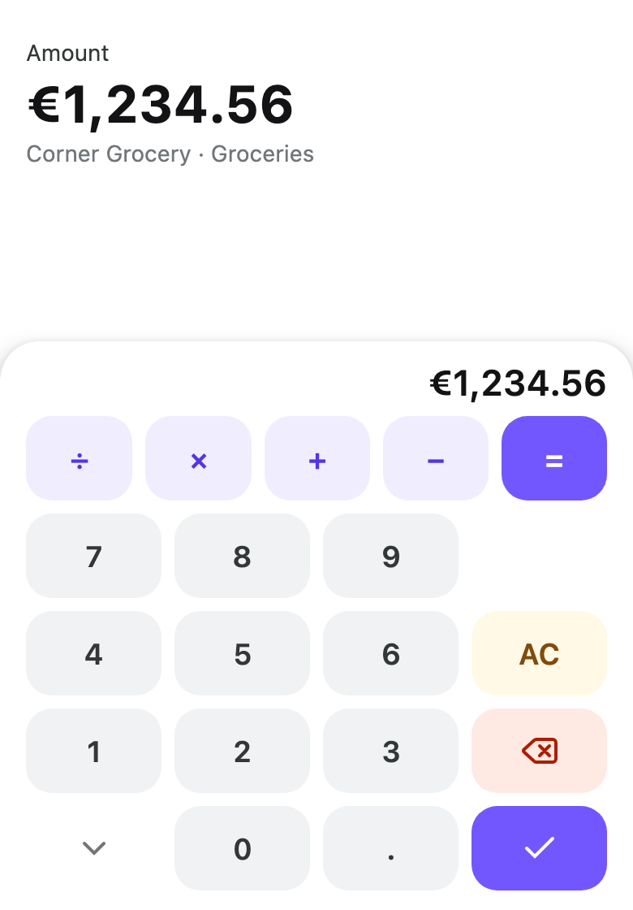

# Keyboard

A custom on-screen keyboard for Compose Multiplatform — a numeric pad, a decimal pad, a phone keypad,
a calculator or a grid of your own — docked to the bottom of a screen. Keys report a `KeyAction`
and the application decides what it does to its own state; the module never edits text itself.

<picture>
  <source media="(prefers-color-scheme: dark)" srcset="../../docs/images/keyboard-dark.png">
  
</picture>

## Install

```kotlin
implementation("dev.voir.areca:keyboard:<version>")
```

`keyboard` passes `dev.voir.areca:foundation` on as an API dependency: keys are foundation
`Button`s, and `ButtonStyle` and `ButtonSize` appear in its API. Every default reads `ArecaTheme`, so
an `ArecaThemeProvider` must sit above it. For the repository and credentials, see
[Getting started](../../docs/getting-started.md).

## Quick start

```kotlin
@Composable
fun AmountScreen() {
    var amount by remember { mutableStateOf("") }
    val keyboard = rememberKeyboardController()
    val target = rememberKeyboardTarget()

    KeyboardHost(
        keyboardContent = {
            KeyboardLayout(
                grid = KeyboardGrids.decimal(
                    onAction = { action ->
                        when (action) {
                            is KeyAction.Digit -> amount += action.value
                            KeyAction.DecimalSeparator -> if (',' !in amount) amount += ','
                            KeyAction.Backspace -> amount = amount.dropLast(1)
                            else -> Unit
                        }
                    },
                    decimalSeparator = ',',
                ),
                header = { Text(amount, textAlign = TextAlign.End) },
            )
        },
        controller = keyboard,
    ) {
        Text(
            text = amount.ifEmpty { "0" },
            modifier = Modifier.keyboardTarget(keyboard, target, onClickLabel = "Edit amount"),
        )
    }
}
```

## Components

Three layers, each usable without the one above it:

| Component | Use it for | Package |
| --- | --- | --- |
| `KeyboardHost` | Docks a keyboard to the bottom edge of a screen, and coordinates focus and scrolling | `dev.voir.areca.keyboard` |
| `KeyboardLayout` | The keyboard's surface — fill, shape, safe-area padding — with header and footer slots, holding a `KeyboardGrid` or any content | `dev.voir.areca.keyboard.layout` |
| `KeyboardKeys` | A `KeyboardGrid` drawn as rows of weighted keys, without the surface — inside a sheet, a panel or a screen | `dev.voir.areca.keyboard.key` |

Alongside them: `rememberKeyboardController`, `rememberKeyboardTarget`, `Modifier.keyboardTarget`
and `Modifier.keyboardAnchor` in `dev.voir.areca.keyboard`; `Key`, `KeyRow`, `KeyboardGrid`,
`KeyboardGrids`, `KeyAction`, `KeyRole`, `KeyStyle` and `toKeyAction` in
`dev.voir.areca.keyboard.key`; `KeyboardStyle` and `KeyboardSize` in
`dev.voir.areca.keyboard.layout`.

---

## Host

`KeyboardHost` goes at the root of a screen. It provides a `KeyboardController` to everything below
and draws the keyboard over the bottom edge while it is open.

```kotlin
KeyboardHost(
    keyboardContent = { target -> },
    controller = rememberKeyboardController(),
    compressContent = true,
    scrim = null,
    animation = KeyboardAnimation.Default,
    paneTitle = "Keyboard",
    onVisibilityChange = { open -> },
    content = { },
)
```

| Parameter | |
| --- | --- |
| `controller` | `rememberKeyboardController()` is saveable: an open keyboard stays open across rotation for a target with the same saveable `key`. `open(target)` and `close()` drive it; `isVisible` reads it |
| `compressContent` | `true` pads the content by the keyboard's height, consuming that much bottom inset. `false` draws the keyboard over the content — for a screen with a docked action bar |
| `scrim` | `null` by default: the screen stays usable while the keyboard is up. `KeyboardScrim.Default` blocks presses on the content; `dismissOnTap` closes the keyboard, read aloud as `dismissLabel` |
| `paneTitle` | Announced when the keyboard appears; `null` for none |
| `onVisibilityChange` | Called when the keyboard opens or closes |

`keyboardContent` receives the open target, so one host serves several inputs. While sliding out it
still receives the last target:

```kotlin
val amount = rememberKeyboardTarget(key = "amount")
val date = rememberKeyboardTarget(key = "date")

KeyboardHost(
    keyboardContent = { target ->
        when (target?.key) {
            "amount" -> KeyboardLayout(grid = KeyboardGrids.decimal(onAction = ::onAmountKey))
            "date" -> DateKeyboard()
        }
    },
) { }
```

### Targets

A `KeyboardTarget` is what to focus and what to scroll clear of the keyboard, one per input:

```kotlin
Modifier.keyboardTarget(
    controller = keyboard,
    target = target,
    enabled = true,
    scroll = true,      // scroll the target above the keyboard once it has opened
    stealFocus = true,  // move focus here, so physical keys reach it
    onClickLabel = "Edit amount",
)
```

- No press indication by default; pass `indication` for one.
- `scroll` waits until the keyboard has opened, then scrolls the nearest scroll container so the
  target clears it. A target outside a scroll container does not move.
- Focus the keyboard moved is cleared when it closes; with `stealFocus = false` focus stays where it
  was.

### Back press

The host does not handle back. Close the keyboard where the application handles back — with Compose
Multiplatform's navigation events, for example:

```kotlin
NavigationBackHandler(
    state = rememberNavigationEventState(NavigationEventInfo.None),
    isBackEnabled = keyboard.isVisible,
    onBackCompleted = { keyboard.close() },
)
```

---

## Layout

`KeyboardLayout` is the surface. Pass a `grid`, or any content as the trailing lambda:

```kotlin
KeyboardLayout(
    style = KeyboardStyle.Default,   // or KeyboardStyle.flat() for a permanently docked keyboard
    size = KeyboardSize.Default,     // or KeyboardSize.Compact for a short screen
    header = { Text(runningTotal) },
    footer = { CurrencyToolbar() },
) {
    // anything at all
}
```

`header` and `footer` are plain slots — a header is normally the value being edited. The surface
clears the bottom system bars and display cutout (`windowInsets`), so the last row is not under the
gesture pill or home indicator; the fill still reaches the screen edge. `KeyboardStyle.flat()` draws
a hairline along the top edge only.

## Keys

`KeyboardKeys` draws a grid without the surface, for a keypad inside a sheet or a panel:

```kotlin
KeyboardKeys(grid = KeyboardGrids.phone(onAction = ::onKeyAction))
```

A `KeyboardGrid` is a list of `KeyRow`s; each row divides its width among its keys by `Key.weight`,
independently of the other rows.

```kotlin
KeyboardGrid(
    KeyRow(Key.text("7") { }, Key.text("8") { }, Key.text("9") { }),
    KeyRow(
        Key.blank("gap"),
        Key.text("0") { },
        Key.icon(ArecaIcons.Delete, id = "back", contentDescription = "Backspace", role = KeyRole.Destructive) { },
    ),
)
```

- `Key.blank(id)` holds a slot open so its neighbours stay aligned.
- Every `id` is unique in its grid, and `weight` is a finite number above zero; anything else is
  rejected.
- A label stays on one line (`KeyboardSize.keyLabelMaxLines`) and ends in an ellipsis.
- Rows keep their left-to-right order in a right-to-left locale, as keypads do.

### Roles

A key's `KeyRole` says what it means; the keyboard's `KeyStyle` turns each role into a foundation
`ButtonStyle`.

| Role | For |
| --- | --- |
| `KeyRole.Digit` | Numbers and separators (the default) |
| `KeyRole.Action` | Operators and modifiers |
| `KeyRole.Confirm` | The key that concludes entry |
| `KeyRole.Destructive` | Backspace, delete |
| `KeyRole.Caution` | Clear, reset |
| `KeyRole.Info` | Paste, scan — something from outside |
| `KeyRole.Ghost` | Hide, switch layout |

Restyle a role with `KeyboardStyle.default(keys = KeyStyle.default(…))`, or one key with its own
`style`.

### Stock grids

`KeyboardGrids.numeric()`, `.decimal()`, `.phone()` and `.calculator()` return grid values. Change
them with `key(id)`, `mapKeys`, `replaceKey`, `removeKey`, `appendRow` and `prependRow`:

```kotlin
KeyboardGrids.calculator(onAction = ::onKeyAction, decimalSeparator = ',')
    .replaceKey("clear") { it.copy(role = KeyRole.Destructive) }
    .removeKey("hide")
    .appendRow(KeyRow(Key.text("Done", role = KeyRole.Confirm) { commit() }))
```

- `numeric()` takes a `leadingKey` for the slot beside the `0`; `calculator()` an `auxiliaryKey` for
  the slot beside the `9` — a paste or scan key.
- `phone()` is the four-by-three keypad with backspace in a fifth row; `*` and `#` report
  `KeyAction.Insert`.

### Actions

```kotlin
fun onKeyAction(action: KeyAction) = when (action) {
    is KeyAction.Digit -> calculator.digit(action.value)
    KeyAction.DecimalSeparator -> calculator.decimal()
    is KeyAction.Operation -> calculator.operation(action.operation)
    is KeyAction.Insert -> calculator.insert(action.text)
    KeyAction.Backspace -> calculator.delete()
    KeyAction.Clear -> calculator.clear()
    KeyAction.Evaluate -> calculator.evaluate()
    KeyAction.Done -> { calculator.evaluate(); keyboard.close() }
    KeyAction.Hide -> keyboard.close()
    is KeyAction.Custom -> handleCustom(action.id)
}
```

### Physical keyboards

`toKeyAction` maps a hardware key press onto the same action; it returns `null` for other keys, so
Tab still moves focus:

```kotlin
Modifier
    .keyboardTarget(keyboard, target)
    .onPreviewKeyEvent { event ->
        val action = event.toKeyAction(decimalSeparator = ',') ?: return@onPreviewKeyEvent false
        onKeyAction(action)
        true
    }
```

---

## Text fields and the system keyboard

The module never shows or hides the platform keyboard, so keep a text field from opening it.

**Read-only field.** `readOnly = true` starts no input session. Open the keyboard when the field
takes focus, and attach the target with `Modifier.keyboardAnchor`, which wires focus, scrolling and
the expanded state without adding a press of its own:

```kotlin
var amount by remember { mutableStateOf("") }
val target = rememberKeyboardTarget()

TextField(
    value = amount,
    onValueChange = {},
    readOnly = true,
    modifier = Modifier
        .keyboardAnchor(keyboard, target, stealFocus = false)
        .onFocusChanged { if (it.isFocused) keyboard.open(target, stealFocus = false) },
)
```

`TextField` is foundation's. Apply each `KeyAction` to `amount` in the keyboard's `onAction`.

**Editable field with a cursor.** Block the platform keyboard with `InterceptPlatformTextInput`
(`@ExperimentalComposeUiApi`):

```kotlin
@OptIn(ExperimentalComposeUiApi::class)
InterceptPlatformTextInput(interceptor = { _, _ -> awaitCancellation() }) {
    TextField(value = amount, onValueChange = { amount = it }, modifier = /* as above */)
}
```

`KeyboardOptions(showKeyboardOnFocus = false)` alone is not enough: a tap still opens the IME.

---

## Styles and sizes

| Component | Style · local | Size · local |
| --- | --- | --- |
| `KeyboardLayout` | `KeyboardStyle` · `LocalKeyboardStyle` | `KeyboardSize` · `LocalKeyboardSize` |
| `KeyboardKeys` | `KeyStyle`, from `KeyboardStyle.keys` | `KeyboardSize` · `LocalKeyboardSize` |

- `KeyboardStyle` holds the surface's colours, shape, elevation, `border` and `divider`, and `keys`,
  a `KeyStyle`. `KeyboardStyle.Default`, `KeyboardStyle.default(…)` and `KeyboardStyle.flat(…)`.
- `KeyboardSize` holds the padding and gaps, `keyHeight`, `keyLabelMaxLines` and `key`, a foundation
  `ButtonSize`. `KeyboardSize.Default`, `KeyboardSize.Compact` and `KeyboardSize.default(…)`.

The locals are `null` unless provided, and fall back to `Default`. `ArecaThemeProvider` does not
provide them; theme a subtree yourself:

```kotlin
CompositionLocalProvider(LocalKeyboardStyle provides KeyboardStyle.flat()) { }
```

---

## Accessibility

See [Accessibility](../../docs/accessibility.md) for the shared rules. In this module:

- A keyboard target is focusable in touch mode too, reads as collapsed or expanded with the keyboard,
  and offers actions to open and close it. Give it an `onClickLabel`.
- The host announces `paneTitle` when the keyboard appears. A scrim that closes on tap reads its
  `dismissLabel` and is not a focus stop.
- Icon keys read their `contentDescription`; the stock grids take theirs from `KeyboardGridLabels`.

## Words

| Text | Where | Default |
| --- | --- | --- |
| Key names for assistive technology | `labels: KeyboardGridLabels` on every stock grid — `backspace`, `clear`, `hide`, `done` | English |
| Keyboard announcement | `KeyboardHost(paneTitle = …)` | `Keyboard` |
| Scrim | `KeyboardScrim(dismissLabel = …)` | `Close keyboard` |
| Target action | `Modifier.keyboardTarget(onClickLabel = …)` | none |

Keys draw glyphs that need no translation (a backspace arrow, a chevron, a tick, `AC`).

```kotlin
KeyboardGrids.calculator(
    onAction = ::onKeyAction,
    labels = KeyboardGridLabels(
        backspace = stringResource(Res.string.backspace),
        clear = stringResource(Res.string.clear),
        hide = stringResource(Res.string.hide_keyboard),
        done = stringResource(Res.string.done),
    ),
)
```

See [Localisation](../../docs/localisation.md).

## Where to look

- **Playground**, under **Keyboard**: the **Keyboard** page — the host, the surface with header and
  footer slots, and grids of weighted keys.
- **KDoc** on each type in `dev.voir.areca.keyboard` and its `key` and `layout` packages.
- **Related**: foundation's `Button`, which draws each key ([foundation README](../foundation/README.md)).
- **Skill**: [`skills/areca-ui-v1/reference/keyboard.md`](../../skills/areca-ui-v1/reference/keyboard.md).
